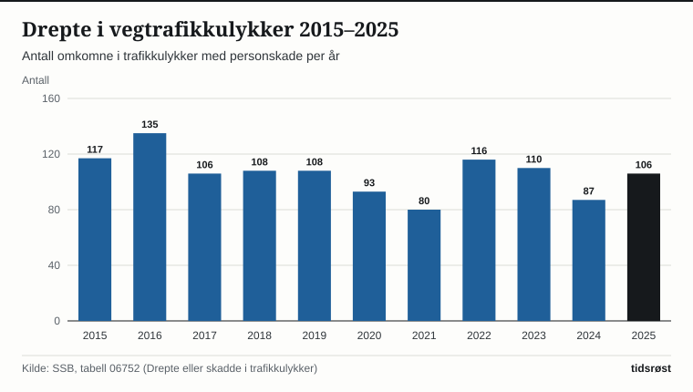

I 2025 omkom 106 personer i trafikkulykker med personskade i Norge. Det er 19 flere enn i 2024, viser Statistisk sentralbyrå (SSB) i en artikkel publisert 29. mai 2026. Antallet hardt skadde økte samtidig fra 578 i 2024 til 645 i 2025.

## Utviklingen over tid

Antall drepte i trafikken har falt siden begynnelsen av 2000-tallet. I 2001 omkom 275 personer, mens tallet var 106 i 2025, en nedgang på 61 prosent. Lavest i den siste tiårsperioden var 2021 med 80 drepte, og 2024 med 87 var det nest laveste. I 2025 økte antallet igjen.

*Antall drepte i trafikkulykker med personskade per år. Kilde: SSB, tabell 06752.*

Antall hardt skadde var 4 552 i 1970, som er det høyeste tallet i statistikken. Det laveste var 565 i 2019. Med 645 hardt skadde i 2025 er nivået høyere enn i 2024.

## Hvem rammes?

I 2025 omkom flere bilførere, bilpassasjerer, motorsyklister, syklister og fotgjengere enn i 2024. Størst økning i antall drepte var det blant motorsyklister (pluss 5), syklister (pluss 5) og fotgjengere (pluss 4).

| Trafikantgruppe | Drepte 2024 | Drepte 2025 | Endring |
|---|---:|---:|---:|
| Bilførere | 38 | 39 | +1 |
| Bilpassasjerer | 9 | 11 | +2 |
| Motorsykkel (førere og passasjerer) | 20 | 25 | +5 |
| Moped (førere og passasjerer) | 1 | 1 | 0 |
| Sykkel (førere og passasjerer) | 6 | 11 | +5 |
| Fotgjengere | 6 | 10 | +4 |
| Andre trafikanter | 7 | 9 | +2 |
| **Sum** | **87** | **106** | **+19** |

*Kilde: SSB, tabell 06752.*

Blant de hardt skadde økte antall bilførere fra 173 til 211, som er den største økningen i noen gruppe. Antall hardt skadde motorsyklister gikk ned fra 143 til 133.

## Alder

Etter alder økte antallet drepte med 9 i aldersgruppen 18–34 år, med 12 i aldersgruppen 55–74 år og med 6 blant dem på 75 år og eldre. I aldersgruppen 35–54 år omkom 8 færre enn året før, og blant barn og unge under 18 år var antallet uendret.

## Kilder

- [SSB: Flere døde og hardt skadde i trafikken i 2025 (29. mai 2026)](https://www.ssb.no/transport-og-reiseliv/landtransport/statistikk/trafikkulykker-med-personskade/artikler/flere-dode-og-hardt-skadde-i-trafikken-i-2025)
- [SSB: Trafikkulykker med personskade](https://www.ssb.no/transport-og-reiseliv/landtransport/statistikk/trafikkulykker-med-personskade)
- [SSB: Tabell 06752 – Drepte eller skadde i trafikkulykker, etter kjønn, skadegrad og trafikantgruppe](https://www.ssb.no/statbank/table/06752)
