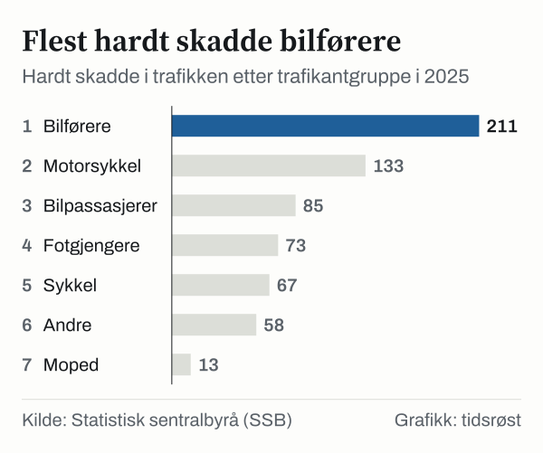

I 2025 omkom 106 personer i trafikkulykker med personskade i Norge. Det er 19 flere enn i 2024, viser Statistisk sentralbyrå (SSB) i en artikkel publisert 29. mai 2026. Antallet hardt skadde økte fra 578 til 645.

Ifølge SSB tilsvarer det nesten 19 trafikkdødsfall per million innbyggere. I Sverige var tallet 19, i Danmark 23 og i Finland 34.

## Utviklingen over tid

*Drepte i trafikkulykker med personskade per år, 2001–2025. Kilde: SSB, tabell 06752.*

I 2001 omkom 275 personer i trafikken, og i 2002 var tallet 310. Siden har antallet falt. Med 106 drepte i 2025 er nivået 61 prosent lavere enn i 2001. Det laveste tallet i perioden var 80, i 2021.

Det høyeste antallet hardt skadde i statistikken, som går tilbake til 1946, var 4 552 i 1970. Det laveste var 565 i 2019.

## Hvem som omkom

I 2025 omkom flere bilførere, bilpassasjerer, motorsyklister, syklister og fotgjengere enn i 2024. Størst var økningen blant motorsyklister og syklister, med 5 flere drepte i hver gruppe, og blant fotgjengere, med 4 flere.

*Drepte i trafikken etter trafikantgruppe, 2024 og 2025. Motorsykkel, moped og sykkel omfatter førere og passasjerer. Kilde: SSB, tabell 06752.*

| Trafikantgruppe | Drepte 2024 | Drepte 2025 | Endring |
|---|---:|---:|---:|
| Bilførere | 38 | 39 | +1 |
| Bilpassasjerer | 9 | 11 | +2 |
| Motorsykkel | 20 | 25 | +5 |
| Moped | 1 | 1 | 0 |
| Sykkel | 6 | 11 | +5 |
| Fotgjengere | 6 | 10 | +4 |
| Andre trafikanter | 7 | 9 | +2 |
| **Sum** | **87** | **106** | **+19** |

*Kilde: SSB, tabell 06752.*

Etter alder økte antallet drepte med 9 i gruppen 18–34 år, med 12 i gruppen 55–74 år og med 6 blant dem som var 75 år eller eldre. I gruppen 35–54 år omkom 8 færre enn året før. Blant barn og unge under 18 år var antallet uendret.

## Hardt skadde

Blant de hardt skadde var økningen størst for bilførere, fra 173 til 211. Antallet hardt skadde motorsyklister gikk ned fra 143 til 133.

*Hardt skadde (meget alvorlig og alvorlig skadd) i trafikken etter trafikantgruppe, 2025. Kilde: SSB, tabell 06752.*

Elsparkesyklister er foreløpig ikke en egen gruppe i statistikken, men er med blant «andre trafikanter». SSB har for første gang regnet ut tallene: i 2025 omkom 2 elsparkesyklister, og 34 ble hardt skadd. Det er om lag 5 prosent av alle hardt skadde.

## Om tallene

Summen av hardt skadde i tabell 06752 er 642 for 2025, mens SSBs artikkel oppgir 645. Antallet drepte er det samme i begge.

## Kilder

- [SSB: Flere døde og hardt skadde i trafikken i 2025 (29. mai 2026)](https://www.ssb.no/transport-og-reiseliv/landtransport/statistikk/trafikkulykker-med-personskade/artikler/flere-dode-og-hardt-skadde-i-trafikken-i-2025)
- [SSB: Trafikkulykker med personskade](https://www.ssb.no/transport-og-reiseliv/landtransport/statistikk/trafikkulykker-med-personskade)
- [SSB: Tabell 06752 – Drepte eller skadde i trafikkulykker, etter kjønn, skadegrad og trafikantgruppe](https://www.ssb.no/statbank/table/06752)
