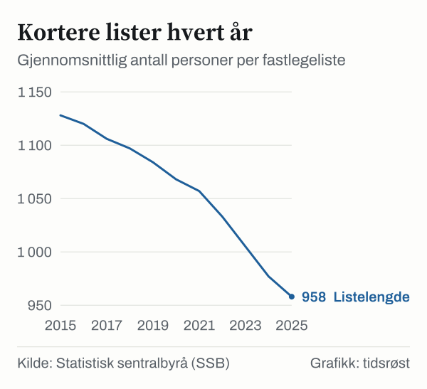

I mai 2026 sto 109 724 innbyggere på en fastlegeliste uten fast lege. Det viser Helsedirektoratets årsrapport for allmennlegetjenesten, med status per mai 2026. Ved utgangen av 2023 var tallet 214 106, så det har falt med 104 382, eller 48,8 prosent. De som står uten fast lege utgjør nå 1,9 prosent av listeinnbyggerne.

*Innbyggere på fastlegeliste uten fast lege, desember 2023, desember 2024 og mai 2026. Kilde: Helsedirektoratet, tabell 11.1.*

## Hva det betyr å stå uten fast lege

En liste uten fast lege er en fastlegeliste der kommunen ikke har avtale med en fast lege. Listen kan dekkes av vikarer eller andre leger, og innbyggerne skal fortsatt ha tilbud om allmennlegetjenester. Men de har ingen fast lege å forholde seg til.

## Toppen i 2022

Ifølge SSB sto 30 985 personer på lister uten fast lege i 2015. Tallet steg hvert år unntatt 2017, og nådde 213 173 i 2022, 3,9 prosent av listeinnbyggerne. Siden har det falt tre år på rad, til 117 899 i 2025.

*Personer på fastlegeliste uten fast lege, 2015–2025. Kilde: SSB, tabell 12005.*

Antallet lister uten fast lege viser samme mønster. SSB oppgir 321 slike lister i 2022 og 197 i 2025, og Helsedirektoratet oppgir 179 i mai 2026.

## Flere fastleger, kortere lister

Ifølge Helsedirektoratet økte antallet fastleger fra 4 858 i 2019 til 5 720 ved utgangen av 2025, en økning på 862, eller 17,7 prosent. Netto tilvekst var 249 fastleger i 2024, det høyeste noensinne, og 203 i 2025. I mai 2026 var det 5 767 fastleger.

| Nøkkeltall (Helsedirektoratet) | Des. 2023 | Des. 2024 | Des. 2025 | Mai 2026 |
|---|---:|---:|---:|---:|
| Fastleger | 5 268 | 5 517 | 5 720 | 5 767 |
| Listeinnbyggere uten fast lege | 214 106 | 163 034 | 117 901 | 109 724 |
| Andel uten fast lege | 3,9 % | 2,9 % | 2,1 % | 1,9 % |
| Lister uten fast lege | 322 | 260 | 194 | 179 |
| Gjennomsnittlig listelengde | 986 | 963 | 947 | 944 |
| Vikarer | 1 322 | 1 355 | 1 254 | 1 070 |

*Kilde: Helsedirektoratet, Allmennlegetjenesten – Årsrapport 2025, inklusive status mai 2026, tabell 11.1 (data fra FLO). Tallene kan avvike noe fra SSBs tall for samme år.*

Samtidig har legene færre pasienter hver. Ifølge SSB falt gjennomsnittlig listelengde fra 1 128 i 2015 til 958 i 2025, en nedgang på 170, eller 15,1 prosent. Listelengden avtales individuelt mellom fastlegen og kommunen.

*Gjennomsnittlig listelengde (personer per fastlegeliste), 2015–2025. Kilde: SSB, tabell 12005.*

I et lengre perspektiv økte antallet fastleger med 2 020, eller 54 prosent, fra 2002 til 2025, mens folketallet økte med 24 prosent, ifølge SSB. Antall innbyggere per fastlege gikk ned fra 1 222 til 978.

## Andre utviklingstrekk

Ifølge Helsedirektoratet var det 79 000 flere innbyggere med fast lege ved utgangen av 2025 enn ett år tidligere. Økningen er større enn befolkningsveksten, fordi flere ubesatte lister har fått fast lege. Samtidig har vikarbruken gått ned.

E-konsultasjoner utgjorde 17 prosent av konsultasjonene hos fastlegene i 2025. Videokonsultasjoner var bare om lag 1 prosent av e-konsultasjonene i andre halvår. Fra april 2026 må fastlegene kunne tilby videokonsultasjon.

## Kilder

- [Helsedirektoratet: Allmennlegetjenesten – Årsrapport 2025, inklusive status mai 2026](https://www.helsedirektoratet.no/rapporter/allmennlegetjenesten-arsrapport-2025-inklusive-status-mai-2026)
- [Helsedirektoratet: Nasjonale utviklingstrekk oppsummert (kapittel 11.1)](https://www.helsedirektoratet.no/rapporter/allmennlegetjenesten-arsrapport-2025-inklusive-status-mai-2026/utvikling-i-fastlegeordningen/nasjonale-utviklingstrekk-oppsummert)
- [Helsedirektoratet: Hovedfunn og vurderinger](https://www.helsedirektoratet.no/rapporter/allmennlegetjenesten-arsrapport-2025-inklusive-status-mai-2026/hovedfunn-og-vurderinger)
- [SSB: Sju av ti nordmenn går til fastlegen minst én gang i året (25. juni 2026)](https://www.ssb.no/helse/helsetjenester/statistikk/allmennlegetjenesten/artikler/sju-av-ti-nordmenn-gar-til-fastlegen-minst-en-gang-i-aret)
- [SSB: Tabell 12005 – Fastlegelister og fastlegekonsultasjoner](https://www.ssb.no/statbank/table/12005)
