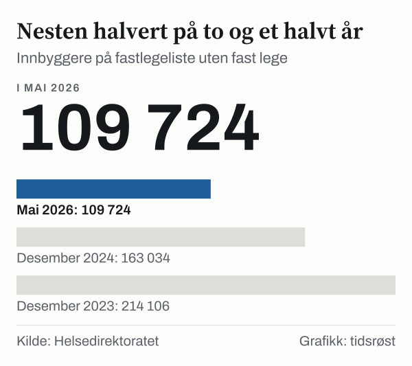
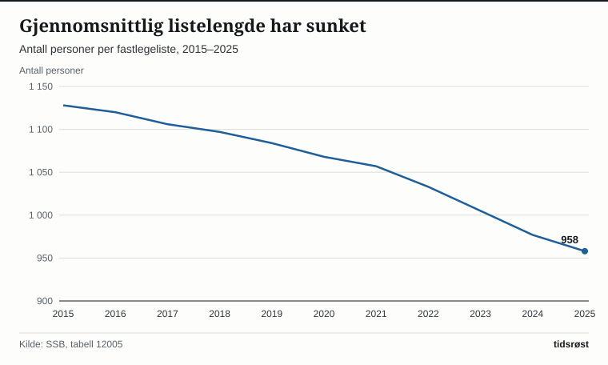

Nesten 110 000 innbyggere sto på en fastlegeliste uten fast lege i mai 2026. Det viser Helsedirektoratets årsrapport for allmennlegetjenesten med status per mai 2026, som ble publisert på direktoratets nettsider 26. august 2026. Tallet i rapporten er 109 724, mot 214 106 ved utgangen av 2023. Det er en nedgang på 104 382 personer, eller 48,8 prosent.

## Hva tallet betyr

En liste uten fast lege er en fastlegeliste der kommunen ikke har avtale med en fast lege, ifølge Helsedirektoratet. Listen kan dekkes av vikarer eller av andre fastleger, og innbyggerne på den skal likevel ha tilbud om allmennlegetjenester. Men de har ingen fast lege. I mai 2026 utgjorde de 1,9 prosent av listeinnbyggerne.

## Toppen i 2022 og veien ned

Antallet på lister uten fast lege økte fra 2015 til 2022. Ifølge SSB sto 30 985 personer på slike lister i 2015, mens tallet nådde 213 173 i 2022, som var 3,9 prosent av listeinnbyggerne. Siden har det falt tre år på rad, til 117 899 i 2025 (2,1 prosent).

*Antall personer på fastlegeliste uten fast lege. Kilde: SSB, tabell 12005.*

Antall lister uten fast lege viser samme mønster. SSB oppgir 321 slike lister i 2022 og 197 i 2025. Helsedirektoratet oppgir 179 lister uten fast lege i mai 2026.

## Flere fastleger, men kortere lister

Antall fastleger i ordningen økte fra 4 858 i 2019 til 5 720 ved utgangen av 2025, en økning på 862 eller 17,7 prosent. Tilveksten i 2025 var 203, mot 249 året før. I mai 2026 var det 5 767 fastleger.

| Nøkkeltall (Helsedirektoratet) | 4. kv. 2023 | 4. kv. 2024 | 4. kv. 2025 | Mai 2026 |
|---|---:|---:|---:|---:|
| Fastleger | 5 268 | 5 517 | 5 720 | 5 767 |
| Listeinnbyggere uten fast lege | 214 106 | 163 034 | 117 901 | 109 724 |
| Andel listeinnbyggere uten fast lege (prosent) | 3,9 | 2,9 | 2,1 | 1,9 |
| Lister uten fast lege | 322 | 260 | 194 | 179 |
| Gjennomsnittlig listelengde | 986 | 963 | 947 | 944 |
| Vikarer | 1 322 | 1 355 | 1 254 | 1 070 |

*Kilde: Helsedirektoratet, Allmennlegetjenesten – Årsrapport 2025, inklusive status mai 2026, tabell 11.1 (data fra FLO). Tall fra Helsedirektoratet kan avvike noe fra SSBs tall for samme år.*

SSB peker på at fastlegene har kortere lister enn før. Innenfor en ramme på 500 til 2 500 pasienter bestemmer legene selv hvor mange de vil ha på listen. Gjennomsnittlig listelengde falt fra 1 128 i 2015 til 958 i 2025, en nedgang på 170 eller 15,1 prosent.

*Gjennomsnittlig listelengde (antall personer per fastlegeliste). Aksen starter på 900. Kilde: SSB, tabell 12005.*

I et lengre perspektiv økte antall fastleger med 2 020, eller 54 prosent, fra 2002 til 2025, mens folketallet økte med 24 prosent, ifølge SSB. Antall innbyggere per fastlege gikk fra 1 222 til 978.

## Flere med fast lege og oppgavedeling

Ifølge Helsedirektoratet var det 79 000 flere innbyggere med fast lege ved utgangen av 2025 enn ett år tidligere.

Helsedirektoratet skriver at det fra 1. januar 2026 er innført takster for konsultasjoner som er delegert til sykepleiere. I perioden januar til mai 2026 ble ordningen tatt i bruk ved 106 legekontor, med 546 leger og 252 sykepleiere, og det ble gjennomført over 16 000 pasientkontakter.

## Kilder

- [Helsedirektoratet: Allmennlegetjenesten – Årsrapport 2025, inklusive status mai 2026](https://www.helsedirektoratet.no/rapporter/allmennlegetjenesten-arsrapport-2025-inklusive-status-mai-2026)
- [Helsedirektoratet: Nasjonale utviklingstrekk oppsummert (kapittel 11.1)](https://www.helsedirektoratet.no/rapporter/allmennlegetjenesten-arsrapport-2025-inklusive-status-mai-2026/utvikling-i-fastlegeordningen/nasjonale-utviklingstrekk-oppsummert)
- [Helsedirektoratet: Hovedfunn og vurderinger](https://www.helsedirektoratet.no/rapporter/allmennlegetjenesten-arsrapport-2025-inklusive-status-mai-2026/hovedfunn-og-vurderinger)
- [Helsedirektoratet: Innbyggere uten fast lege (nasjonale kvalitetsindikatorer)](https://www.helsedirektoratet.no/statistikk/kvalitetsindikatorer/allmennlegetjenesten/innbyggere-uten-fast-lege)
- [SSB: Sju av ti nordmenn går til fastlegen minst én gang i året (25. juni 2026)](https://www.ssb.no/helse/helsetjenester/statistikk/allmennlegetjenesten/artikler/sju-av-ti-nordmenn-gar-til-fastlegen-minst-en-gang-i-aret)
- [SSB: Tabell 12005 – Fastlegelister og fastlegekonsultasjoner](https://www.ssb.no/statbank/table/12005)
