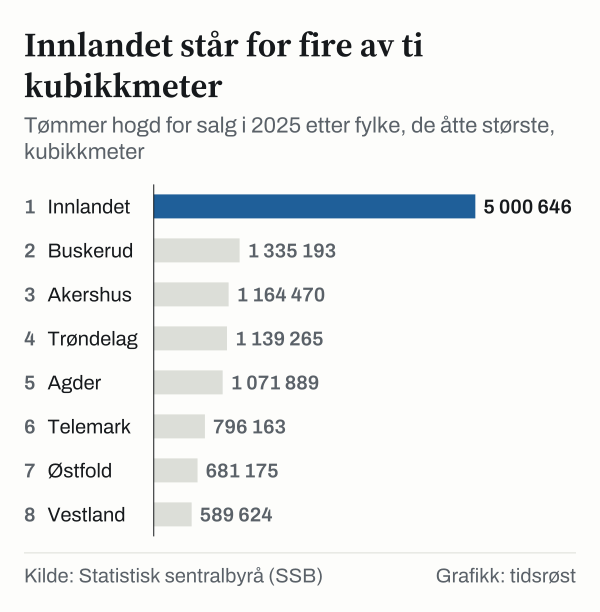

Skogeierne hogde 12,8 millioner kubikkmeter tømmer for salg i 2025 og solgte for 10,9 milliarder kroner, viser endelige tall fra Statistisk sentralbyrå (SSB), publisert 21. mai 2026. SSB skriver at det aldri før er hogd så mye i løpet av ett år. Skogeierne fikk i gjennomsnitt 847 kroner per kubikkmeter. I 2026 har prisene falt.

## Rekordhogst

Hogsten for salg var 12 815 538 kubikkmeter i 2025, 8,6 prosent mer enn i 2024 og 26,7 prosent mer enn i 2015.

![Linjediagram over Aldri hogd mer enn i 2025: Hogst: 7 745 672 i 1996, 8 041 778 i 1997, 7 670 174 i 1998, 7 706 354 i 1999, 7 477 789 i 2000, 7 684 544 i 2001, 7 262 889 i 2002, 6 789 599 i 2003, 7 353 143 i 2004, 8 289 959 i 2005, 7 282 477 i 2006, 8 211 912 i 2007, 8 070 780 i 2008, 6 630 826 i 2009, 8 322 430 i 2010, 8 506 294 i 2011, 8 787 409 i 2012, 8 889 494 i 2013, 9 771 951 i 2014, 10 112 726 i 2015, 10 303 829 i 2016, 10 491 028 i 2017, 10 835 889 i 2018, 11 038 699 i 2019, 10 241 685 i 2020, 11 451 882 i 2021, 11 516 753 i 2022, 10 994 928 i 2023, 11 800 410 i 2024, 12 815 538 i 2025.](./graf-1.svg)
*Tømmer hogd for salg (gran, furu og lauvtre) per år, 1996–2025, kubikkmeter. Kilde: SSB, tabell 03795.*

Gran sto for 73,0 prosent av kvantumet, med 9,4 millioner kubikkmeter. Furu utgjorde 3,1 millioner og lauvtre 0,3 millioner kubikkmeter.

Tallene gjelder industrivirke for salg. Tar man også med vraket virke, flisvirke, virke til eget bruk og ved, var samlet hogst rundt 15,5 millioner kubikkmeter i 2025. Regnet om til skogsvirke, som også omfatter topper og avskjær som blir liggende igjen i skogen, utgjorde det omkring 16,9 millioner kubikkmeter, ifølge SSB.

## Pris og verdi

Gjennomsnittsprisene i 2025 var 1 037 kroner per kubikkmeter for sagtømmer av gran, 952 kroner for sagtømmer av furu, 610 kroner for massevirke av gran og 579 kroner for massevirke av furu. Regnet i faste 2025-kroner var tømmerprisene de høyeste siden 1989, skriver SSB.

Bruttoverdien av tømmeret var 10,9 milliarder kroner, 2,9 milliarder kroner eller 35,8 prosent mer enn i 2024. I 2021 var verdien 5,0 milliarder kroner. Bruttoverdien er før driftskostnader.

## Fylkene

Innlandet sto for 39,0 prosent av hogsten i 2025. Sammen med Buskerud, Akershus, Trøndelag og Agder hogde de fem fylkene 75,8 prosent av tømmeret. Kongsvinger var kommunen med størst hogst, 351 000 kubikkmeter. Seks av de ti største hogstkommunene lå i Innlandet.

*Tømmer hogd for salg etter fylke, de åtte største, 2025, kubikkmeter. Kilde: SSB, tabell 03795.*

| Fylke | Hogd 2025 (1 000 m³) | Andel | Endring fra 2024 | Pris (kr per m³) |
|---|---:|---:|---:|---:|
| Innlandet | 5 001 | 39,0 % | +6,1 % | 862 |
| Buskerud | 1 335 | 10,4 % | +6,7 % | 845 |
| Akershus | 1 164 | 9,1 % | −0,4 % | 883 |
| Trøndelag | 1 139 | 8,9 % | +25,9 % | 795 |
| Agder | 1 072 | 8,4 % | +22,8 % | 833 |
| Telemark | 796 | 6,2 % | +9,8 % | 817 |
| Østfold | 681 | 5,3 % | +3,1 % | 897 |
| Vestland | 590 | 4,6 % | +6,1 % | 780 |
| **Hele landet** | **12 816** | **100,0 %** | **+8,6 %** | **847** |

*Kilde: SSB, tabellene 03795 og 03794. Prisen er bruttoverdi delt på hogd volum.*

Prisene var lavest i Nord-Norge: 714 kroner per kubikkmeter i Nordland, 585 i Troms og 454 i Finnmark.

## Prisfall i 2026

Den gjennomsnittlige tømmerprisen nådde toppen i andre kvartal 2025, med 871 kroner per kubikkmeter. I tredje kvartal 2026 var den 640 kroner, 26 prosent lavere enn ett år tidligere. Samtidig ble det hogd 2,86 millioner kubikkmeter industrivirke, omtrent like mye som i tredje kvartal 2025. SSB skriver at det bare er i tredje kvartal 2025 det er hogd like mye i dette kvartalet siden kvartalstallene startet i 2006.

*Gjennomsnittlig tømmerpris per kvartal, første kvartal 2024 til tredje kvartal 2026, løpende kroner per kubikkmeter. Kilde: SSB, tabell 09242.*

I tredje kvartal 2026 var prisen 861 kroner for sagtømmer av gran og 686 kroner for sagtømmer av furu, 21 og 30 prosent lavere enn ett år tidligere. Massevirke av gran og furu kostet 423 og 402 kroner, begge 31 prosent lavere. Ifølge SSB er tømmerprisen likevel høyere enn i hele perioden fra andre kvartal 2008 til fjerde kvartal 2024, målt i faste kroner.

## Planting og skogvolum

SSB registrerte planting av skog på 284 585 dekar i 2025, det største arealet siden 1991. Innlandet sto for 44 prosent. Tallene gjelder arbeid som er utført med skogavgiftsmidler eller har fått statstilskudd.

| | 2015 | 2020 | 2024 | 2025 |
|---|---:|---:|---:|---:|
| Plantet areal (dekar) | 172 081 | 229 201 | 264 484 | 284 585 |
| Planter (1 000 stk) | 30 936 | 43 532 | 47 970 | 51 903 |
| Kostnad (mill. kroner) | 163,1 | 248,0 | 359,7 | 418,2 |

*Kilde: SSB, tabell 03522. Kostnadene er i løpende kroner.*

Ifølge Landsskogtakseringen, som SSB publiserte 28. august 2026, var det stående skogvolumet 1,025 milliarder kubikkmeter i perioden 2021–2025, 12,5 millioner mer enn i perioden 2020–2024. På ti år har volumet økt med 72,9 millioner kubikkmeter. I regionen Oslo, Akershus, Østfold og Buskerud har volumet på produktiv skogbruksmark likevel gått ned med 5,4 millioner kubikkmeter på fem år.

## Kilder

- [SSB: Rekordhogst og høye priser (21. mai 2026)](https://www.ssb.no/jord-skog-jakt-og-fiskeri/skogbruk/statistikk/skogavvirkning-for-salg/artikler/rekordhogst-og-hoye-priser)
- [SSB: Tømmerprisene fortsetter å falle (21. oktober 2026)](https://www.ssb.no/jord-skog-jakt-og-fiskeri/skogbruk/statistikk/skogavvirkning-for-salg/artikler/tommerprisene-fortsetter-a-falle)
- [SSB: Skogvolumet øker fortsatt (28. august 2026)](https://www.ssb.no/jord-skog-jakt-og-fiskeri/skogbruk/statistikk/landsskogtakseringen/artikler/skogvolumet-oker-fortsatt)
- [SSB: Tabell 03795 – Avvirkning for salg](https://www.ssb.no/statbank/table/03795)
- [SSB: Tabell 03794 – Bruttoverdi. Avvirkning for salg](https://www.ssb.no/statbank/table/03794)
- [SSB: Tabell 09242 – Gjennomsnittspris per kvartal](https://www.ssb.no/statbank/table/09242)
- [SSB: Tabell 08983 – Avvirkning av industrivirke for salg per kvartal](https://www.ssb.no/statbank/table/08983)
- [SSB: Tabell 03522 – Skogplanting](https://www.ssb.no/statbank/table/03522)
