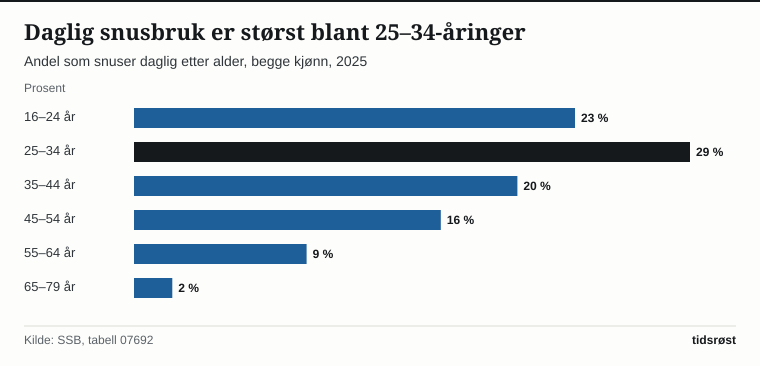

I 2025 brukte 16 prosent av befolkningen mellom 16 og 79 år snus daglig, mens 7 prosent røykte daglig. Det viser tall fra Rusundersøkelsen som Statistisk sentralbyrå (SSB) publiserte 23. oktober 2025. I 1973, da SSB begynte å måle røykevaner, røykte 42 prosent daglig.

## Fra røyk til snus

Andelen som røyker daglig har falt fra 42 prosent i 1973 til 7 prosent i 2025, en nedgang på 35 prosentpoeng. I 2004 røykte 26 prosent daglig. Samtidig økte andelen som snuser daglig fra 4 prosent i 2004 til 16 prosent i 2025. De to kurvene krysset hverandre rundt 2017–2018: I 2017 var begge 11 prosent, og i 2018 var andelen daglige snusbrukere 12 prosent mot 11 prosent daglige røykere. SSB oppgir at snus i 2018 tok over som det mest brukte tobakksproduktet i Norge.

*Andel som bruker daglig, 2004–2025. Kilde: SSB, tabellene 05307 og 07692.*

Regner man med dem som bruker av og til, har den samlede andelen holdt seg stabil, men produktet har byttet. I 2016 røykte 20 prosent daglig eller av og til, mens 14 prosent snuste. I 2025 var det 15 prosent som røykte og 20 prosent som snuste. SSB oppgir at 23 prosent bruker minst ett tobakksprodukt eller e-sigaretter daglig, og 31 prosent daglig eller av og til.

## Alder: snus blant de unge, røyk blant de eldre

Mønsteret er ulikt etter alder. De yngste røyker sjelden daglig, men oftere av og til, mens daglig røyking er vanligst fra 45 år og oppover.

| Aldersgruppe, 2025 | Røyker daglig | Røyker av og til | Snuser daglig | Snuser av og til |
|---|---:|---:|---:|---:|
| 16–24 år | 1 % | 21 % | 23 % | 7 % |
| 25–34 år | 3 % | 11 % | 29 % | 4 % |
| 35–44 år | 5 % | 7 % | 20 % | 4 % |
| 45–54 år | 12 % | 6 % | 16 % | 3 % |
| 55–64 år | 12 % | 4 % | 9 % | 4 % |
| 65–79 år | 10 % | 3 % | 2 % | 1 % |
| **I alt, 16–79 år** | **7 %** | **8 %** | **16 %** | **4 %** |

*Kilde: SSB, tabellene 05307 og 07692.*

*Andel som snuser daglig etter alder, begge kjønn, 2025. Kilde: SSB, tabell 07692.*

## Kjønn: økning for både kvinner og menn

Menn snuser fortsatt oftere enn kvinner, men økningen har vært stor for begge kjønn. Andelen kvinner som snuser daglig økte fra 6 prosent i 2016 til 11 prosent i 2025, mens andelen blant menn økte fra 14 til 21 prosent. Daglig røyking er i 2025 like vanlig blant kvinner og menn, 7 prosent hver. I 2016 var andelene 11 prosent for kvinner og 13 prosent for menn.

| Daglig snusbruk, 2025 | Kvinner | Menn |
|---|---:|---:|
| 16–24 år | 19 % | 27 % |
| 25–34 år | 22 % | 35 % |
| 35–44 år | 13 % | 26 % |
| 45–54 år | 10 % | 21 % |
| 55–64 år | 4 % | 14 % |
| 65–79 år | 1 % | 4 % |

*Kilde: SSB, tabell 07692.*

Blant unge menn på 16–24 år har andelen som røyker daglig gått ned fra 6 prosent i 2016 til 1 prosent i 2025, mens andelen som røyker av og til økte fra 17 til 24 prosent. For unge kvinner i samme alder har andelen som røyker av og til økt fra 11 til 18 prosent, mens andelen som røyker daglig er rundt 2 prosent.

## E-sigaretter og usikkerhet i tallene

E-sigaretter regnes ikke som et tobakksprodukt, men inneholder ofte nikotin. Omtrent 1 prosent av befolkningen brukte e-sigaretter daglig i 2025, ifølge SSB. Blant kvinner på 16–24 år brukte 1 prosent dem daglig og 13 prosent av og til, og det er i denne gruppen e-sigaretter er mest utbredt.

Tallene bygger på en spørreundersøkelse med et landsrepresentativt bruttoutvalg på 8 000 personer mellom 16 og 79 år. Fra 2024 samler SSB inn tallene kun gjennom Rusundersøkelsen, som da ble lagt om til en kombinasjon av web og telefonintervju. I 2025 svarte 68 prosent på webskjema og 32 prosent over telefon. For daglig røyking i 2025 oppgir SSB et konfidensintervall fra 6,4 til 8,2 prosent rundt anslaget på 7 prosent. Usikkerheten er større for små grupper, for eksempel aldersgrupper delt på kjønn. Tallene for 1973–1991 er treårige glidende gjennomsnitt, og utvalget omfattet da personer på 16–74 år, så sammenligningen med 2025 (16–79 år) er omtrentlig.

## Kilder

- [SSB: 1 av 4 snuser eller røyker daglig (23. oktober 2025)](https://www.ssb.no/helse/helseforhold-og-levevaner/statistikk/royk-alkohol-og-andre-rusmidler/artikler/1-av-4-snuser-eller-royker-daglig)
- [SSB: Røyk, alkohol og andre rusmidler (oppdatert 23. oktober 2025)](https://www.ssb.no/helse/helseforhold-og-levevaner/statistikk/royk-alkohol-og-andre-rusmidler)
- [SSB: Tabell 05307 – Dagligrøykere og av-og-til-røykere (16–79 år)](https://www.ssb.no/statbank/table/05307)
- [SSB: Tabell 07692 – Daglig snusbrukere og av-og-til-snusbrukere (16–79 år)](https://www.ssb.no/statbank/table/07692)
