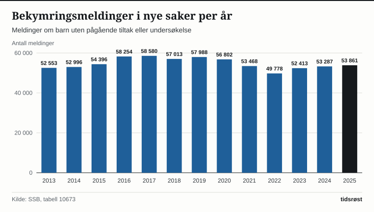

Ved utgangen av 2025 hadde 29 298 barn og unge barnevernstiltak i Norge, ifølge Statistisk sentralbyrå (SSB), som oppdaterte barnevernsstatistikken 3. juni 2026. Det er 26 prosent færre enn i 2017, da antallet var 39 612, det høyeste i tabellen som går tilbake til 2003. I løpet av hele 2025 mottok 42 551 barn og unge ett eller flere tiltak. Tallene omfatter alle mellom 0 og 24 år, siden barnevernet kan videreføre tiltak til unge over 18 år.

Målt som andel av alle barn under 18 år hadde 3,1 prosent barnevernstiltak i løpet av 2025, mot 4,2 prosent i 2015, viser SSBs KOSTRA-tabell 12275.

## Hjelpetiltak og omsorgstiltak

SSB deler tiltakene i to grupper. Omsorgstiltak er tiltak etter barnevernsloven § 5-1, der barnevernet har overtatt omsorgen etter vedtak i Barneverns- og helsenemnda. Alle øvrige tiltak regnes som hjelpetiltak, også akuttiltak og atferdstiltak.

| Per 31. desember | Alle tiltak | Hjelpetiltak | Omsorgstiltak |
|---|---:|---:|---:|
| 2017 | 39 612 | 30 579 | 9 033 |
| 2021 | 35 094 | 27 436 | 7 658 |
| 2025 | 29 298 | 22 974 | 6 324 |

*Kilde: SSB, tabell 09050.*

Av de 29 298 hadde 78 prosent hjelpetiltak og 22 prosent omsorgstiltak. Alle med omsorgstiltak var under 18 år. Blant de 23 592 barna under 18 år med tiltak utgjør de 6 324 med omsorgstiltak 27 prosent. Antallet med omsorgstiltak var høyest i 2016 med 9 080 og er siden redusert med 30 prosent. Antallet med hjelpetiltak var 30 579 i 2017, og er 25 prosent lavere.

*Barn og unge med hjelpetiltak og omsorgstiltak per 31. desember. Kilde: SSB, tabell 09050.*

I 2025 økte antallet med tiltak ved årsskiftet for første gang siden 2017, fra 29 157 til 29 298. Det er en økning på 0,5 prosent.

## Bekymringsmeldinger og undersøkelser

SSB oppgir to tall for bekymringsmeldinger. I 2025 gjennomgikk barnevernstjenestene 53 861 meldinger i nye saker, det vil si om barn som ikke allerede hadde tiltak eller pågående undersøkelse. Når meldinger i aktive saker tas med, var tallet 87 876 ifølge SSBs KOSTRA-tabell 12189. Av dem gjaldt 33 994, eller 39 prosent, barn som allerede hadde tiltak eller en pågående undersøkelse.

| Meldinger i nye saker | 2020 | 2022 | 2025 |
|---|---:|---:|---:|
| Alle meldinger | 56 802 | 49 778 | 53 861 |
| Henlagt | 11 300 | 11 839 | 14 786 |
| Til undersøkelse | 45 502 | 37 939 | 39 074 |

*Kilde: SSB, tabell 10673.*

I tabellen, som starter i 2013, var antallet høyest i 2017 med 58 580 og lavest i 2022 med 49 778. Siden har det økt til 53 861. Andelen meldinger som ble henlagt uten undersøkelse var 27 prosent i 2025, mot 20 prosent i 2020.

*Bekymringsmeldinger i nye saker per år. Kilde: SSB, tabell 10673.*

Barnevernstjenestene startet 39 450 undersøkelser i 2025 og avsluttet 39 165. I 13 063 av de avsluttede undersøkelsene fattet barnevernstjenesten vedtak om tiltak, og i 505 ble det begjært tiltak for Barneverns- og helsenemnda.

## Fosterhjem

Ved utgangen av 2025 bodde 8 899 barn og unge i fosterhjem, mot 11 812 i 2017. Det er en nedgang på 25 prosent. Av dem bodde 2 903 i fosterhjem i familie og nære nettverk, 5 029 i fosterhjem utenfor familie og nære nettverk, 277 i spesialiserte fosterhjem og 554 i beredskapshjem utenfor familie og nære nettverk. Ved utgangen av 2025 var 1 007 plassert i institusjon.

| Barn og unge i fosterhjem per 31. desember | 2017 | 2025 | Endring |
|---|---:|---:|---:|
| 0–2 år | 542 | 294 | −46 % |
| 3–5 år | 1 078 | 530 | −51 % |
| 6–12 år | 4 349 | 2 915 | −33 % |
| 13–17 år | 4 376 | 3 572 | −18 % |
| Alle aldre | 11 812 | 8 899 | −25 % |

*Kilde: SSB, tabell 10661. Endring er regnet ut fra tallene i tabellen. «Alle aldre» omfatter også unge over 18 år.*

## Barnevernsreformen i 2022

Barnevernsreformen trådte i kraft 1. januar 2022. Ifølge Barne- og familiedepartementet ga reformen kommunene et større faglig og økonomisk ansvar, blant annet fullt økonomisk ansvar for statlige barnevernstiltak og ordinære fosterhjem. Kommunene ble kompensert gjennom økt rammetilskudd. Målet var å styrke det forebyggende arbeidet i kommunene.

Antallet barn og unge med tiltak ved årsskiftet gikk fra 35 094 i 2021 til 29 298 i 2025, en nedgang på 17 prosent. Nedgangen startet imidlertid før reformen: fra 39 612 i 2017 til 35 094 i 2021 falt antallet med 11 prosent. Statistikken forklarer ikke årsakene. Bufdir skriver at en del av nedgangen i bekymringsmeldinger kan henge sammen med at andre instanser enn barnevernet arbeider forebyggende, og med økt kunnskap om at meldeplikten først utløses i de mer alvorlige tilfellene.

## Kilder

- [SSB: Barnevern (oppdatert 3. juni 2026)](https://www.ssb.no/sosiale-forhold-og-kriminalitet/barne-og-familievern/statistikk/barnevern)
- [SSB: Tabell 09050 – Barn 0–24 år med barnevernstiltak, etter omsorgs-/hjelpetiltak, kjønn og alder](https://www.ssb.no/statbank/table/09050)
- [SSB: Tabell 10673 – Bekymringsmeldinger til barnevernet](https://www.ssb.no/statbank/table/10673)
- [SSB: Tabell 12189 – Bekymringsmeldinger til barnevernet (KOSTRA)](https://www.ssb.no/statbank/table/12189)
- [SSB: Tabell 10661 – Barnevernstiltak, etter tiltak og alder](https://www.ssb.no/statbank/table/10661)
- [SSB: Tabell 12275 – Barn med tiltak i løpet av året og per 31. desember (KOSTRA)](https://www.ssb.no/statbank/table/12275)
- [Barne- og familiedepartementet: Nå trer barnevernsreformen i kraft (23. desember 2021)](https://www.regjeringen.no/no/aktuelt/na-trer-barnevernsreformen-i-kraft/id2893511/)
- [Bufdir: Bekymringsmeldinger og undersøkelser](https://www.bufdir.no/statistikk-og-analyse/barnevern/bekymringsmeldinger-til-barnevernet/)
- [Bufdir: Barnevernsreformen – en oppvekstreform](https://www.bufdir.no/fagstotte/barnevern-oppvekst/barnevernsreformen/)
