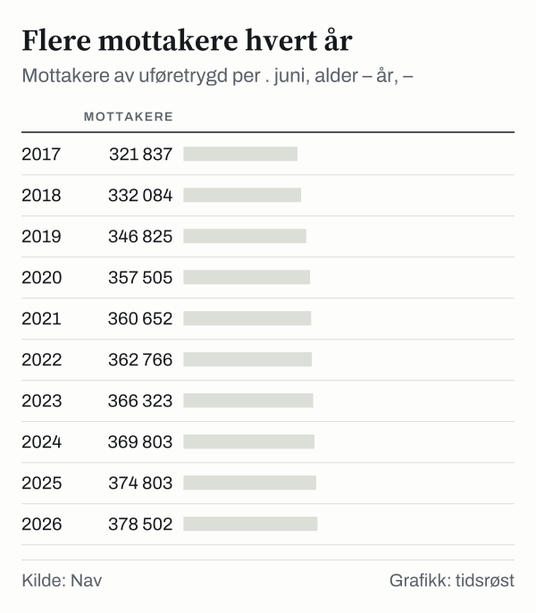

Ved utgangen av juni 2026 hadde 378 502 personer uføretrygd i Norge. Det viser Navs kvartalsstatistikk, oppdatert 13. august 2026. På ett år har tallet vokst med 3 699 mottakere, eller 1,0 prosent. Samlet utgjør de 10,6 prosent av befolkningen mellom 18 og 67 år, opp 0,1 prosentpoeng fra juni 2025.

## Hva uføretrygd er

Ordningen skal sikre inntekt for dem som har fått arbeidsevnen varig nedsatt med minst halvparten på grunn av sykdom, skade eller lyte. Utbetalingen ligger på 66 prosent av tidligere inntekt, begrenset oppad til seks ganger grunnbeløpet i folketrygden.

Nav teller personer med løpende utbetaling i alderen 18–67 år. For 18-åringene regnes 11/12 med og for 67-åringene 1/12, siden retten først inntrer måneden etter fylte 18 år og går over i alderspensjon senest måneden etter fylte 67.

## Utviklingen siden 2017

Siden 2017, da 321 837 personer mottok uføretrygd, har køen vokst hvert eneste år. Oppgangen er på 56 665 personer, eller 17,6 prosent. Som andel av befolkningen steg tallet fra 9,6 prosent i 2017 til 10,5 prosent i 2020, holdt seg flatt på 10,5 prosent helt til 2025, og vippet altså opp til 10,6 prosent i 2026.

*Mottakere av uføretrygd per 30. juni, alder 18–67 år, 2017–2026. Kilde: Nav.*

I første halvår 2026 fikk 15 720 personer uføretrygd for første gang, mot 13 840 i samme periode i 2025. Av de nye mottakerne var 9 086 kvinner og 6 634 menn. Ifølge Nav gikk om lag 12 100 personer ut av ordningen i samme periode, de fleste over til alderspensjon. 67-åringer utgjorde 75,7 prosent av dem som sluttet.

I andre kvartal 2026 kom 81,9 prosent av de nye mottakerne fra arbeidsavklaringspenger, 2,0 prosentpoeng mer enn i samme kvartal året før.

## Kvinner og menn

12,8 prosent av kvinnene i alderen 18–67 år mottar uføretrygd, mot 8,5 prosent av mennene. Kvinner utgjør 58,9 prosent av mottakerne.

*Mottakere av uføretrygd som andel av befolkningen 18–67 år, etter kjønn, 2017–2026. Kilde: Nav.*

| Kjønn | Mottakere juni 2025 | Mottakere juni 2026 | Andel av befolkningen 2026 |
|---|---:|---:|---:|
| Kvinner | 220 392 | 222 863 | 12,8 % |
| Menn | 154 411 | 155 639 | 8,5 % |
| Alle | 374 803 | 378 502 | 10,6 % |

*Kilde: Nav, tabeller per 30. juni 2026.*

Gjennomsnittlig årlig uføretrygd var 371 196 kroner i juni 2026, opp fra 353 611 kroner året før.

## Alder

Andelen øker med alderen, fra 1,3 prosent blant 18–19-åringene til 28,4 prosent blant 65–67-åringene. 191 468 av mottakerne, 50,6 prosent, er mellom 55 og 67 år.

Over tid har andelen gått ned blant de eldste og opp blant de yngre. Blant 65–67-åringene falt den fra 32,4 prosent i 2017 til 28,4 prosent i 2026. Blant 30–34-åringene steg den fra 2,9 til 5,3 prosent. Ifølge Nav skjer veksten nå hovedsakelig i aldersgruppene mellom 30 og 44 år.

*Mottakere av uføretrygd som andel av befolkningen i samme aldersgruppe, 2017 og 2026, utvalgte aldersgrupper. Kilde: Nav.*

| Aldersgruppe | Juni 2025 | Juni 2026 | Endring |
|---|---:|---:|---:|
| 18–29 år | 22 441 | 22 290 | −151 |
| 30–44 år | 73 213 | 75 827 | +2 614 |
| 45–59 år | 160 578 | 160 157 | −421 |
| 60–67 år | 118 569 | 120 228 | +1 659 |
| Alle | 374 803 | 378 502 | +3 699 |

*Kilde: Nav. Aldersgruppene er summert fra femårsgrupper; to personer med uoppgitt alder i 2025 er bare med i totalen.*

## Unge uføre

Nav regner unge uføre som mottakere i alderen 18–29 år. Per juni 2026 var de 22 300, 150 færre enn ett år tidligere. Det tilsvarer 2,7 prosent av befolkningen i samme aldersgruppe. Andelen er 0,9 prosentpoeng høyere enn for ti år siden, men har ifølge Nav vært stabil de siste tre årene.

## Fylkene

Andelen var høyest i Innlandet og Agder (begge 14,5 prosent), Telemark (14,4 prosent) og Østfold (14,0 prosent), og lavest i Oslo (6,4 prosent). Oslo har en yngre befolkning, noe som trekker andelen ned. Nav skriver at det likevel er betydelige forskjeller mellom fylkene også når det korrigeres for alder.

## Navs prognose

Nav venter 379 500 mottakere i desember 2026 og 385 500 i desember 2027. Det vil tilsvare 10,6 og 10,7 prosent av befolkningen.

## Kilder

- [Nav: Uføretrygd – kvartalsstatistikk, per 30. juni 2026 (oppdatert 13. august 2026)](https://www.nav.no/no/nav-og-samfunn/statistikk/aap-nedsatt-arbeidsevne-og-uforetrygd-statistikk/uforetrygd)
- [Nav: Uføretrygd – statistikknotis, utviklingen per juni 2026 med prognoser (oppdatert 13. august 2026)](https://www.nav.no/no/nav-og-samfunn/statistikk/aap-nedsatt-arbeidsevne-og-uforetrygd-statistikk/uforetrygd/statistikknotis-uforetrygd)
- [Nav: Færre unge uføre det siste året (pressemelding 13. august 2026)](https://www.nav.no/no/nav-og-samfunn/statistikk/aap-nedsatt-arbeidsevne-og-uforetrygd-statistikk/nyheter/faerre-unge-ufore-det-siste-aret)
- [Nav: Mottakere av uføretrygd etter kjønn og alder, 2017–2026](https://www.nav.no/no/nav-og-samfunn/statistikk/aap-nedsatt-arbeidsevne-og-uforetrygd-statistikk/tabeller/mottakere-av-uforetrygd-etter-kjonn-og-alder.pr.30.06.2017-2026.antall)
- [Nav: Mottakere av uføretrygd som andel av befolkningen, 2017–2026](https://www.nav.no/no/nav-og-samfunn/statistikk/aap-nedsatt-arbeidsevne-og-uforetrygd-statistikk/tabeller/mottakere-av-uforetrygd-som-andel-av-befolkningen-.etter-kjonn-og-alder.pr.30.06.2017-2026.prosent)
- [Nav: Nye mottakere av uføretrygd, 1. halvår 2017–2026](https://www.nav.no/no/nav-og-samfunn/statistikk/aap-nedsatt-arbeidsevne-og-uforetrygd-statistikk/tabeller/nye-mottakere-av-uforetrygd-etter-kjonn-og-alder.1.halvar-2017-2026.antall)
- [Nav: Gjennomsnittlig årlig uføretrygd, 2017–2026](https://www.nav.no/no/nav-og-samfunn/statistikk/aap-nedsatt-arbeidsevne-og-uforetrygd-statistikk/tabeller/mottakere-av-uforetrygd-gjennomsnittlig-arlig-pensjon-etter-kjonn-og-ytelse.pr.30.06.2017-2026.belop-i-kroner)
