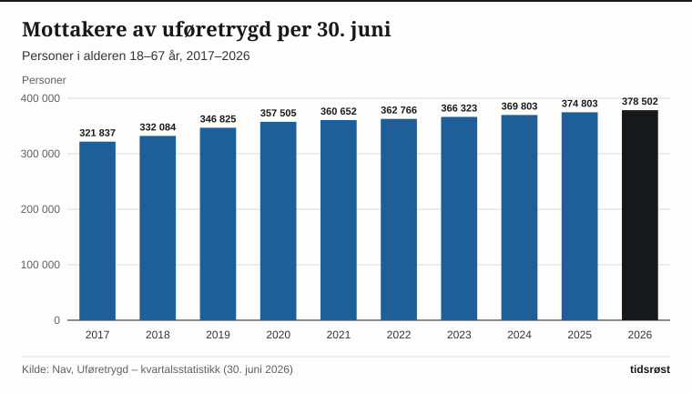

Ved utgangen av juni 2026 mottok 378 502 personer uføretrygd, ifølge Navs kvartalsstatistikk som ble oppdatert 13. august 2026. Det er 3 699 flere enn i juni 2025, en økning på 1,0 prosent. Mottakerne utgjør 10,6 prosent av befolkningen i alderen 18–67 år.

## Slik regnes tallene

Uføretrygd skal sikre inntekt for personer som har fått inntektsevnen varig nedsatt med minst halvparten på grunn av sykdom, skade eller lyte. Ytelsen tilsvarer 66 prosent av tidligere inntekt, opp til seks ganger grunnbeløpet i folketrygden.

Nav teller personer med løpende utbetaling i alderen 18–67 år. Av 18-åringene telles 11/12 og av 67-åringene 1/12, fordi man først kan få uføretrygd måneden etter fylte 18 år og senest blir alderspensjonist måneden etter fylte 67 år.

## Utviklingen siden 2017

Antall mottakere har økt hvert år siden 2017, da tallet var 321 837. Til sammen er det 56 665 flere, en økning på 17,6 prosent. Andelen av befolkningen steg fra 9,6 prosent i 2017 til 10,5 prosent i 2020. Den var 10,5 prosent hvert år til og med 2025 og er 10,6 prosent i 2026.

*Mottakere av uføretrygd per 30. juni, alder 18–67 år. Kilde: Nav, uføretrygd – kvartalsstatistikk.*

I første halvår 2026 fikk om lag 15 700 personer uføretrygd for første gang. Det er om lag 1 900 flere enn i samme periode i 2025. Tabelltallene viser 15 720 mot 13 840, hvorav 9 086 kvinner og 6 634 menn. I samme periode gikk om lag 12 100 ut av ordningen. Flest gikk over til alderspensjon, og 67-åringer utgjorde 75,7 prosent av dem som sluttet.

Tall fra Navs saksunivers viser at det ble fattet vedtak i 17 700 nye uføresaker i første halvår 2026. Av dem ble 14 100 innvilget og 3 400 avslått, mot 11 800 innvilget og 3 400 avslått i samme periode i 2025. I andre kvartal 2026 kom 81,9 prosent av de nye mottakerne fra arbeidsavklaringspenger, 2,0 prosentpoeng mer enn i samme kvartal året før.

## Kvinner og menn

| Kjønn | Mottakere juni 2025 | Mottakere juni 2026 | Andel av befolkningen 2026 |
|---|---:|---:|---:|
| Kvinner | 220 392 | 222 863 | 12,8 % |
| Menn | 154 411 | 155 639 | 8,5 % |
| Alle | 374 803 | 378 502 | 10,6 % |

*Kilde: Nav, uføretrygd – kvartalsstatistikk, tabeller per 30. juni 2026.*

Kvinner utgjør 58,9 prosent av mottakerne. Andelen blant kvinner økte med 0,1 prosentpoeng siste år, mens den var uendret for menn. Blant alle mottakere fikk 85,7 prosent full uføretrygd ved utgangen av juni 2026, mens 14,3 prosent har gradert ytelse. Nav oppgir at flere kvinner enn menn har gradert uføretrygd.

Gjennomsnittlig årlig uføretrygd var 371 196 kroner i juni 2026, opp fra 353 611 kroner året før. For kvinner var snittet 357 308 kroner, og for menn 391 082 kroner.

## Alder: flest eldre, vekst blant 30–44-åringer

Andelen som mottar uføretrygd stiger kraftig med alderen. Blant 18–19-åringene er den 1,3 prosent, mens den er 28,4 prosent blant 65–67-åringene. Totalt er 191 468 av mottakerne, eller 50,6 prosent, i alderen 55–67 år.

*Mottakere av uføretrygd som andel av befolkningen i samme aldersgruppe, prosent. Kilde: Nav, uføretrygd – kvartalsstatistikk.*

Over tid har andelen blant de eldste gått ned: for 65–67-åringer fra 32,4 prosent i 2017 til 28,4 prosent i 2026. Blant 30–34-åringene har den økt fra 2,9 til 5,3 prosent, og blant 40–44-åringene fra 6,4 til 8,0 prosent.

| Aldersgruppe | Juni 2025 | Juni 2026 | Endring |
|---|---:|---:|---:|
| 18–29 år | 22 441 | 22 290 | −151 |
| 30–44 år | 73 213 | 75 827 | +2 614 |
| 45–59 år | 160 578 | 160 157 | −421 |
| 60–67 år | 118 569 | 120 228 | +1 659 |
| Alle | 374 803 | 378 502 | +3 699 |

*Kilde: Nav, uføretrygd – kvartalsstatistikk. Aldersgruppene er summert fra femårsgrupper; to personer med uoppgitt alder i 2025 er bare med i totalen.*

## Unge uføre

Nav regner unge uføre som mottakere i alderen 18–29 år. Per juni 2026 var de 22 300, noe som tilsvarer 2,7 prosent av befolkningen i samme aldersgruppe: 2,6 prosent blant kvinner og 2,8 prosent blant menn. Det er 150 færre enn ett år tidligere. Andelen er 0,9 prosentpoeng høyere enn for ti år siden, men har ifølge Nav vært stabil de siste tre årene. Det er flest i Østfold (3,9 prosent) og færrest i Oslo (1,5 prosent).

I pressemeldingen 13. august 2026 sa arbeids- og velferdsdirektør Hege Nilssen: «det er svært positivt å se at antallet unge uføre har stabilisert seg og til og med gått litt ned etter perioden med sterk vekst». Nav opplyser at de i høst skal sende melding til unge som har hatt uføretrygd i minst to år, med informasjon om arbeidsrettet oppfølging.

## Store forskjeller mellom fylkene

Andelen mottakere varierer mye mellom fylkene. Høyest er den i Innlandet og Agder (14,5 prosent), Telemark (14,4 prosent) og Østfold (14,0 prosent), lavest i Oslo (6,4 prosent). Nav peker på at Oslo har en yngre befolkning, men skriver at betydelige fylkesforskjeller består også når tallene aldersstandardiseres.

## Navs prognose

Nav forventer 379 500 mottakere i desember 2026 og 385 500 i desember 2027. Det tilsvarer en andel på 10,6 prosent ved utgangen av 2026 og 10,7 prosent ved utgangen av 2027, og vekst på 1,2 og 1,6 prosent. Prognosen er nedjustert sammenlignet med januar, hovedsakelig på grunn av lavere forventet tilstrømming i andre halvår 2026.

## Kilder

- [Nav: Uføretrygd – kvartalsstatistikk, per 30. juni 2026 (oppdatert 13. august 2026)](https://www.nav.no/no/nav-og-samfunn/statistikk/aap-nedsatt-arbeidsevne-og-uforetrygd-statistikk/uforetrygd)
- [Nav: Uføretrygd – statistikknotis, utviklingen per juni 2026 med prognoser (oppdatert 13. august 2026)](https://www.nav.no/no/nav-og-samfunn/statistikk/aap-nedsatt-arbeidsevne-og-uforetrygd-statistikk/uforetrygd/statistikknotis-uforetrygd)
- [Nav: Færre unge uføre det siste året (pressemelding 13. august 2026)](https://www.nav.no/no/nav-og-samfunn/statistikk/aap-nedsatt-arbeidsevne-og-uforetrygd-statistikk/nyheter/faerre-unge-ufore-det-siste-aret)
- [Nav: Mottakere av uføretrygd etter kjønn og alder, 2017–2026](https://www.nav.no/no/nav-og-samfunn/statistikk/aap-nedsatt-arbeidsevne-og-uforetrygd-statistikk/tabeller/mottakere-av-uforetrygd-etter-kjonn-og-alder.pr.30.06.2017-2026.antall)
- [Nav: Mottakere av uføretrygd som andel av befolkningen, 2017–2026](https://www.nav.no/no/nav-og-samfunn/statistikk/aap-nedsatt-arbeidsevne-og-uforetrygd-statistikk/tabeller/mottakere-av-uforetrygd-som-andel-av-befolkningen-.etter-kjonn-og-alder.pr.30.06.2017-2026.prosent)
- [Nav: Nye mottakere av uføretrygd, 1. halvår 2017–2026](https://www.nav.no/no/nav-og-samfunn/statistikk/aap-nedsatt-arbeidsevne-og-uforetrygd-statistikk/tabeller/nye-mottakere-av-uforetrygd-etter-kjonn-og-alder.1.halvar-2017-2026.antall)
- [Nav: Gjennomsnittlig årlig uføretrygd, 2017–2026](https://www.nav.no/no/nav-og-samfunn/statistikk/aap-nedsatt-arbeidsevne-og-uforetrygd-statistikk/tabeller/mottakere-av-uforetrygd-gjennomsnittlig-arlig-pensjon-etter-kjonn-og-ytelse.pr.30.06.2017-2026.belop-i-kroner)
