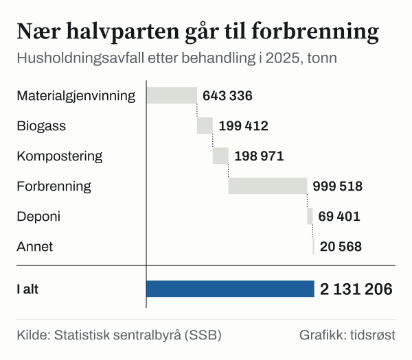

Husholdningsavfallet var i gjennomsnitt 379 kilo per innbygger i Norge i 2025, viser statistikken «Avfall frå hushalda» fra Statistisk sentralbyrå (SSB), oppdatert 15. juni 2026. Til sammen ble det 2 131 000 tonn. 48,9 prosent ble levert til materialgjenvinning, inkludert biogassproduksjon og kompostering. Året før var andelen 46,3 prosent.

*Andel av husholdningsavfallet levert til materialgjenvinning, inkludert biogass og kompostering, 2015–2025. Kilde: SSB, tabell 12241.*

## Mengden per innbygger

Avfallsmengden per innbygger var høyest i 2020, med 448,6 kilo. Siden har den falt med 15,5 prosent, til 379,1 kilo i 2025. Mengden som ble levert til materialgjenvinning per innbygger økte i samme periode fra 184,4 til 185,3 kilo, og fra 166,2 kilo i 2015.

| År | Husholdningsavfall, kg per innbygger | Levert til materialgjenvinning, kg per innbygger | Andel til materialgjenvinning |
|---|---:|---:|---:|
| 2015 | 438,8 | 166,2 | 37,9 % |
| 2020 | 448,6 | 184,4 | 41,1 % |
| 2022 | 386,9 | 169,1 | 43,7 % |
| 2023 | 376,6 | 169,9 | 45,1 % |
| 2024 | 379,4 | 175,8 | 46,3 % |
| 2025 | 379,1 | 185,3 | 48,9 % |

*Kilde: SSB, tabell 12241. Materialgjenvinning inkluderer biologisk behandling.*

## Hva avfallet består av

Restavfall er den største gruppen, med 810 000 tonn eller 38 prosent av husholdningsavfallet i 2025. Deretter følger treavfall (249 000 tonn), matavfall (241 000 tonn) og papp (183 000 tonn). Fra 2024 økte matavfallet med 6,3 prosent, mens restavfallet gikk ned 3,6 prosent.

*Husholdningsavfall etter materiale, 2025. Kilde: SSB, tabell 13136.*

## Hvor avfallet havner

I 2025 ble 1 042 000 tonn levert til materialgjenvinning, biogassproduksjon og kompostering. 46,9 prosent gikk til forbrenning, mot 57,8 prosent i 2015, og 3,3 prosent gikk til deponi.

*Husholdningsavfall etter behandling, 2025. Kilde: SSB, tabell 13136.*

SSB skriver at tallene viser hvor mye avfall som ble levert til materialgjenvinning, ikke hvor mye som faktisk ble gjenvunnet.

## EU-målet på 55 prosent

Etter EUs rammedirektiv om avfall skal 55 prosent av husholdningsavfall og lignende næringsavfall forberedes til ombruk eller materialgjenvinnes innen 2025. Målet øker til 60 prosent i 2030 og 65 prosent i 2035. Ifølge Miljødirektoratet gjelder målet også for Norge gjennom EØS-avtalen.

EU-målet måles på et annet grunnlag enn SSBs andel:

- Næringsavfall som ligner husholdningsavfall, er med.
- Gips, bildekk og byggavfall som husholdningene leverer på gjenvinningsstasjoner, er ikke med.
- Det justeres for tap i sorterings- og gjenvinningsleddet.

Miljødirektoratets utkast til nasjonal avfallsplan 2026–2031, som var på høring fra 9. februar til 7. april 2026, oppgir at Norge oppnådde 42,9 prosent i 2023 målt på denne måten. For husholdningsavfallet alene var andelen om lag 46 prosent, og for det husholdningslignende næringsavfallet 38 prosent. Utkastet er ikke endelig.

## Kilder

- [SSB: Avfall frå hushalda (oppdatert 15. juni 2026)](https://www.ssb.no/natur-og-miljo/avfall/statistikk/avfall-fra-hushalda)
- [SSB: Aukande mengde matavfall frå hushalda (15. juni 2026)](https://www.ssb.no/natur-og-miljo/avfall/statistikk/avfall-fra-hushalda/artikler/aukande-mengde-matavfall-fra-hushalda)
- [SSB: Tabell 12241 – Hushaldsavfall og renovasjon](https://www.ssb.no/statbank/table/12241)
- [SSB: Tabell 13136 – Avfall frå hushalda, etter region, materiale og behandling](https://www.ssb.no/statbank/table/13136)
- [Regjeringen.no: EØS-notat om endring av rammedirektivet om avfall](https://www.regjeringen.no/no/sub/eos-notatbasen/notatene/2014/des/endring-av-rammedirektivet-for-avfall-del-av-pakke-sirkular-okonomi/id2502169/)
- [Miljødirektoratet: Norge må bli flinkere til å kildesortere (10. oktober 2024)](https://www.miljodirektoratet.no/aktuelt/fagmeldinger/2024/oktober-2024/norge-ma-bli-flinkere-til-a-kildesortere/)
- [Miljødirektoratet: Ny nasjonal avfallsplan på høring (9. februar 2026)](https://www.miljodirektoratet.no/hoeringer/2026/februar-2026/ny-nasjonal-avfallsplan-pa-horing/)
- [Miljødirektoratet: Utkast til nasjonal avfallsplan og avfallsforebyggingsprogram 2026–2031, rapport M-3030/2025 (høringsutkast)](https://hoering.miljodirektoratet.no/Hoering/LastNedVedlegg/38088)
