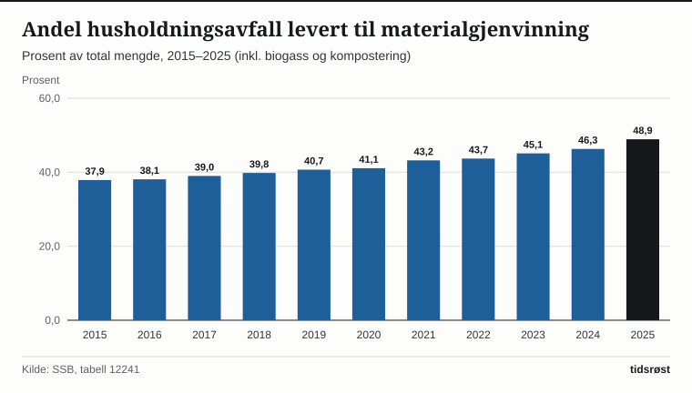
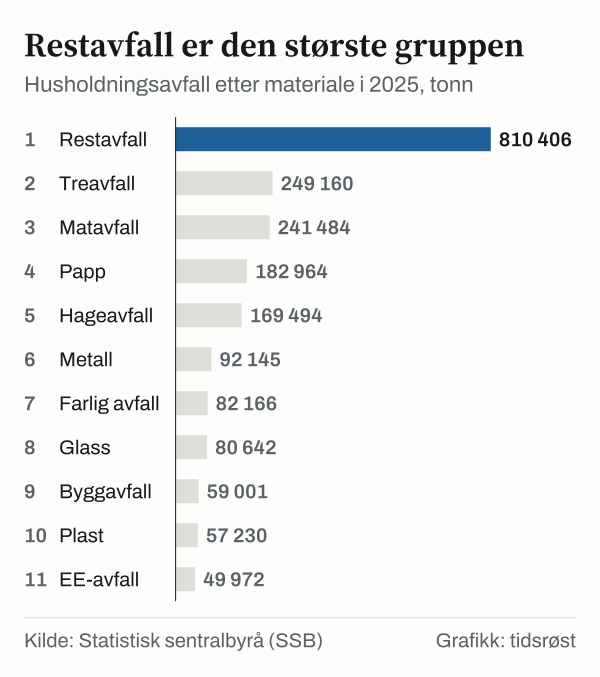

Hver innbygger i Norge kastet i gjennomsnitt 379 kilo husholdningsavfall i 2025, viser Statistisk sentralbyrå (SSB) i statistikken «Avfall frå hushalda», oppdatert 15. juni 2026. Totalt ble det 2 131 000 tonn. Av dette ble 48,9 prosent levert til materialgjenvinning, inkludert biogassproduksjon og kompostering. Året før var andelen 46,3 prosent, og i 2015 var den 37,9 prosent.

## Mengden per innbygger

Avfallsmengden per innbygger var høyest i 2020, med 448,6 kilo, blant årene fra 2015. Siden har den falt til 379,1 kilo i 2025, en nedgang på 69,5 kilo eller 15,5 prosent. Sammenlignet med 2015 er nedgangen 59,7 kilo eller 13,6 prosent. Mengden som leveres til materialgjenvinning har samtidig økt fra 166,2 til 185,3 kilo per innbygger, altså 19,1 kilo mer.

| År | Husholdningsavfall, kg per innbygger | Levert til materialgjenvinning, kg per innbygger | Andel til materialgjenvinning |
|---|---:|---:|---:|
| 2015 | 438,8 | 166,2 | 37,9 % |
| 2020 | 448,6 | 184,4 | 41,1 % |
| 2022 | 386,9 | 169,1 | 43,7 % |
| 2023 | 376,6 | 169,9 | 45,1 % |
| 2024 | 379,4 | 175,8 | 46,3 % |
| 2025 | 379,1 | 185,3 | 48,9 % |

*Kilde: SSB, tabell 12241. Materialgjenvinning inkluderer biologisk behandling.*

*Andel husholdningsavfall levert til materialgjenvinning, inkludert biogass og kompostering. Kilde: SSB, tabell 12241.*

## Hva består avfallet av?

Restavfall er den største gruppen. I 2025 utgjorde det 810 000 tonn, som er 38 prosent av husholdningsavfallet. Deretter følger treavfall (249 000 tonn), matavfall (241 000 tonn) og papp (183 000 tonn).

*Husholdningsavfall etter materiale i 2025, 1 000 tonn. Kilde: SSB, tabell 13136.*

Matavfallet økte med 14 000 tonn, eller 6 prosent, fra 2024, mens restavfallet gikk ned med 31 000 tonn, eller 4 prosent (regnet fra tabell 13136). I SSBs artikkel uttaler en seniorrådgiver at tallene viser at kravene om kildesortering av matavfall fra private husholdninger fungerer.

## Hvor havner avfallet?

I 2025 ble 1 042 000 tonn levert til materialgjenvinning, biogassproduksjon og kompostering. Forbrenning sto for 46,9 prosent, mot 57,8 prosent i 2015, og 3,3 prosent gikk til deponi.

| Behandling | 2024 | 2025 |
|---|---:|---:|
| Materialgjenvinning | 588 | 643 |
| Biogassproduksjon | 184 | 199 |
| Kompostering | 211 | 199 |
| Forbrenning | 1 050 | 1 000 |
| Deponi | 74 | 69 |
| Annen behandling | 15 | 21 |
| **Sum** | **2 123** | **2 131** |

*Kilde: SSB, tabell 13136. Tall i 1 000 tonn.*

SSB understreker at tallene viser hvor mye avfall som ble levert til materialgjenvinning, ikke hvor mye som faktisk ble gjenvunnet. Andelen varierer mye mellom fylkene: fra 36,7 prosent i Vestland til 70,1 prosent i Vestfold i 2025.

## EU-målet: 55 prosent innen 2025

Etter EUs avfallsdirektiv, som er omtalt i regjeringens EØS-notatbase, skal 55 prosent av «municipal waste» forberedes til ombruk eller materialgjenvinnes innen 2025, 60 prosent innen 2030 og 65 prosent innen 2035. Begrepet omfatter husholdningsavfall og lignende avfall fra næringslivet. Miljødirektoratet skriver at målet gjelder for Norge gjennom EØS-avtalen.

Målet måles dermed på et annet grunnlag enn SSBs andel på 48,9 prosent. Miljødirektoratet opplyser at gips, bildekk og byggavfall fra husholdninger ikke regnes med i oppfyllelsen av EU-målet. Næringsavfall regnes derimot med, og det justeres for tap i sorterings- og gjenvinningsleddet.

Miljødirektoratets utkast til nasjonal avfallsplan 2026–2031, som var på høring fra 9. februar til 7. april 2026, oppgir at Norge i 2023 nådde 42,9 prosent reell forberedelse til ombruk og materialgjenvinning etter slik justering. Av husholdningsavfallet alene var andelen om lag 46 prosent, og av husholdningslignende næringsavfall om lag 38 prosent. For 2022 rapporterte Norge til EU 37,3 prosent i juni 2024, noe som var nesten 18 prosentpoeng under målet. Tallet for 2022 er senere justert av SSB etter en metodeendring. Norge nådde heller ikke det bindende målet for 2020, som var 50 prosent.

Utkastet viser til tidligere beregninger som tilsier at dagens virkemidler kan gi 49 prosent forberedelse til ombruk og materialgjenvinning av husholdningsavfall og lignende næringsavfall i 2030. Beregningene beskrives som beheftet med stor usikkerhet. Utkastet er ikke endelig.

## Kilder

- [SSB: Avfall frå hushalda (oppdatert 15. juni 2026)](https://www.ssb.no/natur-og-miljo/avfall/statistikk/avfall-fra-hushalda)
- [SSB: Aukande mengde matavfall frå hushalda (15. juni 2026)](https://www.ssb.no/natur-og-miljo/avfall/statistikk/avfall-fra-hushalda/artikler/aukande-mengde-matavfall-fra-hushalda)
- [SSB: Auking i avfall frå hushalda (16. juni 2025)](https://www.ssb.no/natur-og-miljo/avfall/statistikk/avfall-fra-hushalda/artikler/auking-i-avfall-fra-hushalda)
- [SSB: Tabell 12241 – Hushaldsavfall og renovasjon](https://www.ssb.no/statbank/table/12241)
- [SSB: Tabell 13136 – Avfall frå hushalda, etter region, materiale og behandling](https://www.ssb.no/statbank/table/13136)
- [Regjeringen.no: EØS-notat om endring av rammedirektivet om avfall (14. oktober 2021)](https://www.regjeringen.no/no/sub/eos-notatbasen/notatene/2014/des/endring-av-rammedirektivet-for-avfall-del-av-pakke-sirkular-okonomi/id2502169/)
- [Miljødirektoratet: Norge må bli flinkere til å kildesortere (10. oktober 2024)](https://www.miljodirektoratet.no/aktuelt/fagmeldinger/2024/oktober-2024/norge-ma-bli-flinkere-til-a-kildesortere/)
- [Miljødirektoratet: Ny nasjonal avfallsplan på høring (9. februar 2026)](https://www.miljodirektoratet.no/hoeringer/2026/februar-2026/ny-nasjonal-avfallsplan-pa-horing/)
- [Miljødirektoratet: Utkast til nasjonal avfallsplan og avfallsforebyggingsprogram 2026–2031, rapport M-3030/2025 (høringsutkast)](https://hoering.miljodirektoratet.no/Hoering/LastNedVedlegg/38088)
