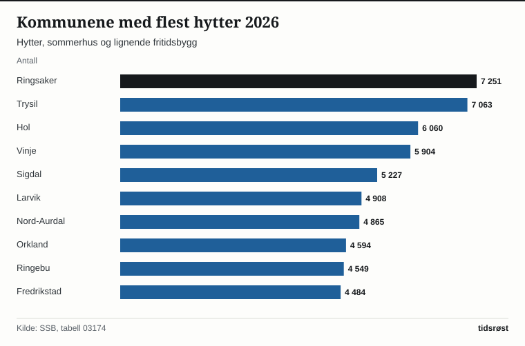

Per januar 2026 var det 452 367 hytter, sommerhus og lignende fritidsbygg i Norge, viser Statistisk sentralbyrå (SSB) i statistikken Bygningsmassen, publisert 4. februar 2026. Det er 973 flere enn året før og 29 326 flere enn i 2016. I 2025 ble det gitt igangsettingstillatelse til 1 973 nye fritidsboliger, mot 7 454 i 2021.

## Hvor mange hytter finnes det?

SSB registrerte 4 358 361 bygninger i Norge i 2026. Hytter, sommerhus og lignende fritidsbygg utgjør 452 367 av dem, det vil si 10,4 prosent. Siden 2001 har antallet økt med 98 307, eller 27,8 prosent, og de siste ti årene har veksten vært 6,9 prosent.

I tillegg regner SSB med en egen gruppe: helårsboliger og våningshus som brukes som fritidsbolig. Den gruppen telte 31 958 bygninger i 2026. Antallet var 33 283 i 2022 og 32 727 i 2016, så det har gått ned 2,3 prosent på ti år. Til sammen blir det 484 325 bygninger i de to gruppene.

| År | Hytter, sommerhus og lignende | Helårsboliger og våningshus brukt som fritidsbolig |
|---|---:|---:|
| 2001 | 354 060 | 23 267 |
| 2006 | 379 169 | 27 604 |
| 2011 | 405 883 | 32 374 |
| 2016 | 423 041 | 32 727 |
| 2021 | 440 443 | 33 099 |
| 2026 | 452 367 | 31 958 |

*Kilde: SSB, tabell 03174. Tallene gjelder situasjonen per januar.*

SSBs faktaside om hytter og fritidsboliger oppgir 452 150 hytter og andre fritidsbygg i 2026 (tabell 05467). Det er 217 færre enn tallet over. SSB forklarer ikke forskjellen på faktasiden.

## Hvor ligger hyttene?

Innlandet har flest hytter med 89 300, som er 19,7 prosent av alle i landet. Deretter følger Trøndelag med 51 734 og Buskerud med 49 084. Disse tre fylkene har til sammen 190 118 hytter, eller 42,0 prosent. I Oslo er det registrert 2 183.

Blant kommunene har Ringsaker flest hytter med 7 251, tett fulgt av Trysil med 7 063 og Hol med 6 060. De ti kommunene med flest hytter har til sammen 54 905, som er 12,1 prosent av landets hytter.

*Kommunene med flest hytter, sommerhus og lignende fritidsbygg, 2026. Kilde: SSB, tabell 03174.*

## Nybygging

Antall igangsettingstillatelser til nye fritidsboliger var 7 454 i 2021 og 1 973 i 2025. Det er 73,5 prosent lavere, og 2025 er det laveste tallet i serien som starter i 2010. Antall fullførte fritidsboliger var 6 690 i 2022 og 2 950 i 2025, 55,9 prosent lavere. Ifølge SSB var 2 744 av dem hytter og 206 fritidsleiligheter.

*Igangsettingstillatelser og fullførte fritidsboliger per år. Kilde: SSB, tabell 13633.*

Gjennomsnittlig bruksareal for fullførte fritidsboliger var 98,9 kvadratmeter i 2025, mot 96,1 i 2010. Flest fullførte fritidsboliger i 2025 var det i Fjord (95), Nesbyen (79), Ringebu (69), Øyer (67) og Flå (63).

## Omsetning og priser

I 2025 ble det omsatt 11 358 fritidseiendommer med bygning i fritt salg, 12,0 prosent flere enn de 10 139 i 2024. Antallet var likevel 32,0 prosent lavere enn toppåret 2021, da det var 16 707 omsetninger. Samlet kjøpesum var 30,88 milliarder kroner. Regnet som kjøpesum i alt delt på antall omsetninger ble gjennomsnittet 2,72 millioner kroner, 31,1 prosent høyere enn i 2019 og 0,8 prosent lavere enn i 2022.

| År | Omsetninger | Kjøpesum i alt (mrd. kr) | Gjennomsnitt (mill. kr) |
|---|---:|---:|---:|
| 2019 | 12 182 | 25,27 | 2,07 |
| 2020 | 15 801 | 35,15 | 2,22 |
| 2021 | 16 707 | 38,60 | 2,31 |
| 2022 | 11 569 | 31,71 | 2,74 |
| 2023 | 9 568 | 25,65 | 2,68 |
| 2024 | 10 139 | 27,69 | 2,73 |
| 2025 | 11 358 | 30,88 | 2,72 |

*Kilde: SSB, tabell 11694. Gjennomsnittet er regnet ut fra kjøpesum i alt og antall omsetninger.*

Gjennomsnittet er ikke en prisindeks, og det varierer med hvilke eiendommer som selges. Blant de ti største hyttekommunene var det i 2025 store forskjeller: Ringebu hadde 157 omsetninger til et gjennomsnitt på 5,00 millioner kroner, Hol 234 til 4,66 millioner, mens Orkland hadde 86 til 1,43 millioner.

Foreløpige tall for 2. kvartal 2026 viser 2 767 omsetninger av fritidsboliger i fritt salg, 0,9 prosent færre enn i samme kvartal i 2025. Gjennomsnittlig kjøpesum per omsetning var 2,785 millioner kroner.

## Kilder

- [SSB: Bygningsmassen (publisert 4. februar 2026)](https://www.ssb.no/bygg-bolig-og-eiendom/bygg-og-anlegg/statistikk/bygningsmassen)
- [SSB: Tabell 03174 – Eksisterende bygningsmasse. Fritidsbygg](https://www.ssb.no/statbank/table/03174)
- [SSB: Tabell 05467 – Antall fritidsbygninger og fritidsbygninger per kvadratkilometer](https://www.ssb.no/statbank/table/05467)
- [SSB: Tabell 13633 – Byggeareal. Antall fritidsboliger og gjennomsnittsareal](https://www.ssb.no/statbank/table/13633)
- [SSB: Tabell 11694 – Omsetning og kjøpesum av fritidseiendommer med bygning i fritt salg](https://www.ssb.no/statbank/table/11694)
- [SSB: Eiendomsomsetning (oppdatert 27. august 2026)](https://www.ssb.no/bygg-bolig-og-eiendom/eiendom/statistikk/eiendomsomsetning)
- [SSB: Salg av fritidseiendommer øker (30. mars 2026)](https://www.ssb.no/bygg-bolig-og-eiendom/eiendom/statistikk/eiendomsomsetning/artikler/salg-av-fritidseiendommer-oker)
- [SSB: Hytter og fritidsboliger (faktaside)](https://www.ssb.no/bygg-bolig-og-eiendom/faktaside/hytter-og-ferieboliger)
