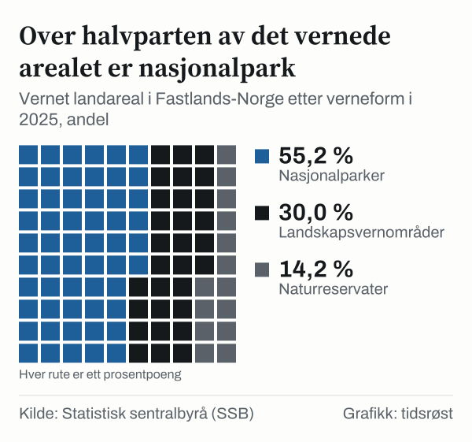

Norge har 48 nasjonalparker, 41 på fastlandet og 7 på Svalbard, viser tall fra Statistisk sentralbyrå (SSB). I 1975 var det 13. Samlet var 17,8 prosent av landarealet i Fastlands-Norge vernet etter naturmangfoldloven ved utgangen av 2025. Samtidig er friluftsliv noe nesten alle driver med: Ifølge SSBs levekårsundersøkelse hadde 96,5 prosent av befolkningen over 16 år drevet minst én friluftsaktivitet i løpet av ett år.

## 48 nasjonalparker

Antallet nasjonalparker har økt fra 13 i 1975 til 18 i 1995, 25 i 2005, 44 i 2015 og 48 i 2025. Vernet omfatter blant annet store sammenhengende fjell- og viddeområder som Hardangervidda, Jotunheimen, Rondane og Børgefjell.

![Linjediagram over Fra tretten til førtiåtte nasjonalparker: Nasjonalparker: 13 i 1975, 13 i 1976, 13 i 1977, 13 i 1978, 13 i 1979, 14 i 1980, 15 i 1981, 15 i 1982, 15 i 1983, 15 i 1984, 15 i 1985, 16 i 1986, 16 i 1987, 16 i 1988, 17 i 1989, 17 i 1990, 18 i 1991, 18 i 1992, 18 i 1993, 18 i 1994, 18 i 1995, 18 i 1996, 18 i 1997, 18 i 1998, 18 i 1999, 18 i 2000, 19 i 2001, 19 i 2002, 21 i 2003, 24 i 2004, 25 i 2005, 29 i 2006, 29 i 2007, 29 i 2008, 39 i 2009, 40 i 2010, 41 i 2011, 43 i 2012, 44 i 2013, 44 i 2014, 44 i 2015, 46 i 2016, 46 i 2017, 47 i 2018, 47 i 2019, 47 i 2020, 47 i 2021, 47 i 2022, 48 i 2023, 48 i 2024, 48 i 2025.](./graf-1.svg)
*Nasjonalparker i Norge, inkludert Svalbard, 1975–2025. Kilde: SSB, tabell 08936.*

## 17,8 prosent av fastlandet

I tillegg til nasjonalparkene er det 2 691 naturreservater og 195 landskapsvernområder på fastlandet. Nasjonalparkene utgjør 55,2 prosent av det vernede landarealet i Fastlands-Norge, landskapsvernområdene 30,0 prosent og naturreservatene 14,2 prosent.

*Vernet landareal i Fastlands-Norge etter verneform, 2025. Annet vern (0,7 prosent) er ikke med i figuren. Kilde: SSB, tabell 08936.*

| Vernekategori (Fastlands-Norge) | Antall områder | Vernet landareal (km²) | Andel av landarealet |
|---|---:|---:|---:|
| Nasjonalparker | 41 | 31 708 | 9,8 % |
| Landskapsvernområder | 195 | 17 221 | 5,3 % |
| Naturreservater | 2 691 | 8 170 | 2,5 % |
| Annet vern (blant annet plante- og dyrefredning, naturminner og biotopvern) | 455 | 392 | 0,1 % |
| Marint vern | 18 | – | – |
| **Alle verneformer** | **3 400** | **57 483** | **17,8 %** |

*Kilde: SSB, vernede områder. Marint vern har ikke vernet landareal. Delsummene kan avvike fra totalen fordi enkelte områder tilhører flere kategorier.*

## 68,9 prosent av Svalbard

På Svalbard var 41 558 km², eller 68,9 prosent av landarealet, og 87,7 prosent av havarealet vernet ved utgangen av 2025, gjennom 7 nasjonalparker, 22 naturreservater og ett område med annet vern.

## 96,5 prosent driver friluftsliv

I SSBs levekårsundersøkelse for 2024 hadde 90,6 prosent vært på gåtur i parker eller naturområder nær boligen det siste året, og 74,8 prosent hadde vært på fottur i fjell, skog eller mark. Andelen som hadde vært på fottur, var lavere enn i 2021, da den var 82,0 prosent. Flere hadde badet utendørs (68,7 prosent mot 61,8 prosent) og vært på bær- eller sopptur (46,8 prosent mot 41,6 prosent).

*Andel av befolkningen over 16 år som har gjort aktiviteten de siste tolv månedene, 2021 og 2024. Kilde: SSB, tabell 13372.*

## Allemannsretten

Friluftsloven regulerer allemannsretten, som innenfor lovens rammer gir rett til å ferdes i utmark, uavhengig av hvem som eier grunnen.

## Kilder

- [Lovdata: Lov om friluftslivet (friluftsloven)](https://lovdata.no/dokument/NL/lov/1957-06-28-16)
- [SSB: Vernede områder](https://www.ssb.no/natur-og-miljo/areal/statistikk/vernede-omrader)
- [SSB: Idrett og friluftsliv, levekårsundersøkelsen](https://www.ssb.no/kultur-og-fritid/idrett-og-friluftsliv/statistikk/idrett-og-friluftsliv-levekarsundersokelsen)
- [SSB Statistikkbanken: Tabell 08936 – Vernet areal](https://www.ssb.no/statbank/table/08936)
- [SSB Statistikkbanken: Tabell 13372 – Friluftslivsaktiviteter](https://www.ssb.no/statbank/table/13372)
