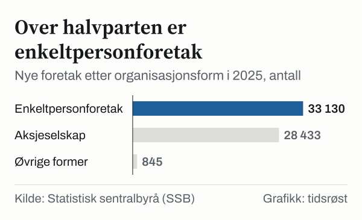

Statistisk sentralbyrå (SSB) registrerte 62 408 nye foretak i Norge i 2025, summert fra de fire kvartalene i statistikktabell 08076. Det er 1,3 prosent flere enn i 2024, da tallet var 61 582. Tallene gjelder alle næringer unntatt offentlig forvaltning og primærnæringene.

I første halvår 2026 ble det registrert 35 144 nye foretak: 18 092 i første kvartal og 17 052 i andre. Det er 14,7 prosent flere enn i første halvår 2025.

*Nye foretak registrert i første halvår (januar–juni), 2024–2026. Kilde: SSB, tabell 08076.*

## Toppen kom i 2021

Antallet nye foretak har ligget over 60 000 hvert år siden 2014. Det høyeste tallet i perioden fra 2008 kom i 2021, med 76 233 nye foretak. Deretter gikk antallet ned tre år på rad, til 61 582 i 2024, før det steg litt igjen i 2025.

*Nye foretak per år, 2008–2025, summert fra kvartalstall. Kilde: SSB, tabell 08076.*

## Andre kvartal 2026

I andre kvartal alene var økningen 20,8 prosent, fra 14 112 nye foretak i andre kvartal 2025 til 17 052. Nyetableringene innen informasjon og kommunikasjon nesten doblet seg i samme periode, fra 789 til 1 551.

## Enkeltpersonforetak og aksjeselskap

De fleste nye foretak er enten enkeltpersonforetak (ENK) eller aksjeselskap (AS). I 2025 ble det registrert 33 130 nye enkeltpersonforetak og 28 433 nye aksjeselskaper. Til sammen utgjorde de 98,7 prosent av de nye foretakene. De øvrige organisasjonsformene sto for 845.

*Nye foretak etter organisasjonsform, 2025. Kilde: SSB, tabell 08076.*

Antallet nye aksjeselskaper økte med 5,9 prosent fra 2024, mens antallet nye enkeltpersonforetak gikk ned med 2,1 prosent.

| Organisasjonsform | 2023 | 2024 | 2025 | Andel 2025 |
|---|---:|---:|---:|---:|
| Enkeltpersonforetak (ENK) | 38 923 | 33 838 | 33 130 | 53,1 % |
| Aksjeselskap (AS) | 28 483 | 26 849 | 28 433 | 45,6 % |
| Øvrige organisasjonsformer | 1 084 | 895 | 845 | 1,4 % |
| **Nye foretak i alt** | **68 490** | **61 582** | **62 408** | **100,0 %** |

*Kilde: SSB, tabell 08076. Unntatt offentlig forvaltning og primærnæringene.*

## Hva skiller AS fra ENK

I et enkeltpersonforetak er eieren personlig ansvarlig for foretakets forpliktelser. Et aksjeselskap gir eierne begrenset økonomisk ansvar. Minste aksjekapital er 30 000 kroner. Aksjekapitalen skal være innbetalt, og innbetalingen må bekreftes, blant annet av et finansforetak, en advokat eller en statsautorisert regnskapsfører, før selskapet registreres i Foretaksregisteret.

## Om tallene

SSBs kvartalsstatistikk viser registrerte nye foretak og er ikke justert for eierskifter. Årstallene i denne artikkelen er summen av fire kvartaler.

## Kilder

- [SSB: Foretak – kvartalsstatistikk over nye foretak](https://www.ssb.no/virksomheter-foretak-og-regnskap/virksomheter-og-foretak/statistikk/foretak)
- [SSB Statistikkbanken: Tabell 08076 – Nye foretak etter region, næring, organisasjonsform og kvartal](https://www.ssb.no/statbank/table/08076)
- [Lovdata: Lov om aksjeselskaper (aksjeloven)](https://lovdata.no/lov/1997-06-13-44)
