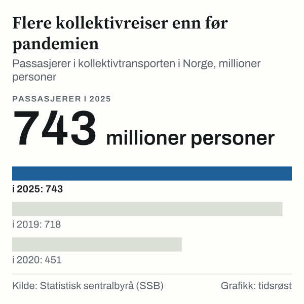
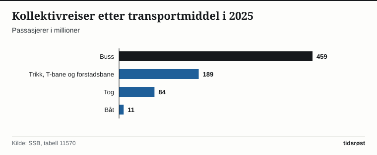

Kollektivtransporten i Norge nådde 743 millioner passasjerer i 2025 – fordelt på buss, T-bane, bybane, trikk, tog og båt. Det er 1,9 prosent flere enn i 2024 og det høyeste nivået i Statistisk sentralbyrås (SSB) statistikk for perioden 2015–2025. Merk at SSB teller hver påstigning for seg, så én reise med bytte mellom to linjer gir to passasjerer i statistikken.

*Passasjerer i kollektivtransporten i Norge, alle transportmidler. Kilde: SSB, tabell 11570.*

## 718 millioner før pandemien

I 2019 var tallet 718 millioner passasjerer. Under pandemiåret 2020 falt det til 451 millioner, og i 2021 var det 471 millioner. Siden har kollektivtrafikken hentet seg inn: 626 millioner i 2022, 713 millioner i 2023, 729 millioner i 2024 og 743 millioner i 2025.

## 61,8 prosent med buss

Bussen er det største kollektivmiddelet med 459 millioner passasjerer i 2025, tilsvarende 61,8 prosent. Deretter følger sporvei og forstadsbane (T-bane, bybane og trikk) med 189 millioner, jernbanen med 84 millioner og båt med 11 millioner.

*Andel av passasjerene i 2025. T-bane og trikk omfatter SSBs gruppe sporvei og forstadsbane, også bybane. Båt omfatter ikke Hurtigruten og bilferger. Kilde: SSB, tabell 11570.*

## 17 millioner flere bussreiser

Fra 2024 til 2025 fikk bussen 17,1 millioner flere passasjerer, en økning på 3,9 prosent. Jernbanen økte med 2,7 prosent og båt med 5,3 prosent, mens sporvei og forstadsbane gikk ned med 3,2 prosent, eller 6,2 millioner passasjerer.

*Passasjerer i 2025 og endring fra 2024, millioner. Kilde: SSB, tabell 11570.*

| Transportmiddel | Passasjerer 2023 (mill.) | Passasjerer 2025 (mill.) | Andel 2025 |
|---|---:|---:|---:|
| Buss | 439,4 | 459,1 | 61,8 % |
| Sporvei og forstadsbane | 184,7 | 188,5 | 25,4 % |
| Jernbane (tog) | 78,2 | 84,1 | 11,3 % |
| Passasjerbåt | 10,7 | 11,1 | 1,5 % |
| **Kollektivtransport i alt** | **713,0** | **742,9** | **100,0 %** |

*Kilde: SSB, tabell 11570.*

## 17,5 milliarder kroner i billettinntekter

Billettinntektene i kollektivtransporten var 17,5 milliarder kroner i 2025, 3,0 prosent mer enn i 2024 og 14,3 prosent mer enn i 2019. Beløpene er i løpende kroner.

## 1,1 prosent færre i første halvår 2026

Utviklingen i 2026 er så langt litt svakere. SSB har registrert 377,8 millioner passasjerer i første halvår, mot 382,0 millioner i første halvår 2025, en nedgang på 1,1 prosent.

## Hva tallene ikke viser

Statistikken teller påstigninger, ikke personer. Én person som pendler med buss og tog hver dag, gir mange passasjerer i løpet av et år. Tallene sier derfor ikke hvor mange som bruker kollektivtransport.

## Kilder

- [SSB: Kollektivtrafikk – faktaside](https://www.ssb.no/transport-og-reiseliv/faktaside/kollektivtrafikk)
- [SSB Statistikkbanken: Tabell 11570 – Kollektivtransport, billettinntekter og passasjerer](https://www.ssb.no/statbank/table/11570)
- [SSB Statistikkbanken: Tabell 11347 – Kollektivtransport, kvartalstall](https://www.ssb.no/statbank/table/11347)
