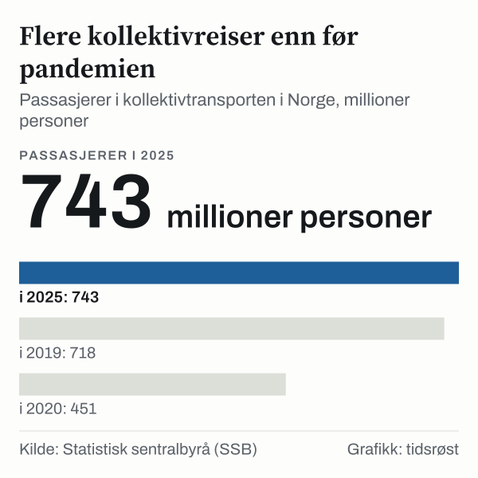
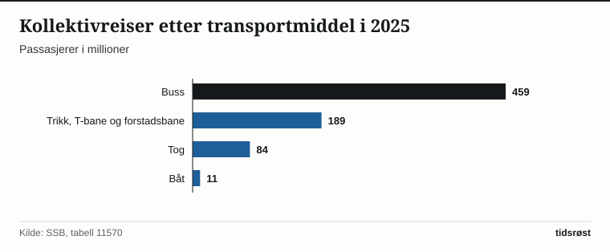

Norske passasjerer foretok 743 millioner reiser med buss, T-bane, bybane, trikk, tog og båt i 2025, viser kollektivtransportstatistikken fra Statistisk sentralbyrå (SSB). Det er 1,9 prosent flere enn i 2024 og det høyeste passasjertallet i SSBs tabell for årene 2015–2025. SSB teller hver påstigning for seg, slik at en reise med bytte mellom transportmidler gir flere passasjerer.

Utviklingen i 2026 er så langt litt svakere: SSB har registrert 377,8 millioner passasjerer i første halvår, mot 382,0 millioner i første halvår 2025, en nedgang på 1,1 prosent.

## Passasjertallet har vokst etter pandemien

Etter at tallet var nede i 451 millioner passasjerer under pandemiåret 2020, har kollektivtrafikken hentet seg inn. I 2019 var tallet 718 millioner. I 2024 endte det på 729 millioner, og det økte videre til 743 millioner i 2025.

Bussen er det største kollektivmiddelet med 459 millioner passasjerer i 2025, tilsvarende 61,8 prosent. Deretter følger trikk, T-bane og forstadsbane med 189 millioner, mens jernbanen hadde 84 millioner passasjerer.

*Samlet antall passasjerer i kollektivtransporten i Norge (millioner), 2020–2025. Kilde: SSB, tabell 11570.*

## Slik fordeler passasjerene seg mellom transportmidlene

Tabellen viser passasjerer fordelt på de fire transportmåtene i SSBs statistikk:

| Transportmiddel | Passasjerer 2023 (mill.) | Passasjerer 2025 (mill.) | Andel 2025 |
|---|---:|---:|---:|
| Buss | 439,4 | 459,1 | 61,8 % |
| Trikk, T-bane og forstadsbane | 184,7 | 188,5 | 25,4 % |
| Jernbane (tog) | 78,2 | 84,1 | 11,3 % |
| Passasjerbåt | 10,7 | 11,1 | 1,5 % |
| **Kollektivtransport i alt** | **713,0** | **742,9** | **100,0 %** |

*Kilde: SSB, tabell 11570. Båt omfatter ikke Hurtigruten og bilferger.*

Fra 2024 til 2025 økte bussen med 3,9 prosent, jernbanen med 2,7 prosent og båt med 5,3 prosent, mens trikk, T-bane og forstadsbane gikk ned med 3,2 prosent.

*Antall passasjerer etter transportmiddel i 2025 (millioner). Kilde: SSB, tabell 11570.*

## Kilder

- [SSB: Kollektivtrafikk – faktaside](https://www.ssb.no/transport-og-reiseliv/faktaside/kollektivtrafikk)
- [SSB Statistikkbanken: Tabell 11570 – Kollektivtransport, billettinntekter og passasjerer](https://www.ssb.no/statbank/table/11570)
- [SSB Statistikkbanken: Tabell 11347 – Kollektivtransport, kvartalstall](https://www.ssb.no/statbank/table/11347)
