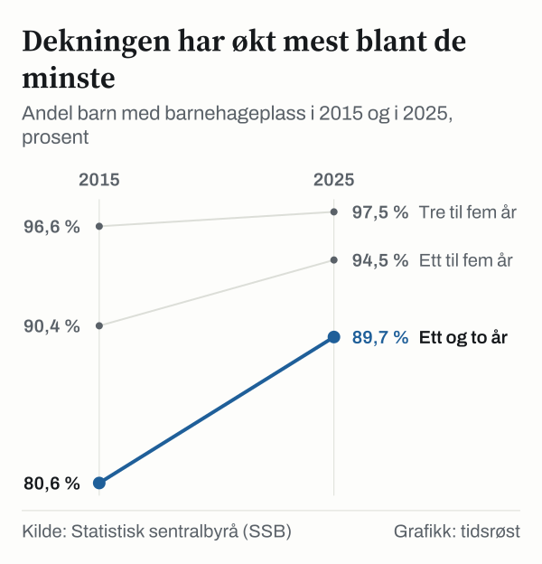

Fra 1. august 2025 er den nasjonale maksprisen for en heltidsplass i barnehage 1 200 kroner i måneden, ifølge Utdanningsdirektoratet. I kommuner i sentralitetssone 5 og 6 er maksprisen 700 kroner, og i tiltakssonen i Finnmark og Nord-Troms er barnehagen gratis. I januar 2022 var maksprisen 3 315 kroner. For en familie med ett barn i barnehage er det 2 115 kroner mindre i måneden, eller 23 265 kroner i året for elleve betalingsmåneder. Samtidig gikk 94,5 prosent av alle barn mellom ett og fem år i barnehage i 2025, viser tall fra Statistisk sentralbyrå (SSB).

## Slik er maksprisen endret

Fra 2013 til januar 2022 steg maksprisen hvert år i kroner, fra 2 330 til 3 315 kroner i måneden. Deretter er den satt ned i flere trinn: til 3 050 kroner fra 1. august 2022, til 3 000 kroner fra januar 2023, til 2 000 kroner fra 1. august 2024 og til 1 200 kroner fra 1. august 2025. Ved nedsettelsen i august 2024 ble maksprisen i sentralitetssone 5 og 6 satt til 1 500 kroner, og fra august 2025 til 700 kroner.

*Nasjonal makspris for heltidsplass i barnehage per måned, nominelle kroner, januar 2013–august 2025. Kilde: Kunnskapsdepartementet og Utdanningsdirektoratet.*

## Hva en plass koster nå

| Ordning / geografisk område | Månedlig makspris | Årlig kostnad (11 mnd.) |
|---|---:|---:|
| Nasjonal makspris (ordinær sats) | 1 200 kr | 13 200 kr |
| Barn nummer to (30 % søskenmoderasjon) | 840 kr | 9 240 kr |
| Sentralitetssone 5 og 6 | 700 kr | 7 700 kr |
| Tiltakssonen i Finnmark og Nord-Troms | 0 kr (gratis) | 0 kr |
| Barn nummer tre eller flere | 0 kr (gratis) | 0 kr |

*Kilde: Utdanningsdirektoratet og Kunnskapsdepartementet. Søskenmoderasjonen er minst 30 prosent; tabellen viser 30 prosent.*

Har familien flere barn i barnehage i samme kommune, gis det søskenmoderasjon på minst 30 prosent for barn nummer to, og plassen er gratis for det tredje barnet og eventuelt flere barn. Ifølge Utdanningsdirektoratet skal ingen betale mer enn 6 prosent av husholdningens inntekt per barn. Alle to-, tre-, fire- og femåringer i husholdninger med lav inntekt har rett til 20 timer gratis kjernetid i uken. Inntektsgrensen er 669 050 kroner fra 1. august 2025.

## Hvem som går i barnehage

I 2025 hadde 264 210 barn barnehageplass i Norge, 1 804 færre enn i 2024. Andelen av alle barn mellom ett og fem år var likevel høyere enn før, 94,5 prosent. Blant barn i alderen tre til fem år var deltakelsen 97,5 prosent, mens 89,7 prosent av ett- og toåringene hadde plass.

Den største økningen har kommet blant de minste. I 2015 hadde 80,6 prosent av ett- og toåringene barnehageplass, mot 96,6 prosent av tre- til femåringene.

*Andel barn med barnehageplass i forhold til alle innbyggere i samme aldersgruppe, hele landet. Kilde: SSB, tabell 13502.*

På landsbasis er det i gjennomsnitt 5,7 barn per årsverk i grunnbemanningen, et tall som har vært uendret siden 2019. Barnehagelærere utgjør 41,2 prosent av grunnbemanningen, ifølge SSBs tall for 2025.

## Hva som skjer i 2027

I forslaget til statsbudsjett for 2027 foreslår regjeringen å fryse maksprisen på 1 200 kroner i måneden og 700 kroner i sentralitetssone 5 og 6. Forslaget skal behandles i Stortinget.

## Hva tallene ikke viser

Maksprisen er det høyeste en barnehage kan ta for en heltidsplass. Beløpene er i nominelle kroner og er ikke justert for prisvekst. Dekningsgraden viser hvor mange barn som har plass i forhold til alle barn i samme alder, ikke hvor mange som har søkt og ikke fått plass.

## Kilder

- [SSB: Barnehager – faktaside](https://www.ssb.no/utdanning/faktaside/barnehager)
- [SSB Statistikkbanken: Tabell 13502 – Utvalgte nøkkeltall for barnehager](https://www.ssb.no/statbank/table/13502)
- [SSB Statistikkbanken: Tabell 09169 – Barn i barnehager](https://www.ssb.no/statbank/table/09169)
- [Utdanningsdirektoratet: Foreldrebetaling og moderasjonsordninger i barnehage](https://www.udir.no/regelverk-og-tilsyn/barnehage/foreldrebetaling/)
- [Regjeringen: Statsbudsjettet 2024 – Historisk billig barnehage (tabell over maksprisen siden 2013)](https://www.regjeringen.no/no/aktuelt/historisk-billig-barnehage/id2997094/)
- [Regjeringen: Statsbudsjettet 2027 – Regjeringa vidarefører den historiske låge maksprisen i barnehage](https://www.regjeringen.no/no/aktuelt/regjeringa-vidareforer-den-historiske-lage-maksprisen-i-barnehage/id3174270/)
