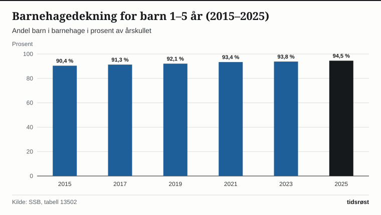
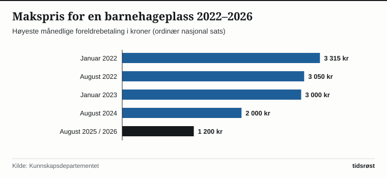

I 2025 gikk 94,5 prosent av alle barn mellom ett og fem år i barnehage i Norge, viser offisiell statistikk fra Statistisk sentralbyrå (SSB). Totalt hadde 264 210 barn barnehageplass. Blant barn i alderen tre til fem år er deltakelsen 97,5 prosent, mens 89,7 prosent av ett- og toåringene har plass.

Den høye deltakelsen henger sammen med den lovfestede retten til barnehageplass og de store kuttene i foreldrebetalingen de siste årene.

## Maksprisen kuttet fra 3 315 til 1 200 kroner i måneden

I 2022 var den nasjonale maksprisen for en heltidsplass i barnehage 3 315 kroner i måneden (36 465 kroner i året for elleve betalingsmåneder). Gjennom flere trinn i statsbudsjettene har regjeringen og Stortinget redusert foreldrebetalingen: først til 3 000 kroner fra januar 2023, videre til 2 000 kroner fra august 2024, og deretter ned til 1 200 kroner i måneden fra august 2025.

For en familie med ett barn i barnehage tilsvarer nedgangen fra 2022-nivået en besparelse på over 23 000 kroner i året i løpende kroner (2 115 kroner i måneden i elleve måneder). Har familien flere barn i barnehage samtidig, gis det søskenmoderasjon på minst 30 prosent for barn nummer to, og barn nummer tre og flere får gratis plass.

*Andel barn 1–5 år med barnehageplass i Norge, utvalgte år 2015–2025. Kilde: SSB, tabell 13502.*

## Ekstra lettelser i distriktene og for familier med lav inntekt

I tillegg til den nasjonale maksprisen på 1 200 kroner gjelder målrettede ordninger som gjør barnehagen enda rimeligere eller helt gratis:

| Ordning / geografisk område | Månedlig makspris | Årlig kostnad (11 mnd.) |
|---|---:|---:|
| Nasjonal makspris (ordinær sats) | 1 200 kr | 13 200 kr |
| Barn nummer to (30 % søskenmoderasjon) | 840 kr | 9 240 kr |
| Sentralitetssone 5 og 6 | 700 kr | 7 700 kr |
| Tiltakssonen i Finnmark og Nord-Troms | 0 kr (gratis) | 0 kr |
| Barn nummer tre eller flere | 0 kr (gratis) | 0 kr |

*Kilde: Utdanningsdirektoratet og Kunnskapsdepartementet. Søskenmoderasjonen er minst 30 prosent; tabellen viser 30 prosent.*

I tillegg skal ingen husholdning betale mer enn 6 prosent av samlet inntekt for en barnehageplass, og husholdninger under en fastsatt inntektsgrense har rett til 20 timer gratis kjernetid per uke for barn i alderen to til fem år.

*Makspris for heltidsplass i barnehage per måned (nasjonal sats), utvalgte tidspunkt 2022–2026. Kilde: Kunnskapsdepartementet og Utdanningsdirektoratet.*

## Bemanning og barnehagelærere

På landsbasis er det i gjennomsnitt 5,7 barn per årsverk i grunnbemanningen, et tall som har vært uendret siden 2019. Barnehagelærere utgjør 41,2 prosent av grunnbemanningen, ifølge SSBs tall for 2025.

## Kilder

- [SSB: Barnehager – faktaside](https://www.ssb.no/utdanning/faktaside/barnehager)
- [SSB Statistikkbanken: Tabell 13502 – Utvalgte nøkkeltall for barnehager](https://www.ssb.no/statbank/table/13502)
- [Utdanningsdirektoratet: Foreldrebetaling og moderasjonsordninger i barnehage](https://www.udir.no/regelverk-og-tilsyn/barnehage/foreldrebetaling/)
- [Regjeringen: Maksprisen i barnehage videreføres på historisk lavt nivå](https://www.regjeringen.no/no/aktuelt/regjeringa-vidareforer-den-historiske-lage-maksprisen-i-barnehage/id3174270/)
