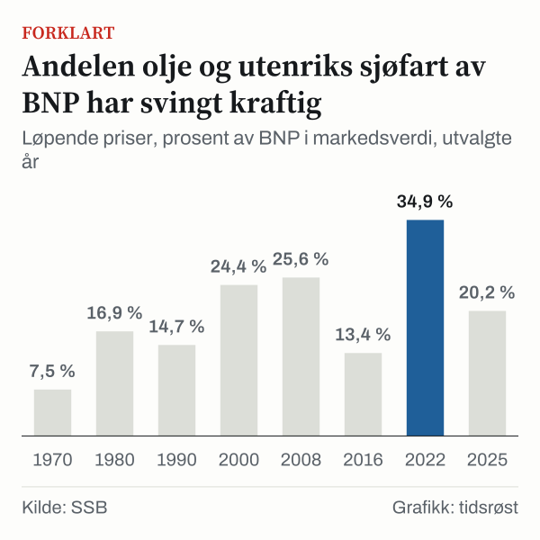

BNP for Fastlands-Norge er verdiskapingen i Norge uten olje- og gassutvinning, rørtransport og utenriks sjøfart. I 2025 sto Fastlands-Norge for 79,8 prosent av bruttonasjonalproduktet (BNP) målt i løpende priser. Olje og utenriks sjøfart sto for 20,2 prosent. Den andelen var 7,5 prosent i 1970 og 34,9 prosent i 2022.

## Hva måler BNP for Fastlands-Norge?

Statistisk sentralbyrå (SSB) definerer begrepet slik: «Med BNP i Fastlands-Norge menes bruttoproduktet for all innenlandsk produksjonsaktivitet utenom næringene utvinning av råolje og naturgass, rørtransport og utenriks sjøfart.» SSB skriver også at innholdet i begrepet ble endret ved hovedrevisjonen av nasjonalregnskapet i 2014.

Samlet BNP tar med alle næringer. Ifølge SSB er BNP i markedsverdi «summen av bruttoproduktet over alle næringer målt i basisverdi», tillagt produktskatter og fratrukket produktsubsidier.

Samlet BNP var 5 511,3 milliarder kroner i løpende priser i 2025. BNP for Fastlands-Norge var 4 397,7 milliarder kroner, og olje og utenriks sjøfart utgjorde 1 113,6 milliarder kroner.

## Hvorfor har Norge to BNP-mål?

SSB forklarer det slik: «At vi har to BNP-mål, skyldes at verdien av olje- og gassvirksomheten betyr mye for norsk økonomi og for tolkningen av BNP-tallene.»

Tallene viser hvor mye denne delen kan bevege seg. Fra 2021 til 2022 økte verdien av olje og utenriks sjøfart i løpende priser med 102,5 prosent, til 2 070,2 milliarder kroner. BNP for Fastlands-Norge økte med 11,8 prosent i samme periode. I 2022 utgjorde Fastlands-Norge dermed 65,1 prosent av samlet BNP.

Tidsrøst har også forklart [hvordan oljepengene brukes i statsbudsjettet](/artikkel/statsbudsjettet-2027-slik-brukes-oljepengene/) og [hvordan verdien av oljefondet har utviklet seg](/artikkel/oljefondet-slik-har-verdien-utviklet-seg/). Skillet mellom olje og fastland går også igjen i [statistikken over fastlandseksporten](/artikkel/sjomateksporten-laks-er-norges-storste-fastlandseksport/).

## Slik har oljeandelen svingt siden 1970

I 1970 sto olje og utenriks sjøfart for 7,5 prosent av BNP i løpende priser. I 1980 var andelen 16,9 prosent, og i 2000 var den 24,4 prosent.

*Løpende priser, prosent av BNP i markedsverdi, utvalgte år. Kilde: SSB.*

Svingningene har til tider vært store. Andelen var 19,6 prosent i 2014 og 13,4 prosent i 2016, et fall på 6,2 prosentpoeng. I 2020 var den 11,2 prosent, i 2021 var den 22,8 prosent, og i 2022 nådde den 34,9 prosent. Fra 2022 til 2025 falt andelen med 14,7 prosentpoeng, til 20,2 prosent.

| År | Olje og utenriks sjøfart, andel av BNP |
|---|---|
| 1970 | 7,5 % |
| 1980 | 16,9 % |
| 1990 | 14,7 % |
| 2000 | 24,4 % |
| 2008 | 25,6 % |
| 2014 | 19,6 % |
| 2016 | 13,4 % |
| 2020 | 11,2 % |
| 2022 | 34,9 % |
| 2025 | 20,2 % |

*Løpende priser, prosent av BNP i markedsverdi. Kilde: SSB.*

## Når går de to målene i hver sin retning?

Veksten måles i volum, altså uten prisendringer. I 1989 var volumendringen 1,0 prosent i samlet BNP og minus 1,5 prosent i BNP for Fastlands-Norge. Olje og utenriks sjøfart vokste med 27,7 prosent i 1989.

Fra 2005 til 2007 gikk det motsatt vei, og olje og utenriks sjøfart krympet. Volumendringen var minus 4,6 prosent i 2005, minus 5,5 prosent i 2006 og minus 5,3 prosent i 2007.

De samme årene vokste BNP for Fastlands-Norge med 5,0 prosent i 2005, 5,5 prosent i 2006 og 6,4 prosent i 2007. Samlet BNP vokste med 3,0 prosent i 2005, 2,8 prosent i 2006 og 3,4 prosent i 2007. Forskjellen mellom målene var 3,0 prosentpoeng i 2007.

*Årlig volumendring, prosent. Kilde: SSB.*

Volumendringen i olje og utenriks sjøfart var minus 4,5 prosent i 2018 og minus 4,2 prosent i 2019. Samlet BNP vokste med 1,1 prosent i 2018 og med 1,5 prosent i 2019, mens Fastlands-Norge vokste med 2,1 prosent i 2018 og med 2,7 prosent i 2019. Begge målene falt i 2020: volumendringen var minus 1,4 prosent i samlet BNP og minus 2,7 prosent i Fastlands-Norge, mens olje og utenriks sjøfart vokste med 6,7 prosent.

Olje og utenriks sjøfart vokste med 3,9 prosent i 2024. Samlet BNP vokste med 1,4 prosent i 2024 og Fastlands-Norge med 0,6 prosent i 2024. I 2025 var volumendringen i olje og utenriks sjøfart minus 1,0 prosent, og samlet BNP vokste med 1,1 prosent mot 1,7 prosent for Fastlands-Norge.

## Løpende priser eller faste priser?

Andelen olje og utenriks sjøfart blir en annen når prisendringene holdes utenfor. Om faste priser skriver SSB at seriene lages ved å «kjede sammen verdien i referanseåret med de årlige volumendringstallene». Volumendring er ifølge SSB «endringen av fastpristallet fra ett år til et annet».

| År | Løpende priser | Faste priser |
|---|---|---|
| 2008 | 25,6 % | 31,3 % |
| 2022 | 34,9 % | 24,4 % |
| 2025 | 20,2 % | 24,3 % |

*Olje og utenriks sjøfart, prosent av BNP i markedsverdi. Kilde: SSB.*

I løpende priser var andelen 34,9 prosent i 2022, mot 24,4 prosent i faste priser. Verdien av olje og utenriks sjøfart økte med 102,5 prosent fra 2021 til 2022, mens volumet økte med 0,2 prosent i 2022. Tabellene viser ikke hva prisendringene skyldes.

Faste priser har også en ulempe. SSB skriver at kjedingen gjør at man «ikke oppnår additivitet i tabellene». I 2008 var summen av Fastlands-Norge og olje og utenriks sjøfart i faste priser 4 330,4 milliarder kroner, mens samlet BNP var 4 239,5 milliarder kroner.

Denne artikkelen bruker utvalgte år fra 1970 til 2025, ikke hele serien, og volumtall i 1989, i 2005–2007 og i 2014–2025.

## Kilder

- [SSB: Bruttonasjonalprodukt for Norge og Fastlands-Norge](https://www.ssb.no/statbank/table/09189/)
- [SSB: Begreper i nasjonalregnskapet](https://www.ssb.no/nasjonalregnskap-og-konjunkturer/begreper-i-nasjonalregnskapet)
- [SSB-skole: Nasjonalregnskapet gir tall for tilstanden og utviklingen i norsk økonomi](https://www.ssb.no/ssb-skole/undervisningsopplegg/realligningen-inflasjon-bnp-og-norges-handel-med-utlandet/nasjonalregnskapet-gir-tall-for-tilstanden-og-utviklingen-i-norsk-okonomi)
