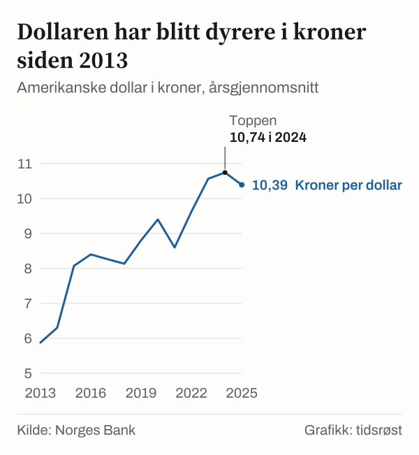
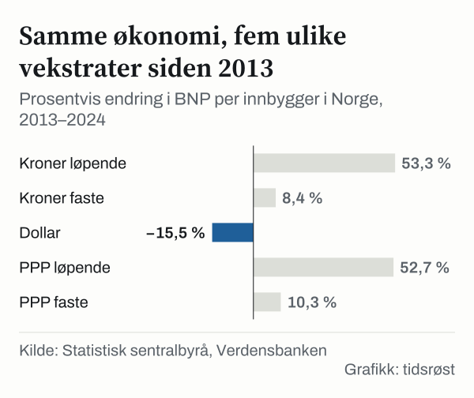

Den som veksler kroner til dollar før en utenlandsreise, får færre dollar for hver krone i 2025 enn i 2013. Norges Bank har tallene: I 2013 var gjennomsnittskursen 5,88 kroner per dollar. I 2024 var den 10,74 kroner, og i 2025 var den 10,39 kroner.

Den samme bevegelsen påvirker hvordan Norge ser ut i internasjonale sammenlikninger. I 2024 var BNP per innbygger 932 583 kroner i Statistisk sentralbyrås (SSB) nasjonalregnskap. Verdensbanken oppgir den samme størrelsen som 89 889 dollar. Når tallet justeres for prisnivået mellom land, blir det 105 657 internasjonale dollar. Det er tre tall for én økonomi, og de gir ulike svar på to spørsmål: har Norge blitt rikere eller ikke, og hvor står landet blant andre?

Svaret avhenger av målet. Siden 2013 har BNP per innbygger økt med 53,3 prosent i kroner, men falt med 15,5 prosent i dollar. Her undersøker vi hva som ligger bak forskjellen, og hva hvert av målene egner seg til.

## Tre mål, tre spørsmål

BNP per innbygger er verdiskapingen i et land i løpet av et år, delt på folketallet. Tallet sier noe om hvor mye som produseres per innbygger. Det sier ikke noe om hvordan verdiene fordeles, eller hva husholdningene til slutt disponerer.

Det første målet er kroner i løpende priser, slik SSB beregner det. Det svarer på hvor mye som produseres per innbygger i landets egen valuta, uten at prisendringer er tatt ut. Det andre målet er dollar. Verdensbanken oppgir BNP per innbygger omregnet til amerikanske dollar. Det svarer på hva produksjonen er verdt i dollar på verdensmarkedet. Det tredje målet er PPP-justert dollar. PPP står for «purchasing power parity», en omregning mellom valutaer som tar hensyn til prisnivået. Her bruker Verdensbanken ikke valutakursen, men en omregningsfaktor som tar ut forskjeller i prisnivå mellom land. Det svarer på hvor mye varer og tjenester produksjonen tilsvarer lokalt.

Verdensbankens hovedserier for dollar og PPP er ifølge bankens egne indikatornotater «expressed in current prices». Det betyr at prisstigning ligger inne i tallene.

I kroner var BNP per innbygger 608 314 i 2013 og 932 583 i 2024. I faste priser var tallet 592 781 i 2013 og 642 453 i 2024. Forskjellen mellom de to seriene er prisstigningen i perioden.

Tre spørsmål hører derfor til hvert BNP-tall: hvilken valuta det er oppgitt i, om prisendringer er tatt ut, og hvilke år og land det sammenliknes med.

## Dollaren ble dyrere i kroner

Første spørsmål er hvorfor kroner og dollar peker i hver sin retning. Svaret ligger i valutakursen. Dollartallet følger kronetallet og kursen. I perioden 2013–2024 økte BNP per innbygger i kroner med 53,3 prosent. Kursen, målt som kroner per dollar, økte med 82,8 prosent. Når telleren stiger mindre enn nevneren, faller brøken. Verdensbankens dollartall for Norge falt med 15,5 prosent i perioden 2013–2024. Dollartallet er likevel ikke nøyaktig kronetallet delt på kursen. Deler vi SSBs kronetall for året 2024 på årsgjennomsnittet for kursen, blir dollartallet noe lavere enn Verdensbankens. Vi har ikke funnet en kilde som forklarer forskjellen, så de to tallene er ikke regnet ut fra samme grunnlag.

*Amerikanske dollar i kroner, årsgjennomsnitt. Kilde: Norges Bank.*

Kursen har ikke steget jevnt. Fra 5,88 kroner i 2013 gikk den til 8,07 kroner i 2015, og den nådde 10,74 kroner i 2024. I 2025 var den litt lavere, 10,39 kroner. Det gir et lite utslag i dollartallet. Regnet med året 2025 som sluttår har BNP per innbygger i dollar falt med 11,0 prosent siden 2013. Med året 2024 som sluttår er fallet 15,5 prosent.

Hvorfor kursen har endret seg, viser ikke tallene, og vi kommenterer det ikke.

## Fjerde eller andre plass

Neste spørsmål er hva de tre målene gjør med plasseringen. For å se det har vi satt Norge ved siden av ti andre land: de nordiske, store naboland, USA, Sveits, Nederland og Luxembourg. Landene er satt sammen av oss.

I dollar var BNP per innbygger høyest i Luxembourg i 2025, med 147 252 dollar, fulgt av Sveits med 114 769 og Island med 98 323. Norge kommer på fjerde plass med 94 594 dollar, foran USA med 90 027.

*BNP per innbygger, løpende priser, dollar, målt i 2025, bare de elleve landene i sammenlikningen. Kilde: Verdensbanken.*

Med PPP-justerte dollar endrer rekkefølgen seg. Luxembourg er fortsatt først med 156 542 internasjonale dollar. Så kommer Norge med 104 044, foran Sveits med 102 513. Island, som lå på tredjeplass i dollar, har 83 431 og havner bak både USA og Nederland. Sveits går motsatt vei, fra andreplass i dollar til tredjeplass med PPP-justerte dollar. For USA er de to tallene like, siden dollar er referansen.

*BNP per innbygger i 2025, dollar og PPP-justerte internasjonale dollar. Kilde: Verdensbanken.*

Hva er det som flytter landene? Forholdet mellom PPP-tallet og dollartallet viser det. Et PPP-tall som er høyere enn dollartallet betyr at prisnivået i landet, regnet med årets valutakurs, er lavere enn i USA. Et lavere PPP-tall betyr at prisnivået er høyere. I 2025 er PPP-tallet 1,10 ganger dollartallet for Norge. For Sveits er forholdet 0,89 ganger, og for Island 0,85 ganger. For USA er det 1,00 ganger, siden dollar er referansen. Dermed trekkes Sveits og Island ned, mens Norge trekkes opp.

For Norge er forskjellen 9 449 dollar per innbygger i 2025. Hvilket mål som er riktig, avhenger av hva man vil vite. Dollartallet sier hva produksjonen er verdt målt i dollar. PPP-tallet sier hva den dekker av varer og tjenester lokalt.

## Fem vekstrater for samme økonomi

Utviklingen siden 2013 viser den samme typen forskjell. I perioden 2013–2024 økte BNP per innbygger i Norge med 53,3 prosent i kroner og 52,7 prosent i PPP-justerte dollar, begge i løpende priser. I dollar falt den med 15,5 prosent. I dollar var tallet 106 333 i 2013 og 89 889 i 2024, og i PPP-justerte dollar 69 186 i 2013 og 105 657 i 2024. Det er derfor mulig å fortelle to motsatte historier om samme tidsrom, og begge er riktige så lenge målet oppgis.

Tallene for kroner, dollar og PPP er alle i løpende priser, og prisstigning ligger derfor inne i dem. Når prisene tas ut, er bildet et annet. SSBs tall i faste priser viser en økning på 8,4 prosent. Verdensbankens PPP-tall i faste priser viser 10,3 prosent. Forskjellen mellom dem er 1,9 prosentpoeng. Den kommer av ulike prisbaser og ulike beregninger, og vi har ikke gått nærmere inn på detaljene.

*Prosentvis endring i BNP per innbygger i Norge, 2013–2024. Kilde: Statistisk sentralbyrå, Verdensbanken.*

Med prisene tatt ut er BNP per innbygger 8,4 til 10,3 prosent høyere i 2024 enn i 2013, avhengig av kilde. Det er langt mindre enn de 53,3 prosent i løpende kroner.

For å se hvordan dollarbildet endrer sammenlikningen med andre land, har vi tatt med åtte av landene. I 2013 lå Norge på andreplass av de åtte, bak Luxembourg og foran Sveits. I 2025 ligger Norge på fjerdeplass.

*BNP per innbygger, løpende priser, dollar. Kilde: Verdensbanken.*

Norge er det eneste av de åtte landene som har et lavere dollartall i 2025 enn i 2013. Luxembourg, Sveits, Island, USA, Danmark, Sverige og Tyskland ligger alle høyere. Regnet i dollar økte BNP per innbygger i perioden 2013–2025 med 22,7 prosent i Luxembourg, 29,2 prosent i Sveits, 96,0 prosent på Island, 68,9 prosent i USA, 25,4 prosent i Danmark, 3,8 prosent i Sverige og 28,2 prosent i Tyskland. Norge ligger på minus 11,0 prosent. Spredningen er stor, fra 3,8 prosent i Sverige til 96,0 prosent på Island. 

## En annen måte å lese tallene på

Kronetallet er ikke uten forbehold. BNP regnes ut fra produksjonen i Norge, inkludert olje- og gassvirksomheten. Bruttonasjonalinntekten (BNI) tar også med inntekter fra og til utlandet. I 2024 var BNI per innbygger 975 393 kroner, mot 932 583 kroner for BNP. Forskjellen er 42 810 kroner per innbygger. Hvilket av de to som passer, avhenger av om spørsmålet gjelder produksjonen i landet eller inntektene til landets innbyggere.

Bruttonasjonalinntekten økte med 58,7 prosent i perioden 2013–2024, mot 53,3 prosent for BNP. De to målene beveger seg altså ikke helt likt.

## Det tallene ikke måler

Flere forhold begrenser hva tallene kan brukes til. Om PPP-serien skriver Verdensbanken at den er koblet sammen til en tidsserie, og at den «may not be comparable with other national accounts series» for historiske år. PPP-tall er dessuten beregninger, ikke observasjoner, og kan revideres.

Hvilke år som brukes, påvirker svaret. SSBs tabell med BNP per innbygger går til året 2024, mens Verdensbanken har tall for året 2025. Vi har brukt året 2024 som sluttår for vekstratene slik at målene dekker samme periode, og året 2025 for plasseringen. Hadde vi brukt året 2025 som sluttår i dollar, hadde fallet vært 11,0 prosent og ikke 15,5 prosent. Å starte i 2013 er også en avgjørelse.

Landene i sammenlikningen er satt sammen av oss. Rangeringen gjelder bare blant de elleve landene, og i en bredere gruppe ville plasseringene sett annerledes ut. BNP per innbygger sier dessuten ingenting om forskjeller mellom regioner eller grupper innenfor landet. Til slutt har SSB og Verdensbanken ikke nødvendigvis samme folketall, så kronetallet og dollartallet er ikke regnet ut fra samme grunnlag.

## Slik regnet vi

Kronetallene er hentet fra SSBs nasjonalregnskap: BNP, BNI og BNP i faste priser, alle per innbygger, i 2013 og i 2024. Dollartallene og de PPP-justerte tallene i 2013, i 2024 og i 2025 er fra Verdensbankens World Development Indicators, sist oppdatert 8. oktober 2026. Kursene er årsgjennomsnitt fra Norges Bank.

Vekstratene er prosentvis endring mellom de to årene. Forholdet mellom PPP-tallet og dollartallet er PPP-tallet delt på dollartallet. Plasseringene følger av å sortere verdiene i 2025. Alle tall er hentet slik kildene publiserer dem. Vi har ikke gjort egne anslag.

## Kilder

- [SSB: Nasjonalregnskap, BNP og andre hovedstørrelser per innbygger](https://www.ssb.no/nasjonalregnskap-og-konjunkturer/nasjonalregnskap/statistikk/nasjonalregnskap)
- [Verdensbanken: BNP per innbygger, løpende dollar](https://data.worldbank.org/indicator/NY.GDP.PCAP.CD)
- [Verdensbanken: BNP per innbygger, PPP, løpende internasjonale dollar](https://data.worldbank.org/indicator/NY.GDP.PCAP.PP.CD)
- [Verdensbanken: BNP per innbygger, PPP, faste internasjonale dollar](https://data.worldbank.org/indicator/NY.GDP.PCAP.PP.KD)
- [Norges Bank: Valutakurser](https://www.norges-bank.no/en/topics/Statistics/exchange_rates/)
