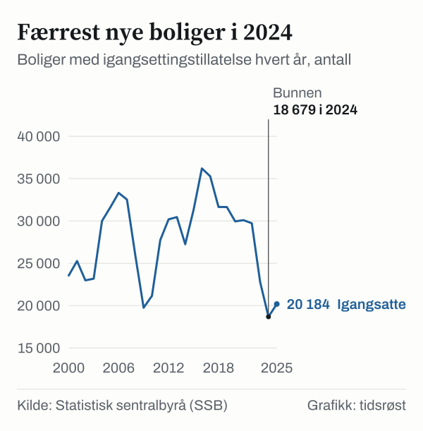
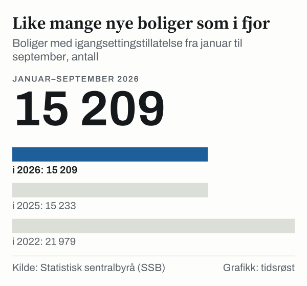

I løpet av 2025 ble det gitt igangsettingstillatelse til 20 184 nye boliger i Norge, viser tall fra Statistisk sentralbyrå (SSB). Det er en oppgang fra 18 679 boliger i 2024, men under årsgjennomsnittet på rundt 27 800 boliger for perioden 2000–2025. De ni første månedene av 2026 ble det registrert 15 209 igangsatte boliger.

## Utviklingen siden 2012

Mellom 2012 og 2022 lå antallet igangsatte boliger stabilt over 27 000 i året, med en topp på 36 203 boliger i 2016. I 2023 ble det gitt tillatelse til 22 778 boliger og i 2024 til 18 679, før tallet økte igjen til 20 184 boliger i 2025.

*Antall boliger med igangsettingstillatelse per år. De tre siste årene er uthevet. Kilde: SSB, tabell 05940.*

En igangsettingstillatelse innebærer at kommunen har godkjent oppstart av selve byggearbeidet. SSB gjør oppmerksom på at tallene er foreløpige, og at registreringstidspunktet i kommunene gjør at statistikken for en enkeltperiode ikke alltid sammenfaller helt med når byggearbeidet fysisk starter.

## De ni første månedene av 2026

Månedstallene fra SSB viser at det fra januar til og med september 2026 ble registrert 15 209 igangsatte boliger, omtrent likt med de 15 233 boligene i de samme ni månedene i 2025 (mot 21 979 i 2022).

I september isolert ble det registrert 2 421 igangsatte boliger. Ser man på de siste tolv månedene samlet – fra oktober 2025 til september 2026 – kom tallet opp i 20 319 boliger, en økning på 5,6 prosent sammenlignet med tolvmånedersperioden før.

*Sum igangsatte boliger januar–september, basert på månedstall. Tallene for 2026 er foreløpige. Kilde: SSB, tabell 03723.*

Summen av de løpende månedstallene kan avvike litt fra de endelige årstallene fordi etterregistreringer og oppdateringer i Matrikkelen legges inn fortløpende.

## Utviklingen i bruktboligmarkedet

SSBs prisindeks for brukte boliger lå på 158,3 i tredje kvartal 2026, opp fra 153,2 i tredje kvartal 2025 – en oppgang på 3,3 prosent på ett år. Indeksen har 2015 som referanseår (100), og årsgjennomsnittet på 152,5 for 2025 innebærer at bruktboligprisene i løpende kroner har økt med drøyt 50 prosent på ti år.

## Igangsatte og fullførte boliger

Tabellen viser igangsatte og fullførte boliger per år:

| År | Igangsatte boliger | Fullførte boliger |
|---|---|---|
| 2022 | 29 727 | 28 056 |
| 2023 | 22 778 | 27 975 |
| 2024 | 18 679 | 24 032 |
| 2025 | 20 184 | 19 498 |

*Kilde: SSB, tabell 05940.*

## Kilder

- [SSB: Byggeareal (statistikkside, publisert 12. oktober 2026)](https://www.ssb.no/bygg-bolig-og-eiendom/bygg-og-anlegg/statistikk/byggeareal)
- [SSB: Tabell 05940 – Boligbygg, etter år](https://www.ssb.no/statbank/table/05940)
- [SSB: Tabell 03723 – Boligbygg, etter måned](https://www.ssb.no/statbank/table/03723)
- [SSB: Tabell 07221 – Prisindeks for brukte boliger, etter kvartal](https://www.ssb.no/statbank/table/07221)
- [SSB: Tabell 07230 – Prisindeks for brukte boliger, etter år](https://www.ssb.no/statbank/table/07230)
