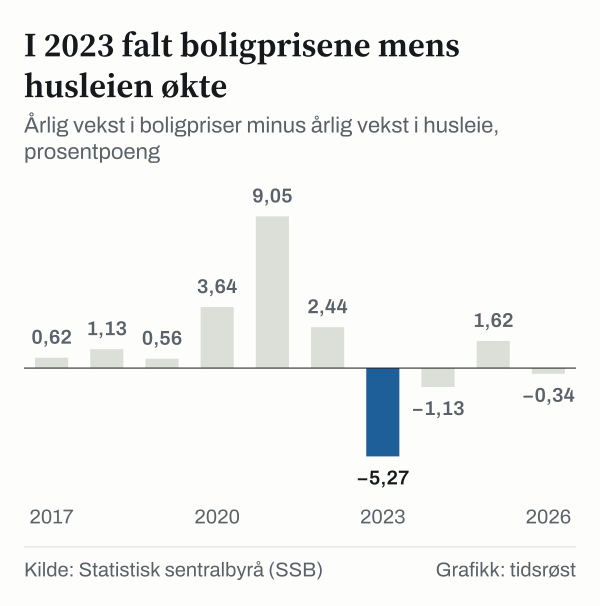
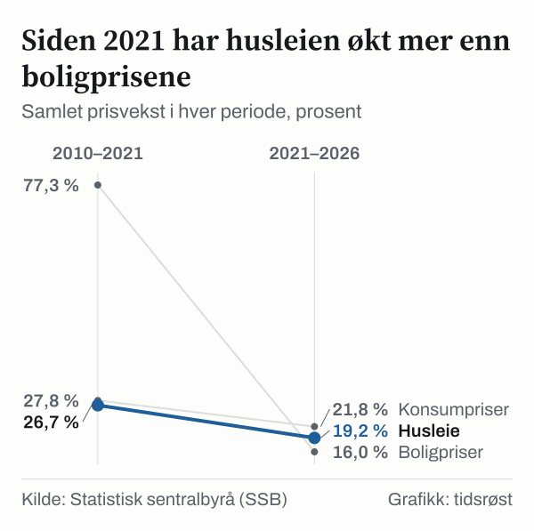
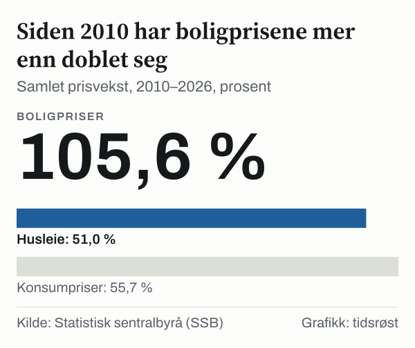

Fra 3. kvartal 2010 til 3. kvartal 2026 har prisene på brukte boliger steget 105,6 prosent. Husleien, slik Statistisk sentralbyrå (SSB) måler den i konsumprisindeksen, har i samme tid steget 51,0 prosent. Den første serien har mer enn doblet seg. Den andre har økt litt under halvparten så mye, og lavere enn konsumprisene totalt, som steg 55,7 prosent mellom september 2010 og september 2026.

Begge tallene handler om å bo. Likevel har de beveget seg i svært ulik takt, og forskjellen er ikke jevnt fordelt over årene. Vi har stilt de to seriene side om side for å finne ut når de skilte lag, hvor stor avstanden ble, og om den fortsatt vokser.

Tallene kommer fra to ulike deler av SSBs statistikk. Her ser vi dem ved siden av hverandre, og vi trekker ingen slutning om hva en leser bør gjøre. Det er ikke formålet.

![Linjediagram over Boligprisene steg mer enn husleien i de første elleve årene: Boligpriser: 100,0 i 2010, 108,3 i 2011, 116,0 i 2012, 119,6 i 2013, 123,8 i 2014, 131,3 i 2015, 141,7 i 2016, 145,2 i 2017, 149,5 i 2018, 153,0 i 2019, 160,5 i 2020, 177,3 i 2021, 185,8 i 2022, 183,5 i 2023, 189,5 i 2024, 199,0 i 2025, 205,6 i 2026; Husleie: 100,0 i 2010, 102,2 i 2011, 104,2 i 2012, 108,8 i 2013, 112,0 i 2014, 114,9 i 2015, 116,9 i 2016, 119,1 i 2017, 121,2 i 2018, 123,4 i 2019, 125,0 i 2020, 126,7 i 2021, 129,8 i 2022, 135,0 i 2023, 140,9 i 2024, 145,7 i 2025, 151,0 i 2026.](./graf-1.svg)
*Indeks, startåret = 100 for begge serier. Kilde: Statistisk sentralbyrå (SSB).*

## To indekser som måler ulike ting

Prisindeksen for brukte boliger følger prisen på brukte boliger. Husleieindeksen følger hva leierne betaler for boliger som er leid ut. Den første er prisen på en eiendel, den andre er prisen på å bruke en bolig over tid. At de ikke følger hverandre, er derfor ikke nødvendigvis en selvmotsigelse.

Husleieindeksen er også bygget på en annen måte enn boligprisindeksen. SSB opplyser at husleien i konsumprisindeksen bygger på en delundersøkelse med et fast utvalg på om lag 2 500 utleieboliger, hentet fra Leiemarkedsundersøkelsen. Vi har ikke gått nærmere inn i hvordan utvalget er trukket, og vi bygger ingen forklaring på det.

Det gjør at de to seriene har ulike utgangspunkt. Den ene følger prisen på boliger som er omsatt, den andre følger det et utvalg av leietakere betaler. Vi sammenligner dem likevel, fordi forskjellen mellom dem i seg selv er et funn.

## De første elleve årene: boligprisene steg mest

Vi har regnet begge seriene om til indekser som starter på 100 i 2010. Boligprisene er hentet for 3. kvartal hvert år, husleien for september. Da ser vi at boligprisindeksen nådde 177,3 i 2021, mens husleieindeksen kom til 126,7.

I perioden 2010–2021 økte boligprisene med 77,3 prosent. Husleien økte med 26,7 prosent, og konsumprisene totalt økte med 27,8 prosent. I denne perioden lå husleien altså omtrent på linje med konsumprisene, mens boligprisene lå langt over.

Sagt på en annen måte: det som startet som 100 i boligprisindeksen var blitt 177,3 i 2021, mens det som startet som 100 i husleieindeksen var blitt 126,7.

Underveis var indeksene slik. I 2015 var boligprisindeksen 131,3 og husleieindeksen 114,9 indekspoeng. I 2020 var de 160,5 og 125,0 indekspoeng. I 2021 var de 177,3 og 126,7 indekspoeng. Hvert tall sier hva 100 i 2010 var blitt til det året.

Avstanden kan også uttrykkes som et forhold. Når begge indeksene starter på 100 i 2010, var forholdet mellom boligprisindeksen og husleieindeksen 1,40 i 2021.

Totaltallet skjuler variasjon mellom årene. Tabellen under viser de siste ti årene. Forskjellen er boligprisveksten minus husleieveksten, i prosentpoeng.

| År | Boligpriser (prosent) | Husleie (prosent) | Forskjell (prosentpoeng) |
|---|---|---|---|
| i 2017 | 2,5 % | 1,9 % | 0,62 |
| i 2018 | 3,0 % | 1,8 % | 1,13 |
| i 2019 | 2,3 % | 1,8 % | 0,56 |
| i 2020 | 4,9 % | 1,3 % | 3,64 |
| i 2021 | 10,4 % | 1,4 % | 9,05 |
| i 2022 | 4,8 % | 2,4 % | 2,44 |
| i 2023 | −1,3 % | 4,0 % | −5,27 |
| i 2024 | 3,3 % | 4,4 % | −1,13 |
| i 2025 | 5,0 % | 3,4 % | 1,62 |
| i 2026 | 3,3 % | 3,7 % | −0,34 |

*Årlig vekst fra 3. kvartal (boligpriser) og september (husleie) året før. Kilde: Statistisk sentralbyrå.*

Før året 2021 var forskjellen størst i 2016 og i 2011. I 2016 økte boligprisene 7,9 prosent og husleien 1,8 prosent. I 2011 var tallene 8,3 prosent og 2,2 prosent.

Tabellen viser at seriene gikk lengst fra hverandre i 2021: boligprisene økte 10,4 prosent og husleien 1,4 prosent, en forskjell på 9,05 prosentpoeng. Det er den største forskjellen i hele årsrekken 2011–2026.

## Året 2023: to serier i hver sin retning

Fra 3. kvartal 2022 til 3. kvartal 2023 falt boligprisene med 1,3 prosent. I samme tolvmånedersperiode steg husleien med 4,0 prosent. Forskjellen på 5,27 prosentpoeng, med husleien foran, er den største i den retningen i rekken vi har regnet på.

Før året 2023 var husleien foran bare i ett enkelt år i rekken 2011–2022. Det var ikke første gang husleien økte raskere enn boligprisene i denne rekken. I 2013 steg boligprisene 3,1 prosent og husleien 4,4 prosent. Men da var forskjellen 1,3 prosentpoeng, omtrent en fjerdedel av forskjellen i 2023, og året etter var boligprisene igjen foran.

I indeksene ser forskjellen slik ut. Boligprisindeksen var 185,8 indekspoeng i 2022, og 183,5 indekspoeng i 2023. Husleieindeksen gikk i samme tidsrom fra 129,8 indekspoeng til 135,0 indekspoeng. Det er det eneste året i rekken 2011–2026 der boligprisindeksen falt.

*Årlig vekst i boligpriser minus årlig vekst i husleie, prosentpoeng. Kilde: Statistisk sentralbyrå (SSB).*

## Siden 2021 har husleien tatt igjen litt

Da vi delte rekken i 2021, ble bildet snudd. I perioden 2021–2026 steg boligprisene med 16,0 prosent og husleien med 19,2 prosent. Konsumprisene totalt steg 21,8 prosent i samme periode. Husleien har altså steget mer enn boligprisene siden 2021, men fortsatt litt mindre enn konsumprisene.

Så til året 2022. Boligprisene steg 4,8 prosent og husleien 2,4 prosent, en forskjell på 2,44 prosentpoeng i boligprisenes favør. I 2024 var forholdet motsatt: boligprisene steg 3,3 prosent og husleien 4,4 prosent, en forskjell på 1,13 prosentpoeng i husleiens favør.

Bildet er ikke jevnt heller i denne perioden. I 2025 var det omvendt av året 2023: boligprisene steg 5,0 prosent og husleien 3,4 prosent. I 2026 var husleien foran igjen, med 3,7 prosent mot 3,3 prosent for boligprisene, en forskjell på 0,34 prosentpoeng. I tre av de fem siste årene har husleien steget raskere enn boligprisene.

Delingen i 2021 er vår egen avgrensning, og den er ikke selvskreven. Vi har lagt delingen til det året fordi forskjellen i årlig vekst var størst da. Et annet delingsår ville gitt andre prosenttall.

Avstanden mellom seriene har krympet, men den er ikke borte. I 2026 var boligprisindeksen 205,6 og husleieindeksen 151,0 indekspoeng. Når begge indeksene starter på 100 i 2010, var forholdet mellom boligprisindeksen og husleieindeksen 1,36 i 2026. I 2021 var forholdet 1,40. Forholdet har med andre ord falt fra 1,40 til 1,36, mens det store gapet fra de første elleve årene stort sett består.

*Samlet prisvekst i hver periode, prosent. Kilde: Statistisk sentralbyrå (SSB).*

## En annen måte å lese tallene på

En annen leser vil kanskje mene at sammenligningen er skjev fra starten. Boligprisen er prisen på en eiendel som kan beholdes i mange år, og som kan endre verdi etter hvert som markedet flytter seg. Husleien er en løpende utgift. Å sette dem på samme indeksskala sier hvor mye hver av dem har steget, men ikke hva det koster å bo.

Det er et rimelig poeng, og tallene våre motsier det ikke. Vi har ikke regnet ut kostnaden ved å eie, og vi har ikke regnet ut kostnaden ved å leie. Vi har bare sammenlignet to prisutviklinger.

Konsumprisindeksen har dessuten en egen post, beregnet husleie, som gjengir boligkonsumet til selveierne. Den er ikke med i våre tall. Vi har holdt oss til husleien som leierne faktisk betaler.

Den tredje innvendingen gjelder sammenligningen med konsumprisene. Husleien har holdt seg under konsumprisene totalt i begge delperiodene: 26,7 prosent mot 27,8 prosent i den første, og 19,2 prosent mot 21,8 prosent i den andre. Husleien har dermed ligget nær konsumprisene i begge perioder, mens boligprisene lå langt over dem i den første.

*Samlet prisvekst, 2010–2026, prosent. Kilde: Statistisk sentralbyrå (SSB).*

## Hva sammenligningen ikke kan fortelle

Indeksene viser bare endring fra startåret. Den sier ingenting om hva en bolig koster i kroner eller hva en leilighet koster i leie. To indekser som begge starter på 100 sier derfor ikke at de to tingene er like dyre i utgangspunktet. De sier bare hvor mye hver av dem har endret seg.

Tidspunktet vi måler på har betydning. Vi har brukt ett målepunkt per år for hver serie: 3. kvartal for boligprisene og september for husleien. Det gir en ren sammenligning, men det betyr at svingninger innad i året ikke vises.

Husleieindeksen har sin egen begrensning. SSB oppgir at husleieindeksen bygger på et fast utvalg på om lag 2 500 utleieboliger, men dette avsnittet sier ikke hvilke typer leieavtaler som inngår. Vi kan derfor ikke si at indeksen viser leien i nye kontrakter. Den viser det SSB har målt i sitt utvalg.

Begge seriene er landstall. Boligprisene har ulik utvikling i ulike deler av landet, og vi har ikke delt tallene etter region. En leier i en by og en eier i en annen kommune kan ha opplevd noe helt annet enn gjennomsnittet.

Alle tall er nominelle, uten korreksjon for inflasjon. Vi har satt konsumprisene ved siden av for at leseren skal kunne se hvor stor prisveksten er totalt, men vi har ikke regnet boligprisene eller husleien om til faste priser.

## Slik regnet vi

Boligprisene er hentet fra SSBs tabell over prisindeks for brukte boliger, for hele landet og alle boligtyper, 3. kvartal hvert år i perioden 2010–2026. Husleien er hentet fra SSBs tabell over konsumprisindeksen etter vare- og tjenestegruppe, gruppen betalt husleie, for september hvert år. Konsumprisene totalt er hentet fra samme tabell.

Hver verdi er hentet som én enkelt celle fra SSBs åpne API og lagret med tidspunkt. Vi har regnet de to seriene om til indekser som starter på 100 i 2010. Samlet vekst i en periode er sluttverdien delt på startverdien, minus én, målt i prosent. Årlig vekst er regnet på samme måte mellom to påfølgende år. Forskjellen er boligprisveksten minus husleieveksten. Forholdet er boligprisindeksen delt på husleieindeksen, når begge starter på 100 i 2010.

Opplysningen om utvalget bak husleieindeksen er hentet fra SSBs omtale av konsumprisindeksen.

## Kilder

- [SSB: Prisindeks for brukte boliger](https://www.ssb.no/statbank/table/07221)
- [SSB: Konsumprisindeks etter vare- og tjenestegruppe](https://www.ssb.no/statbank/table/14700)
- [SSB: Konsumprisindeksen, om statistikken](https://www.ssb.no/priser-og-prisindekser/konsumpriser/statistikk/konsumprisindeksen)
