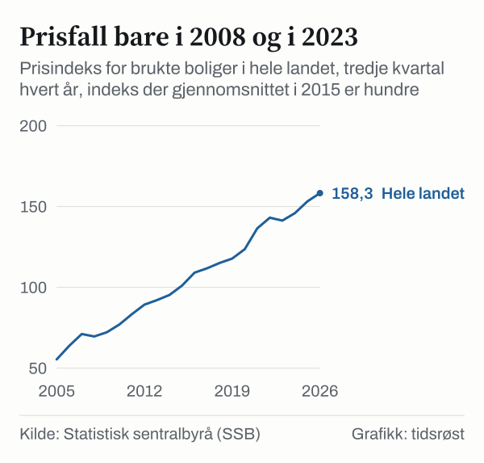

Prisene på brukte boliger økte med 0,5 prosent fra andre til tredje kvartal 2026, justert for sesongvariasjoner. Det viser prisindeksen for brukte boliger fra Statistisk sentralbyrå (SSB), som ble publisert 12. oktober 2026. Fra tredje kvartal 2025 til tredje kvartal 2026 steg prisene med 3,3 prosent for hele landet.

## Store regionale forskjeller

Utviklingen varierer mellom regionene. Bergen hadde høyest prisvekst, med en oppgang på 11,2 prosent siste år, og prisene steg også på Vestlandet utenom Bergen (7,1 prosent), i Agder og Rogaland utenom Stavanger (6,9 prosent) og i Nord-Norge (6,6 prosent). I Oslo med Bærum var oppgangen 0,1 prosent.

*Prisendring for brukte boliger fra 3. kvartal 2025 til 3. kvartal 2026, prosent. Kilde: SSB, tabell 07221.*

Fra andre til tredje kvartal 2026 lå endringene mellom minus 0,6 prosent i Stavanger og pluss 2,1 prosent i Bergen, justert for sesongvariasjoner. Nord-Norge steg 1,8 prosent, mens prisene i Oslo med Bærum var uendret.

| Region | Siste kvartal | Siste år |
|---|---:|---:|
| Hele landet | 0,5 % | 3,3 % |
| Oslo med Bærum | 0,0 % | 0,1 % |
| Stavanger | −0,6 % | 5,7 % |
| Bergen | 2,1 % | 11,2 % |
| Trondheim | 0,9 % | 2,8 % |
| Nord-Norge | 1,8 % | 6,6 % |

*Prisendring for brukte boliger, andre til tredje kvartal 2026 (sesongjustert) og tredje kvartal 2025 til tredje kvartal 2026. Kilde: SSB.*

## Fra 2020 til 2026

Indeksen for hele landet lå på 123,6 i tredje kvartal 2020 og 158,3 i tredje kvartal 2026. Det er en økning på 28,1 prosent over seks år. Størsteparten av økningen kom i 2021 og 2022. Indeksen var litt lavere i tredje kvartal 2023 (141,3) enn året før (143,1), og har steget hvert år siden.

*SSBs prisindeks for brukte boliger, hele landet, 3. kvartal hvert år. Kilde: SSB, tabell 07221.*

## Ulike boligtyper

Prisutviklingen siste år har også vært ulik mellom boligtypene. Tabellen er beregnet fra SSBs indekstall for tredje kvartal.

| Boligtype | Indeks 3. kv. 2025 | Indeks 3. kv. 2026 | Endring |
|---|---:|---:|---:|
| Eneboliger | 148,5 | 154,8 | 4,2 % |
| Småhus | 153,7 | 159,2 | 3,6 % |
| Blokkleiligheter | 163,3 | 165,4 | 1,3 % |

*Endring beregnet fra indekstall (ikke sesongjustert). Kilde: SSB, tabell 07221.*

Blokkleiligheter har dermed hatt lavest prisvekst det siste året, selv om indeksnivået fortsatt er høyest for denne boligtypen. Indeksene sier noe om prisutviklingen over tid, ikke om hva en bolig koster i kroner.

## Kilder

- [SSB: Prisindeks for brukte boliger – siste statistikk (3. kvartal 2026, publisert 12. oktober 2026)](https://www.ssb.no/priser-og-prisindekser/boligpriser-og-boligprisindekser/statistikk/prisindeks-for-brukte-boliger)
- [SSB: Tabell 07221 – Prisindeks for brukte boliger, etter region, boligtype, statistikkvariabel og kvartal](https://www.ssb.no/statbank/table/07221)
