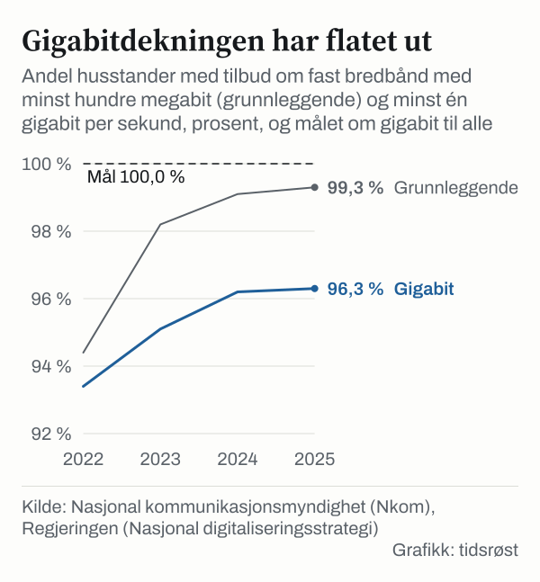

Ved utgangen av 2025 hadde 99,3 prosent av norske husstander tilbud om bredbånd med minst 100 megabit per sekund (Mbit/s), viser dekningsrapporten fra Nasjonal kommunikasjonsmyndighet (Nkom) som ble lagt fram 27. mai 2026. 96,3 prosent hadde tilbud om minst 1 gigabit per sekund (Gbit/s). Målet i regjeringens digitaliseringsstrategi er at alle skal ha tilbud om gigabitbredbånd innen utgangen av 2030.

## Hva målene er

Regjeringens digitaliseringsstrategi fra september 2024 har som mål at alle skal ha minst 100 Mbit/s innen utgangen av 2025, og at alle husstander og virksomheter skal ha minst 1 Gbit/s innen utgangen av 2030.

## Hvor dekningen er nå

19 393 husstander hadde ikke tilbud om minst 100 Mbit/s ved utgangen av 2025, og 18 520 av dem ligger i spredtbygde strøk. Flest gjenstår i Nordland (3 403 husstander), Trøndelag (2 602) og Innlandet (2 085). For gigabit gjensto 96 985 husstander, flest i Innlandet (11 298), Trøndelag (10 822) og Akershus (10 589).

I byer og tettsteder hadde alle husstandene tilgang til minst 100 Mbit/s, mens dekningen i spredtbygde strøk var 95,5 prosent.

| Ved utgangen av 2025 | Tettbygd | Spredtbygd |
|---|---|---|
| Tilbud om minst 100 Mbit/s | 100,0 | 95,5 |
| Fiberdekning | 93,9 | 82,8 |
| Fast trådløst bredbånd, minst 100 Mbit/s | 95,4 | 67,4 |
| Tilbud fra to eller flere tilbydere | 98,2 | 69,9 |

*Prosent av husstandene. Kilde: Nkom, Husstandsdekning for fast bredbånd 2025.*

I alle fylker kan over 90 prosent av husstandene få minst 1 Gbit/s. Høyest ligger Oslo med 99,2 prosent, fulgt av Rogaland og Vestland med 97,9 prosent. Lavest er Nordland med 90,9 prosent. På 100 Mbit/s har Nordland en dekning på 97,1 prosent.

*Andel husstander med tilbud om minst 1 Gbit/s per fylke ved utgangen av 2025. Den stiplede linjen viser hele landet. Kilde: Nkom.*

## Utviklingen: Gigabit flater ut

Fra 2022 til 2025 økte dekningen for 100 Mbit/s fra 94,4 til 99,3 prosent, og gigabitdekningen fra 93,4 til 96,3 prosent. Fra 2024 til 2025 steg gigabitdekningen med 0,1 prosentpoeng. Nkom beskriver utviklingen som at gigabitsamfunnet flater ut.

*Andel husstander med tilbud om fast bredbånd med minst 100 Mbit/s og minst 1 Gbit/s, 2022–2025. Den stiplede linjen viser målet om gigabit til alle innen utgangen av 2030. Kilde: Nkom og regjeringens digitaliseringsstrategi.*

I spredtbygde områder har andelen husstander som kan bestille gigabithastighet, økt fra 70,4 prosent i 2022 til 82,9 prosent i 2025.

## Fiber og valgfrihet

Ved utgangen av 2025 hadde 92,1 prosent av norske husstander mulighet til å koble seg på fiber, og 78,5 prosent hadde fiberkabel ført inn til husveggen. Nkom kaller forskjellen på om lag 13,6 prosentpoeng et gap mellom fiberdekning og faktisk tilkobling. Medianhastigheten for private bredbåndsabonnementer var 250 Mbit/s både i 2024 og 2025.

Nasjonalt kan 93,7 prosent av husstandene velge mellom to eller flere bredbåndstilbydere, 98,2 prosent i tettbygde strøk og 69,9 prosent i spredtbygde områder.

## Mobilnettet

Nkoms kartlegging av mobilnettet fra 17. juni 2026 viser at 99,8 prosent av norske husstander hadde grunnleggende 5G-dekning ved årsskiftet. Målt ved 30 Mbit/s over mobilnettet var husstandsdekningen 95,2 prosent på landsbasis, mens 71,4 prosent av husstandene hadde tilgang til 100 Mbit/s over 5G – fra 99,1 prosent i Oslo til 37,9 prosent i Finnmark.

Regnet etter landareal dekket grunnleggende 5G 78,5 prosent av Norges areal, fra 63,2 prosent i Finnmark til 99,9 prosent i Oslo. Nkom gjør oppmerksom på at beregningsgrunnlaget ble oppdatert i 2025, slik at tallene ikke er direkte sammenlignbare med eldre årganger.

## Statlig støtte i 2026

I områder der teleselskapene ikke bygger ut på rent kommersielt grunnlag, bidrar staten med øremerkede tilskudd som fordeles via fylkeskommunene. For 2026 er det tildelt 159,11 millioner kroner til de gjenstående områdene i fylkene. Nordland mottar den største rammen med 25,9 millioner kroner – rundt 16 prosent av potten – mens Oslo får 0,48 millioner kroner.

Støtteordningen for 2026 ble godkjent av EFTAs overvåkningsorgan ESA i februar 2026, og åpner nå også for å bruke midler på å styrke arealdekningen i mobilnettet. Ifølge statsbudsjettet for 2026 har til sammen rundt 30 000 husstander fått eller vil få høyhastighetsbredbånd gjennom de statlige støtteordningene for perioden 2022–2025.

## Kilder

- [Nkom: Husstandsdekning for fast bredbånd 2025 (27. mai 2026)](https://nkom.no/statistikk/statiske-rapporter-og-analyser/_/attachment/inline/c21188c4-f5e0-4ec0-afa5-710add6f6feb:a31f531d1ca86f7cbf4942f93f9b0ac8f976e0ac/Husstandsdekning%202025.pdf)
- [Nkom: Utviklingen av gigabitsamfunnet flater ut (27. mai 2026)](https://nkom.no/statistikk/statiske-rapporter-og-analyser/_/attachment/inline/ee404519-e6e0-4655-b215-558eb3e8f341:e8ff59b05959dd7beab1956f80a8183c4e414cce/Utviklingen%20av%20gigabitsamfunnet%20flater%20ut.pdf)
- [Nkom: Over 96 prosent kan få superraskt internett (27. mai 2026)](https://nkom.no/aktuelt/over-96-prosent-kan-fa-superraskt-internett)
- [Nkom: Tilgang til mobildata i Norge – kartlegging ved utgangen av 2025 (17. juni 2026)](https://nkom.no/statistikk/statiske-rapporter-og-analyser/_/attachment/inline/0ab42b51-d552-4a57-bc15-c9e35bbfffbf:93270e9691f3a6f5f5eb9fa8616bb7e49f411ceb/Tilgang%20til%20mobildata%20i%20Norge%202025.pdf)
- [Nkom: Offentlig støtte til bredbåndsutbygging](https://nkom.no/fysiske-nett-og-infrastruktur/offentlig-stotte-til-bredbandsutbygging)
- [Nkom: Bredbåndsmålet nærmer seg (7. mai 2025)](https://nkom.no/aktuelt/bredbandsmalet-naermer-seg)
- [Regjeringen: Nasjonal digitaliseringsstrategi, kapittel 3.2](https://www.regjeringen.no/no/tema/statlig-forvaltning/it-politikk/ny-nasjonal-digitaliseringsstrategi/3.2sorge-for-en-sikker-og-fremtidsrettet-digital-infrastruktur/id3054264/)
- [Regjeringen: Prop. 1 S (2025–2026) Digitaliserings- og forvaltningsdepartementet](https://www.regjeringen.no/no/dokumenter/prop.-1-s-20252026/id3123325/?ch=1)
