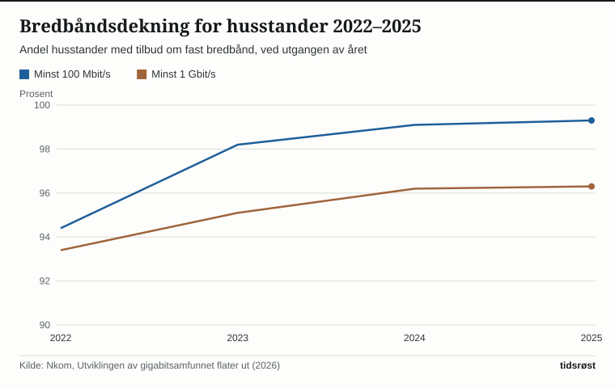

Regjeringen hadde som mål at alle husstander og virksomheter skulle ha tilbud om bredbånd med minst 100 megabit per sekund (Mbit/s) innen utgangen av 2025. Ved utgangen av 2025 var 99,3 prosent av husstandene dekket, viser Nasjonal kommunikasjonsmyndighets (Nkom) rapport om husstandsdekningen for 2025, publisert 27. mai 2026. Målet ble dermed ikke helt nådd: 19 393 husstander manglet fortsatt et slikt tilbud. Nesten alle bodde i spredtbygde områder.

## Målene og hvor langt Norge har kommet

Målene står i regjeringens nasjonale digitaliseringsstrategi fra september 2024: minst 100 Mbit/s innen utgangen av 2025 og minst 1 gigabit per sekund (Gbit/s) innen utgangen av 2030. I statsbudsjettet for 2026 (Prop. 1 S (2025–2026)) skrev Digitaliserings- og forvaltningsdepartementet at regjeringen var «nære ved å nå målet om full dekning» for 100 Mbit/s innen utgangen av 2025.

Dekningen for 100 Mbit/s har økt fra 94,4 prosent i 2022 til 99,3 prosent i 2025. Gigabitdekningen har økt fra 93,4 til 96,3 prosent i samme periode, men veksten fra 2024 til 2025 var bare 0,1 prosentpoeng. 96 985 husstander manglet tilbud om 1 Gbit/s ved utgangen av 2025.

*Gigabitdekningen sto nesten stille fra 2024 til 2025. Kilde: Nkom.*

I en egen analyse fra mai 2026 skriver Nkom at markedet ser ut til å nærme seg et kommersielt metningspunkt for ny gigabitdekning. Ifølge Nkom gjør høyere rente, inflasjon og dyrere anleggsarbeid nye graveprosjekter mindre lønnsomme, samtidig som de gjenværende husstandene ofte er dyrere å nå.

«De små endringene i dekningsgraden, kan tyde på at de områdene som er kommersielt lønnsomme er utbygd flere steder i landet», sier Nkom-direktør John-Eivind Velure i Nkoms pressemelding om tallene.

## Store forskjeller mellom by og land

I tettbygde områder hadde alle husstander tilbud om minst 100 Mbit/s ved utgangen av 2025. I spredtbygde områder var andelen 95,5 prosent. Av de 19 393 husstandene som manglet tilbudet, lå 18 520 i spredtbygde områder. Det tilsvarer 95,5 prosent (beregnet fra Nkoms tall).

| Ved utgangen av 2025 | Tettbygd | Spredtbygd |
|---|---|---|
| Tilbud om minst 100 Mbit/s | 100,0 | 95,5 |
| Fiberdekning | 93,9 | 82,8 |
| Fast trådløst bredbånd, minst 100 Mbit/s | 95,4 | 67,4 |
| Tilbud fra to eller flere tilbydere | 98,2 | 69,9 |

*Prosent av husstandene. Kilde: Nkom, Husstandsdekning for fast bredbånd 2025.*

Gapet krymper likevel. Andelen husstander i spredtbygde områder med tilbud om gigabithastighet økte fra 70,4 prosent i 2022 til 82,9 prosent i 2025, ifølge Nkom.

## Nordland ligger lavest

Blant fylkene har Oslo høyest gigabitdekning med 99,2 prosent, mens Nordland ligger lavest med 90,9 prosent. Nordland er også fylket med lavest dekning for 100 Mbit/s, 97,1 prosent, og med flest husstander uten et slikt tilbud: 3 403. Deretter følger Trøndelag med 2 602 og Innlandet med 2 085 husstander.

*Nordland og Buskerud har lavest gigabitdekning. Kilde: Nkom.*

Flest husstander uten gigabittilbud finnes i Innlandet (11 298), Trøndelag (10 822) og Akershus (10 589).

## Mobilnettet: 5G nesten overalt der folk bor

Nkoms kartlegging av mobildekningen, publisert 17. juni 2026, viser at 99,8 prosent av husstandene hadde grunnleggende 5G-dekning ved utgangen av 2025. Med krav om 30 Mbit/s var husstandsdekningen 95,2 prosent. Nordland og Finnmark lå mer enn 5 prosentpoeng under landsgjennomsnittet. For 100 Mbit/s i 5G-nettet var dekningen 71,4 prosent, fra 99,1 prosent i Oslo til 37,9 prosent i Finnmark.

Arealdekningen er lavere. Grunnleggende 5G-dekning gjaldt 78,5 prosent av arealet, fra 63,2 prosent i Finnmark til 99,9 prosent i Oslo. Nkom opplyser at det er et statistisk brudd i datagrunnlaget for 2025, og fraråder direkte sammenligning med 2024 og tidligere år.

## Statlig støtte der markedet ikke bygger

Staten gir støtte til bredbåndsutbygging i områder uten kommersielt grunnlag. Midlene fordeles til fylkeskommunene, som tildeler dem til prosjekter. For 2025 ble det tildelt 415 millioner kroner, ifølge Nkom. For 2026 er fylkeskommunene tildelt til sammen 159,11 millioner kroner. Nordland har fått mest med 25,9 millioner kroner, om lag 16 prosent av totalen (beregnet). Oslo har fått minst med 0,48 millioner kroner.

Ordningen for 2026 ble godkjent av EFTAs overvåkningsorgan ESA i februar 2026. Ifølge Nkom kan den nå også gi støtte til bedre arealdekning for mobil. I statsbudsjettet for 2026 opplyser departementet at om lag 30 000 nye husstander har fått eller vil få høyhastighetsbredbånd gjennom støtteordningen fra 2022 til 2025.

## Hva betyr dette for folk flest?

For de aller fleste husstandene finnes det et tilbud om raskt bredbånd. Det er likevel ikke alle som tar det i bruk. Ved utgangen av 2025 hadde 92,1 prosent av husstandene mulighet for fiber, mens 78,5 prosent var fysisk tilkoblet fibernettet. Medianhastigheten på private abonnementer var 250 Mbit/s både i 2024 og 2025, ifølge Nkom.

For husstander i distriktene er bildet et annet. I spredtbygde områder hadde 69,9 prosent tilbud fra to eller flere tilbydere, mot 98,2 prosent i tettbygde områder. Færre tilbydere kan bety mindre valgfrihet. Nkom skriver i analysen fra mai 2026 at markedet neppe alene vil sikre full geografisk gigabitdekning. Det er fylkeskommunene som administrerer de statlige støttemidlene til utbygging.

Digitaliserings- og forvaltningsminister Karianne Tung (Ap) uttalte i Nkoms pressemelding 27. mai 2026: «Vi må sørge for at nettene er sikre og robuste, og vi må sørge for god konkurranse og rimelige priser.»

## Kilder

- [Nkom: Husstandsdekning for fast bredbånd 2025 (27. mai 2026)](https://nkom.no/statistikk/statiske-rapporter-og-analyser/_/attachment/inline/c21188c4-f5e0-4ec0-afa5-710add6f6feb:a31f531d1ca86f7cbf4942f93f9b0ac8f976e0ac/Husstandsdekning%202025.pdf)
- [Nkom: Utviklingen av gigabitsamfunnet flater ut (27. mai 2026)](https://nkom.no/statistikk/statiske-rapporter-og-analyser/_/attachment/inline/ee404519-e6e0-4655-b215-558eb3e8f341:e8ff59b05959dd7beab1956f80a8183c4e414cce/Utviklingen%20av%20gigabitsamfunnet%20flater%20ut.pdf)
- [Nkom: Over 96 prosent kan få superraskt internett (27. mai 2026)](https://nkom.no/aktuelt/over-96-prosent-kan-fa-superraskt-internett)
- [Nkom: Tilgang til mobildata i Norge – kartlegging ved utgangen av 2025 (17. juni 2026)](https://nkom.no/statistikk/statiske-rapporter-og-analyser/_/attachment/inline/0ab42b51-d552-4a57-bc15-c9e35bbfffbf:93270e9691f3a6f5f5eb9fa8616bb7e49f411ceb/Tilgang%20til%20mobildata%20i%20Norge%202025.pdf)
- [Nkom: Offentlig støtte til bredbåndsutbygging](https://nkom.no/fysiske-nett-og-infrastruktur/offentlig-stotte-til-bredbandsutbygging)
- [Nkom: Bredbåndsmålet nærmer seg (7. mai 2025)](https://nkom.no/aktuelt/bredbandsmalet-naermer-seg)
- [Regjeringen: Nasjonal digitaliseringsstrategi, kapittel 3.2](https://www.regjeringen.no/no/tema/statlig-forvaltning/it-politikk/ny-nasjonal-digitaliseringsstrategi/3.2sorge-for-en-sikker-og-fremtidsrettet-digital-infrastruktur/id3054264/)
- [Regjeringen: Prop. 1 S (2025–2026) Digitaliserings- og forvaltningsdepartementet](https://www.regjeringen.no/no/dokumenter/prop.-1-s-20252026/id3123325/?ch=1)
