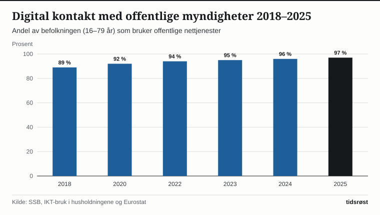
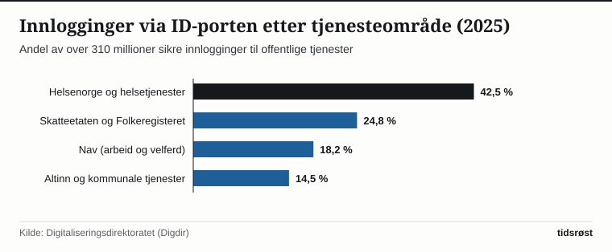

Norge ligger helt i toppen i Europa når det gjelder bruk av digitale offentlige tjenester. Ifølge undersøkelsen *IKT-bruk i husholdningene* fra Statistisk sentralbyrå (SSB) og sammenligninger fra Eurostat har hele 97 prosent av befolkningen mellom 16 og 79 år vært i digital kontakt med offentlige myndigheter i løpet av det siste året – mot et gjennomsnitt i EU på rundt 70 prosent.

Bak den høye bruken ligger felles nasjonal infrastruktur forvaltet av Digitaliseringsdirektoratet (Digdir), Norsk helsenett, Skatteetaten og Brønnøysundregistrene.

## Over 310 millioner sikre innlogginger gjennom ID-porten

Kjernen i de offentlige nettjenestene er nasjonale felleskomponenter som ID-porten, Altinn, Digital postkasse og Kontakt- og reservasjonsregisteret. I 2025 formidlet ID-porten over 310 millioner sikre innlogginger med elektronisk ID (BankID, MinID, Buypass og Commfides) til mer enn 1 400 statlige og kommunale tjenester.

*Andel av befolkningen 16–79 år som bruker digitale offentlige tjenester, 2018–2025. Kilde: SSB og Eurostat.*

Samtidig mottar over 4,2 millioner innbyggere post fra stat og kommune digitalt, slik at vedtak, skatteoppgjør og innkallinger til sykehus kommer frem umiddelbart og uten papirpostgang.

## De mest brukte digitale borgertjenestene

Tabellen oppsummerer de sentrale nasjonale plattformene og deres årlige bruksvolum:

| Plattform / fellesløsning | Ansvarlig virksomhet | Hovedfunksjon | Årlig bruk / dekning |
|---|---|---|---|
| ID-porten | Digitaliseringsdirektoratet | Felles elektronisk innlogging | Over 310 mill. innlogginger |
| Helsenorge.no | Norsk helsenett | Pasientjournal, resepter og fastlege | Over 115 mill. besøk |
| Skatteetaten.no | Skatteetaten | Skattemelding, skattekort og folkeregister | Over 92 % leverer digitalt |
| Altinn | Digitaliseringsdirektoratet | Dialog mellom næringsliv og myndigheter | Over 100 mill. skjemainnsendinger og oppslag |
| Nav.no | Arbeids- og velferdsetaten | Søknader, meldekort og pensjonsberegning | Over 90 mill. innloggede besøk |

*Kilde: Digitaliseringsdirektoratet, Norsk helsenett, Skatteetaten og Nav.*

På helseområdet er Helsenorge.no den desidert mest besøkte portalen, der innbyggerne kan fornye resepter, bestille time hos fastlegen, se prøvesvar og lese epikriser fra sykehusene.

*Fordeling av innlogginger via ID-porten etter tjenesteområde i 2025. Kilde: Digitaliseringsdirektoratet.*

## Sammenhengende livshendelser og digital inkludering

I *Nasjonal digitaliseringsstrategi 2024–2030*, lagt fram av Digitaliserings- og forvaltningsdepartementet, er et hovedmål at innbyggerne skal møte én samordnet offentlig sektor ved viktige livshendelser – som å få barn, starte bedrift, flytte til Norge eller miste nærstående – uten å måtte sende inn de samme opplysningene til flere etater.

Samtidig legger strategien stor vekt på digital inkludering: Gjennom kommunale veiledningstjenester på folkebibliotek og innbyggertorg, enklere fullmaktsløsninger og rett til papirbaserte alternativer for dem som har reservert seg, sørger myndighetene for at alle innbyggere får ivaretatt sine rettigheter.

## Kilder

- [SSB: IKT-bruk i husholdningene](https://www.ssb.no/teknologi-og-innovasjon/informasjons-og-kommunikasjonsteknologi-ikt/statistikk/ikt-bruk-i-husholdningene)
- [Digitaliseringsdirektoratet (Digdir): Statistikk for ID-porten, Altinn og Digital postkasse](https://www.digdir.no/tall-og-fakta/statistikk-felleslosninger/1627)
- [Digitaliserings- og forvaltningsdepartementet: Fremtidens digitale Norge – Nasjonal digitaliseringsstrategi 2024–2030](https://www.regjeringen.no/no/dokumenter/fremtidens-digitale-norge/id3054980/)
- [Norsk helsenett: Nøkkeltall for Helsenorge](https://www.nhn.no/helsenorge)
