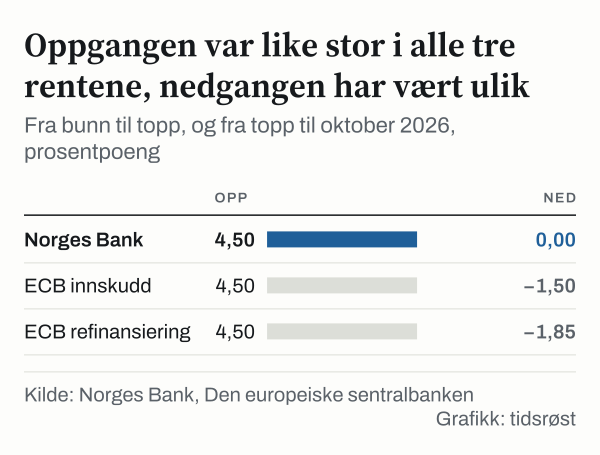

Dagen var 11. juni 2014: Den europeiske sentralbanken (ECB) satte innskuddsrenten til −0,10 prosent, for første gang i serien vi har lest. Dagen før var den 0,00 prosent. Samme dag lå Norges Banks styringsrente på 1,50 prosent, og gapet mellom de to rentene var 1,60 prosentpoeng.

Innskuddsrenten ble liggende under null til 26. juli 2022, da den var −0,50 prosent. Dagen etter, 27. juli 2022, var den 0,00 prosent. I mellomtiden gikk den norske styringsrenten både opp og ned.

Siden 2014 har gapet mellom de to rentene variert mellom 0,50 og 2,00 prosentpoeng ved årsskiftene. Ved utgangen av året 2025 var gapet 2,00 prosentpoeng, og 21. oktober 2026 er det like stort. Det samme gapet fant vi ved utgangen av året 2019, og det er det største vi finner ved noe årsskifte i perioden. Det minste, 0,50 prosentpoeng, finner vi ved utgangen av året 2020 og av året 2023.

Årsskifte for årsskifte lå den norske renten over den europeiske, men avstanden varierte mye. Mellom årsskiftene var bildet ikke alltid det samme, og vi kommer tilbake til et eksempel fra mars 2023.

## To renter som ikke er helt det samme

Norges Banks styringsrente er renten på bankenes innskudd i Norges Bank. ECB har flere styringsrenter. Vi bruker innskuddsrenten, som er renten bankene får når de setter inn penger over natten i Eurosystemet.

Det er en rimelig parallell, men ikke en identisk en. Begge rentene er styringsrenter som skal påvirke andre renter i økonomien. Vi går ikke inn på hvordan den påvirkningen skjer. Vi sammenligner bare selve styringsrentene, slik de er oppgitt i dataseriene. ECB har også hovedrefinansieringsrenten, som i våre målinger ligger like høyt eller høyere. Vi kommer tilbake til hva det betyr for gapet.

Begge sentralbankene oppgir rentene dag for dag i sine datatjenester. Vi har lest av begge rentene på samme dato, siste handelsdag hvert år i perioden 2014–2025, og i tillegg 21. oktober 2026. Gapet er Norges Banks rente minus ECBs innskuddsrente, i prosentpoeng.

![Linjediagram over Styringsrenten har ligget over innskuddsrenten ved hvert årsskifte: Norges Bank: 1,25 % i 2014, 0,75 % i 2015, 0,50 % i 2016, 0,50 % i 2017, 0,75 % i 2018, 1,50 % i 2019, 0,00 % i 2020, 0,50 % i 2021, 2,75 % i 2022, 4,50 % i 2023, 4,50 % i 2024, 4,00 % i 2025, okt. 2026: 4,50 %; ECB: −0,20 % i 2014, −0,30 % i 2015, −0,40 % i 2016, −0,40 % i 2017, −0,40 % i 2018, −0,50 % i 2019, −0,50 % i 2020, −0,50 % i 2021, 2,00 % i 2022, 4,00 % i 2023, 3,00 % i 2024, 2,00 % i 2025, okt. 2026: 2,50 %.](./graf-1.svg)
*Siste handelsdag hvert år, og siste punkt i oktober, prosent. Kilde: Norges Bank, Den europeiske sentralbanken.*

## Gapet ved hvert årsskifte

Ved utgangen av året 2014 var gapet 1,45 prosentpoeng, med en styringsrente på 1,25 prosent og en innskuddsrente på −0,20 prosent. Året etter var det 1,05 prosentpoeng, og ved utgangen av året 2016 og av året 2017 var det 0,90 prosentpoeng begge ganger. Ved utgangen av året 2018 var det 1,15 prosentpoeng.

Så endret gapet seg raskt. Ved utgangen av året 2019 var gapet 2,00 prosentpoeng, med en styringsrente på 1,50 prosent og en innskuddsrente på −0,50 prosent. Ved utgangen av året 2020 var det 0,50 prosentpoeng, med en styringsrente på 0,00 prosent og en innskuddsrente på −0,50 prosent. Innskuddsrenten var −0,50 prosent begge gangene.

Videre var gapet 1,00 prosentpoeng ved utgangen av året 2021, 0,75 prosentpoeng ved utgangen av året 2022, og 0,50 prosentpoeng ved utgangen av året 2023. Ved utgangen av året 2024 var det 1,50 prosentpoeng, og ved utgangen av året 2025 var det 2,00 prosentpoeng.

Nivåene bak gapet er disse. Ved utgangen av året 2020 var styringsrenten 0,00 prosent, og ved utgangen av året 2023 var den 4,50 prosent. Innskuddsrenten var −0,50 prosent ved utgangen av året 2021, og 4,00 prosent ved utgangen av året 2023. Begge hadde sitt høyeste årsskiftenivå ved utgangen av året 2023, og styringsrenten lå på samme nivå ved utgangen av året 2024.

Ved årsskiftene vi har lest av, har gapet aldri vært negativt, og det har ikke vært større enn 2,00 prosentpoeng.

*Norges Banks styringsrente minus ECBs innskuddsrente, prosentpoeng. Kilde: Den europeiske sentralbanken, Norges Bank.*

## Oppgangen: samme størrelse, ulik tid

Vi ser først på den siste oppgangen. Norges Banks styringsrente var 0,00 prosent 23. september 2021, og 0,25 prosent dagen etter. ECBs innskuddsrente var −0,50 prosent 26. juli 2022, og 0,00 prosent dagen etter. Norges Bank hevet første gang omtrent ti måneder før ECB.

ECBs topp kom før Norges Banks. ECBs innskuddsrente stod på 4,00 prosent 20. september 2023. Norges Banks styringsrente stod på 4,50 prosent 15. desember 2023, knapt tre måneder senere. Fra første heving til toppen gikk det drøyt to år for Norges Bank og drøyt ett år for ECB.

Størrelsen på oppgangen var den samme. Styringsrenten gikk opp med 4,50 prosentpoeng fra bunnen til toppen, og det samme gjorde innskuddsrenten. Oppgangen var altså like stor i begge rentene, men tok ulik tid. Gapet var 1,00 prosentpoeng ved utgangen av året 2021, 0,75 prosentpoeng ved utgangen av året 2022, og 0,50 prosentpoeng ved utgangen av året 2023.

ECBs hovedrefinansieringsrente var 0,00 prosent 26. juli 2022 og 4,50 prosent 20. september 2023, en økning på 4,50 prosentpoeng. Ved hver sin topp lå dermed Norges Banks styringsrente og ECBs hovedrefinansieringsrente på samme nivå, 4,50 prosent, mens innskuddsrenten lå 0,50 prosentpoeng lavere.

Midt i oppgangen kan vi også se hvor følsomt gapet er for tidspunktet. 26. juli 2022, dagen før ECBs første heving, var gapet 1,75 prosentpoeng. Ved utgangen av året 2022, fem måneder senere, var det 0,75 prosentpoeng. Gapet falt altså med 1,00 prosentpoeng på under et halvt år.

## Nedgangen etter toppene

Den første nedsettelsen etter toppen kom på ulike tidspunkter. ECBs innskuddsrente var 4,00 prosent 11. juni 2024, og 3,75 prosent dagen etter. Det er ECBs første nedsettelse etter toppen i 2023. Norges Banks styringsrente sto på 4,50 prosent fra 15. desember 2023, og den var 4,25 prosent 20. juni 2025. Det er omtrent ett år mellom de to første nedsettelsene etter toppene.

Innen 11. juni 2025 hadde ECBs innskuddsrente falt med 2,00 prosentpoeng fra toppen, til 2,00 prosent. Norges Banks styringsrente var 4,00 prosent 19. september 2025, et fall på 0,50 prosentpoeng fra toppen. Gapet gikk fra 0,50 prosentpoeng, ved utgangen av året 2023, til 1,50 prosentpoeng, ved utgangen av året 2024, og 2,00 prosentpoeng, ved utgangen av året 2025. I løpet av året 2025 falt styringsrenten med 0,50 prosentpoeng, fra 4,50 prosent til 4,00 prosent. Innskuddsrenten falt med 1,00 prosentpoeng, fra 3,00 prosent til 2,00 prosent. Hva som ligger bak, ligger utenfor materialet vårt.

*Fra bunn til topp, og fra topp til oktober 2026, prosentpoeng. Kilde: Norges Bank, Den europeiske sentralbanken.*

## Begge opp igjen i 2026

I 2026 har begge sentralbankene hevet renten to ganger. Norges Banks styringsrente var 4,25 prosent 8. mai 2026, og 4,50 prosent 25. september 2026. ECBs innskuddsrente var 2,00 prosent 16. juni 2026, og 2,25 prosent dagen etter. Den var 2,50 prosent 16. september 2026.

Den første hevingen fra ECB i 2026 kom knapt seks uker etter Norges Banks, og den andre kom ni dager før Norges Banks. Begge hevet med 0,25 prosentpoeng hver gang. Den 21. oktober 2026 er styringsrenten 4,50 prosent, innskuddsrenten 2,50 prosent og hovedrefinansieringsrenten 2,65 prosent. Fordi rentene steg like mye, er gapet uendret på 2,00 prosentpoeng siden utgangen av året 2025.

Figuren under setter rentenivåene fra desember 2021 og fra oktober 2026 ved siden av hverandre, sammen med ECBs hovedrefinansieringsrente.

*Rentenivå, prosent. Kilde: Norges Bank, Den europeiske sentralbanken.*

## En annen lesemåte: hva om vi bruker ECBs andre rente

Innskuddsrenten er ikke ECBs eneste styringsrente. Hovedrefinansieringsrenten var 0,00 prosent ved utgangen av året 2021, mot −0,50 prosent for innskuddsrenten. Forskjellen mellom de to var altså 0,50 prosentpoeng. Ved utgangen av året 2025 var forskjellen 0,15 prosentpoeng: 2,15 prosent mot 2,00 prosent.

Det endrer gapet. Regnet mot hovedrefinansieringsrenten var gapet 0,50 prosentpoeng ved utgangen av året 2021, mot 1,00 prosentpoeng målt mot innskuddsrenten. Ved utgangen av året 2025 var det 1,85 prosentpoeng, og 21. oktober 2026 er det 1,85 prosentpoeng, mot 2,00 prosentpoeng i begge tilfeller for innskuddsrenten.

Hvilken ECB-rente vi legger til grunn, påvirker størrelsen på gapet: 0,50 prosentpoeng mot 1,00 prosentpoeng ved utgangen av året 2021, og 1,85 prosentpoeng mot 2,00 prosentpoeng ved utgangen av året 2025. Vi har ikke regnet gapet mot hovedrefinansieringsrenten for alle årsskiftene, bare for tre tidspunkter: desember 2021, desember 2025 og oktober 2026. Tallene sier derfor lite om årene imellom. I de tre målingene mot hovedrefinansieringsrenten er gapet positivt.

## Hva et årsskifte ikke viser

Vi har lest av rentene på noen få datoer, og gapet mellom dem er et øyeblikksbilde. Mellom to årsskifter kan mye skje, som eksempelet fra juli 2022 viser. Et annet utvalg av datoer, for eksempel midt i hvert år, kunne gitt andre tall for enkelte år. Den 22. mars 2023 var styringsrenten 2,75 prosent og innskuddsrenten 3,00 prosent, et gap på −0,25 prosentpoeng. Den 24. mars 2023 var begge 3,00 prosent, et gap på 0,00 prosentpoeng. Fortegnet kan altså være et annet mellom årsskiftene.

Sammenligningen sier heller ikke noe om realrenter. Vi har ikke trukket fra prisvekst. Den sier ingenting om kronekursen, og den sier ingenting om hvorfor de to sentralbankene valgte ulike tidspunkter. Hver av dem begrunner sine beslutninger i egne dokumenter, som vi ikke har gått gjennom her.

Datoene vi oppgir er datoene da en endring gjelder fra i dataseriene. De er ikke nødvendigvis datoene for rentemøtene.

Gapet kan regnes på andre måter, for eksempel som et forholdstall. Vi har valgt prosentpoeng fordi begge rentene er oppgitt i prosent. Vi sier heller ikke at en av ECB-rentene er den riktige å sammenligne med. Der det er mulig, viser vi begge.

Til slutt: tallene beskriver hva som har skjedd. De sier ikke noe om hvor rentene går videre.

## Slik regnet vi

Grunnlaget er Norges Banks dagsserie for styringsrenten og ECBs dagsserier for innskuddsrenten og hovedrefinansieringsrenten. Alle tall er lest for datoer der begge rentene er oppgitt, siste handelsdag hvert år i perioden 2014–2025 og 21. oktober 2026, i tillegg til datoene rundt de enkelte renteendringene og to datoer i mars 2023. Gapet er styringsrenten minus innskuddsrenten, i prosentpoeng, regnet av oss. Gapet mot hovedrefinansieringsrenten er regnet på samme måte.

Oppgangen er forskjellen mellom bunnen og toppen i hver rente, og nedgangen er forskjellen mellom toppen og 21. oktober 2026. Hvert tall kan slås opp i kilden. Beskrivelsene av rentene bygger på Norges Banks og ECBs egne sider om styringsrenter.

## Kilder

- [Norges Bank: Styringsrenten, oversikt over rentemøter og endringer](https://www.norges-bank.no/tema/pengepolitikk/Styringsrenten/Styringsrenten-Oversikt-over-rentemoter-og-endringer-i-styringsrenten-/)
- [Norges Bank: Styringsrenten og rentebanen](https://www.norges-bank.no/en/topics/Monetary-policy/Policy-rate/)
- [ECB: Key ECB interest rates](https://www.ecb.europa.eu/stats/policy_and_exchange_rates/key_ecb_interest_rates/html/index.en.html)
- [ECB Data Portal: innskuddsrenten (deposit facility)](https://data-api.ecb.europa.eu/service/data/FM/D.U2.EUR.4F.KR.DFR.LEV)
- [ECB Data Portal: hovedrefinansieringsrenten (main refinancing operations)](https://data-api.ecb.europa.eu/service/data/FM/D.U2.EUR.4F.KR.MRR_FR.LEV)
