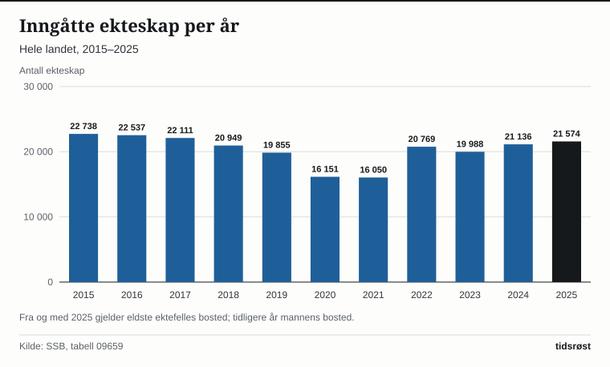

Det ble inngått 21 574 ekteskap i Norge i 2025, ifølge Statistisk sentralbyrå (SSB). Det er 438 flere enn året før og det høyeste tallet siden 2017. Skilsmissene økte samtidig til 8 583 og separasjonene til 9 772. Tallene ble publisert 12. mai 2026.

## Hovedtall for 2025

Både ekteskap, skilsmisser og separasjoner økte i 2025. Separasjonene økte mest, med 4,6 prosent.

| | 2024 | 2025 | Endring | Endring i prosent |
|---|---:|---:|---:|---:|
| Inngåtte ekteskap | 21 136 | 21 574 | +438 | +2,1 |
| Skilsmisser | 8 474 | 8 583 | +109 | +1,3 |
| Separasjoner | 9 340 | 9 772 | +432 | +4,6 |

*Kilde: SSB, tabell 09659 og 09660.*

Antall ekteskap er likevel langt under toppnivået. Flest ekteskap ble inngått i 1969, med 29 630. Det laveste tallet i tabellen, som starter i 1966, er 16 050 i 2021. Fra 2021 til 2025 økte antallet med 5 524, eller 34,4 prosent, men 2025-tallet er 27,2 prosent lavere enn i 1969.

*Inngåtte ekteskap per år, hele landet. Kilde: SSB, tabell 09659.*

## Alder ved første ekteskap

Gjennomsnittsalderen for dem som gifter seg for første gang har økt med mer enn elleve år siden 1974. I 1974 var menn i gjennomsnitt 25,3 år og kvinner 22,8 år ved første ekteskap. I 2025 var tallene 36,7 år for menn og 34,6 år for kvinner. Det er en økning på 11,4 år for menn og 11,8 år for kvinner.

*Gjennomsnittsalder ved første ekteskap, ikke tidligere gifte. Kilde: SSB, tabell 05742.*

Høyeste alder i tabellen er fra 2024, med 37,2 år for menn og 35,2 år for kvinner, så 2025 ligger litt lavere. I 2020 var gjennomsnittsalderen for menn også 36,7 år. Regnes alle som giftet seg, også de som var gift før, var gjennomsnittsalderen 39,7 år for menn og 37,1 år for kvinner i 2025.

## Skilsmisser og separasjoner over tid

Antall skilsmisser var høyest i 2004, med 11 045. Med 8 583 i 2025 er antallet 22,3 prosent lavere. Antall separasjoner var også høyest i 2004, med 13 167 (tabellen starter i 1974). Med 9 772 i 2025 er antallet 25,8 prosent lavere. Laveste antall skilsmisser de siste tjue årene var 8 204 i 2022.

SSB oppgir at det ble registrert flest separasjoner i januar 2025, med 959, fulgt av september (957) og oktober (934). Færrest ble registrert i desember, med 641.

## Kilder

- [SSB: Ekteskap og skilsmisser (oppdatert 12. mai 2026)](https://www.ssb.no/befolkning/barn-familier-og-husholdninger/statistikk/ekteskap-og-skilsmisser)
- [SSB: Fleire tok ut separasjon i 2025 (12. mai 2026)](https://www.ssb.no/befolkning/barn-familier-og-husholdninger/statistikk/ekteskap-og-skilsmisser/artikler/fleire-tok-ut-separasjon-i-2025)
- [SSB: Tabell 09659 – Inngåtte ekteskap, etter mannens bosted](https://www.ssb.no/statbank/table/09659)
- [SSB: Tabell 09660 – Skilsmisser og separasjoner, etter mannens bosted](https://www.ssb.no/statbank/table/09660)
- [SSB: Tabell 05742 – Gjennomsnittsalder ved giftermålet, etter kjønn](https://www.ssb.no/statbank/table/05742)
