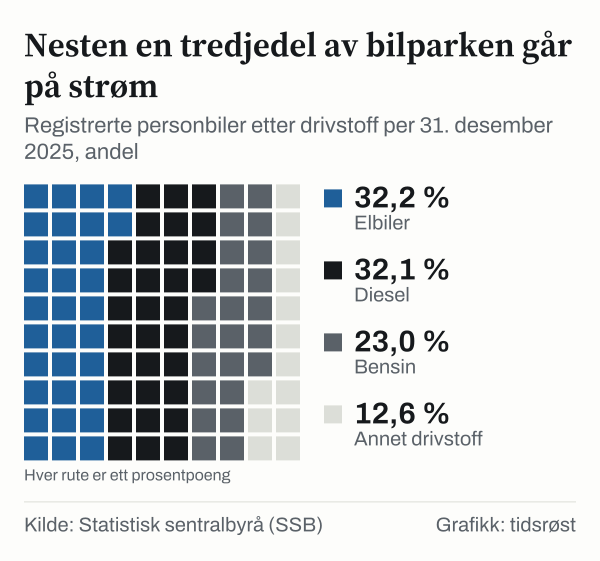

Fra januar til september 2026 ble det førstegangsregistrert 114 599 nye personbiler i Norge, og 112 224 av dem var elektriske eller andre nullutslippsbiler. Det tilsvarer 97,9 prosent, viser statistikk fra Statistisk sentralbyrå (SSB). Målet i Nasjonal transportplan var at alle nye personbiler skulle være nullutslippsbiler i 2025. Det året var andelen 95,9 prosent.

## Hva målet er

Allerede i Nasjonal transportplan 2018–2029 satte myndighetene som måltall at «nye personbiler og lette varebiler skal være nullutslippskjøretøy i 2025», en ambisjon som ble videreført i Nasjonal transportplan 2022–2033.

## Hvor nybilsalget står

I 2025 ble det registrert 169 569 nye elbiler av totalt 176 847 nye personbiler, en andel på 95,9 prosent. I de ni første månedene av 2026 var andelen 97,9 prosent, og i september 2026 alene 98,8 prosent.

*Andel elektrisk/nullutslipp av førstegangsregistrerte nye personbiler. 2026 gjelder januar–september. Kilde: SSB, tabell 14020.*

## Slik har andelen utviklet seg

I 2015 var 17,1 prosent av nye personbiler elektriske eller nullutslipp. Andelen passerte halvparten i 2020, med 54,3 prosent, og var 79,3 prosent i 2022 og 88,9 prosent i 2024.

## Bilparken skiftes ut langsommere

Siden en personbil ifølge Finansdepartementet har en typisk levetid på 15 til 20 år, tar det langt lengre tid å bytte ut hele bilparken enn å snu nybilsalget. Ved utgangen av 2025 var det registrert 945 182 elektriske personbiler i Norge, 19,8 prosent flere enn ett år tidligere. Dermed utgjorde elbilene 32,2 prosent av landets 2 935 738 registrerte personbiler, opp fra 2,6 prosent i 2015, 12,1 prosent i 2020 og 27,4 prosent i 2024.

I 2025 var det for første gang registrert flere elbiler enn dieselbiler (942 780) på norske skilt. Bensinbilene var 676 614.

![Linjediagram over Elbilene gikk forbi dieselbilene i 2025: Elbiler: 1 693 i 2008, 1 776 i 2009, 2 068 i 2010, 3 909 i 2011, 8 031 i 2012, 17 770 i 2013, 38 652 i 2014, 69 134 i 2015, 97 532 i 2016, 138 983 i 2017, 195 351 i 2018, 260 692 i 2019, 340 002 i 2020, 460 734 i 2021, 599 169 i 2022, 689 169 i 2023, 788 750 i 2024, 945 182 i 2025; Diesel: 597 391 i 2008, 690 560 i 2009, 804 384 i 2010, 922 986 i 2011, 1 025 220 i 2012, 1 110 621 i 2013, 1 186 194 i 2014, 1 243 235 i 2015, 1 276 947 i 2016, 1 294 493 i 2017, 1 290 442 i 2018, 1 281 019 i 2019, 1 246 671 i 2020, 1 204 097 i 2021, 1 135 538 i 2022, 1 065 135 i 2023, 1 005 761 i 2024, 942 780 i 2025.](./graf-2.svg)
*Registrerte personbiler med elektrisk drivstoff og med diesel, per 31. desember. Kilde: SSB, tabell 07849.*

Fra 2017 til 2025 ble beholdningen av personbiler med forbrenningsmotor redusert med nær 600 000, tilsvarende om lag 23 prosent, opplyser Finansdepartementet i budsjettproposisjonen for 2027. Beholdningen av personbiler samlet har likevel fortsatt å øke.

*Registrerte personbiler etter drivstoff per 31. desember 2025. Annet drivstoff er alle andre drivstofftyper enn el, diesel og bensin. Kilde: SSB, tabell 07849.*

## Hva som endres i 2027

Fram til nyttår 2023 var elbiler helt fritatt for merverdiavgift. Fra 2023 ble det innført 25 prosent moms på den delen av kjøpesummen som oversteg 500 000 kroner, og i 2026-budsjettet ble denne fribeløpsgrensen senket til 300 000 kroner.

I statsbudsjettet for 2027, lagt fram 7. oktober, foreslår regjeringen å senke grensen til 150 000 kroner fra 1. januar 2027. Endringen er beregnet å gi statskassen 3,8 milliarder kroner i merinntekter i 2027. Forslaget krever vedtak i Stortinget, og en videreføring av et delvis fritak etter 2026 må også godkjennes av EFTAs overvåkningsorgan ESA.

Dersom Stortinget vedtar forslaget, vil en ny elbil med en pris før avgift på 300 000 kroner eller mer få 37 500 kroner i økt merverdiavgift. For biler mellom 150 000 og 300 000 kroner før avgift øker momsen gradvis. Biler som leveres til kunden etter 31. desember 2026, får beløpsgrensen på 150 000 kroner, også ved leasing.

Finansdepartementet har regnet ut hvor mye ekstra moms som påløper ved ulike bilpriser dersom hele avgiftsøkningen veltes over i utsalgsprisen (full overvelting):

| Pris ekskl. avgift | Økt moms |
|---|---|
| 150 000 kr | – |
| 200 000 kr | 12 500 kr |
| 300 000 kr | 37 500 kr |
| 500 000 kr | 37 500 kr |

Ved førstegangsregistrering betaler elbiler kun vektkomponenten i engangsavgiften, som ble innført i 2023. For 2027 foreslår regjeringen å prisjustere særavgiftene med 2,7 prosent i takt med forventet prisvekst, slik at vektavgiften for alle personbiler øker fra 12,71 til 13,05 kroner per kilo utover de første 500 kiloene. For bensin- og dieselbiler ble engangsavgiften økt i budsjettet for 2026.

## Utslipp fra veitrafikken

Foreløpige tall fra SSB viser at veitrafikken slapp ut 6,9 millioner tonn CO₂-ekvivalenter i 2025, en nedgang på 8,2 prosent på ett år og ned fra 10,3 millioner tonn i 2015. Ifølge SSB var utslippskuttet på veiene den viktigste enkeltårsaken til at Norges samlede klimagassutslipp gikk ned med 1,2 prosent til 44,1 millioner tonn i 2025. Mer om utviklingen står i [vår gjennomgang av klimagassutslippene](/artikkel/klimagassutslippene-sa-langt-er-norge-fra-malet/).

## Kilder

- [SSB: Tabell 14020 – Førstegangsregistrerte kjøretøy, etter type registrering og drivstofftype](https://www.ssb.no/statbank/table/14020)
- [SSB: Tabell 07849 – Registrerte kjøretøy, etter type kjøring og drivstofftype](https://www.ssb.no/statbank/table/07849)
- [SSB: Bilparken (oppdatert 6. mars 2026)](https://www.ssb.no/transport-og-reiseliv/landtransport/statistikk/bilparken)
- [SSB: Tabell 13931 – Klimagasser, etter utslippskilde](https://www.ssb.no/statbank/table/13931)
- [SSB: Utslipp til luft (oppdatert 4. juni 2026)](https://www.ssb.no/natur-og-miljo/forurensning-og-klima/statistikk/utslipp-til-luft)
- [SSB: Liten nedgang i klimagassutslipp i 2025 (4. juni 2026)](https://www.ssb.no/natur-og-miljo/forurensning-og-klima/statistikk/utslipp-til-luft/artikler/liten-nedgang-i-klimagassutslipp-i-2025)
- [Regjeringen: Meld. St. 20 (2020–2021) Nasjonal transportplan 2022–2033](https://www.regjeringen.no/no/dokumenter/meld.-st.-20-20202021/id2839503/?ch=1)
- [Regjeringen: Prop. 1 LS (2026–2027) Skatter og avgifter 2027, kapittel 1](https://www.regjeringen.no/no/dokumenter/prop.-1-ls-20262027/id3176120/?ch=1)
- [Regjeringen: Prop. 1 LS (2026–2027), kapittel 9 og 10](https://www.regjeringen.no/no/dokumenter/prop.-1-ls-20262027/id3176120/?ch=2)
- [Regjeringen: Statsbudsjettet 2027 – skatter og avgifter](https://www.regjeringen.no/no/statsbudsjett/2027/statsbudsjettet-2027-skatter-og-avgifter/id3173278/)
