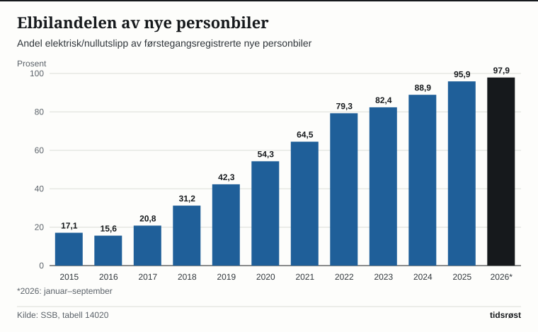
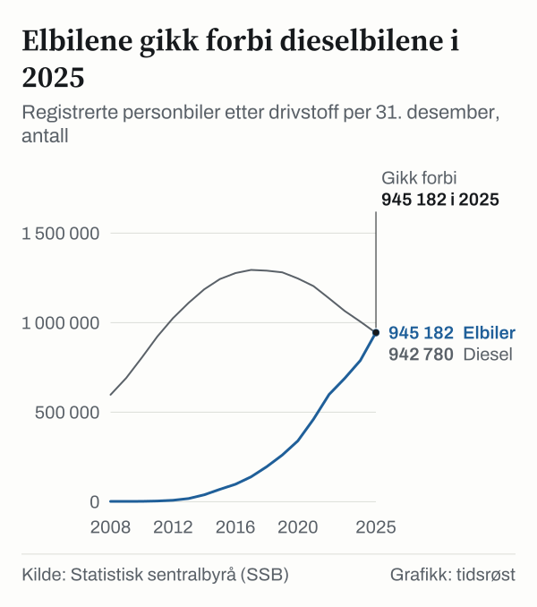

Fra januar til september 2026 ble det førstegangsregistrert 114 599 nye personbiler i Norge, og hele 112 224 av dem var elektriske eller andre nullutslippsbiler. Det tilsvarer 97,9 prosent av nybilsalget, viser statistikk fra Statistisk sentralbyrå (SSB). Skiftet i bilparken går stadig raskere og har allerede ført til et markant fall i utslippene fra veitrafikken. Etter at målet om 100 prosent nullutslipp i nybilsalget i praksis er innfridd, legger regjeringen i forslaget til statsbudsjett for 2027 opp til en gradvis normalisering av merverdiavgiften for nye personbiler.

## 2025-målet i praksis innfridd

Allerede i Nasjonal transportplan 2018–2029 satte myndighetene som måltall at «nye personbiler og lette varebiler skal være nullutslippskjøretøy i 2025», en ambisjon som ble videreført i Nasjonal transportplan 2022–2033.

Tallene over førstegangsregistrerte personbiler hos SSB viser hvor bratt overgangen har vært på ti år: I 2015 var 17,1 prosent av nye personbiler elektriske eller nullutslipp. I 2020 var andelen kommet opp i 54,3 prosent, og i målåret 2025 endte den på 95,9 prosent – 169 569 elbiler av totalt 176 847 nyregistrerte personbiler. I 2026 har elbilandelen krøpet enda litt nærmere hundre prosent, med 98,8 prosent i september måned alene.

*Andel elektrisk/nullutslipp av førstegangsregistrerte nye personbiler. 2026 gjelder januar–september. Kilde: SSB, tabell 14020.*

Da statsbudsjettet for 2026 ble lagt fram i oktober 2025, konstaterte finansminister Jens Stoltenberg (Ap) at målet i praksis var nådd med en elbilandel på 95 prosent i 2025: «Vi har hatt som mål at alle nye personbiler skal være elektriske i 2025.»

## Flere elbiler enn dieselbiler på norske veier

Siden en personbil ifølge Finansdepartementet har en typisk levetid på 15 til 20 år, tar det langt lengre tid å bytte ut hele den rullende bilparken enn å snu nybilsalget. Ved utgangen av 2025 var det registrert 945 182 elektriske personbiler i Norge – 19,8 prosent flere enn ett år tidligere. Dermed utgjorde elbilene 32,2 prosent av landets 2 935 738 registrerte personbiler (SSB-tabell 07849), opp fra bare 2,6 prosent i 2015.

2025 ble dessuten et veiskille i bilstatistikken: For første gang var det registrert flere elbiler enn både dieselbiler (942 780) og bensinbiler (676 614) på norske skilt (kategorien «annet drivstoff» holdes utenom sammenligningen).

*Andel personbiler med elektrisk drivstoff av alle registrerte personbiler, per 31. desember. Kilde: SSB, tabell 07849.*

Fra 2017 til 2025 ble beholdningen av personbiler med forbrenningsmotor redusert med nær 600 000, tilsvarende om lag 23 prosent, opplyser Finansdepartementet i budsjettproposisjonen for 2027. Beholdningen av personbiler samlet har likevel fortsatt å øke.

## Slik trappes momsfritaket ned mot 2028

Fram til nyttår 2023 var elbiler helt fritatt for merverdiavgift. Fra 2023 ble det innført 25 prosent moms på den delen av kjøpesummen som oversteg 500 000 kroner, og i 2026-budsjettet ble denne fribeløpsgrensen senket til 300 000 kroner.

I statsbudsjettet for 2027, lagt fram 7. oktober, foreslår regjeringen – i tråd med et tidligere anmodningsvedtak fra Stortinget – å kutte grensen videre til 150 000 kroner fra 1. januar 2027. Stortinget har bedt regjeringen om å senke grensen med ytterligere 150 000 kroner i 2028, forutsatt godkjenning fra ESA. Endringen er beregnet å gi statskassen 3,8 milliarder kroner i merinntekter i 2027. Forslaget krever vedtak i Stortinget, og en videreføring av et delvis fritak etter 2026 må også godkjennes av EFTAs overvåkningsorgan ESA.

Finansdepartementet har regnet ut hvor mye ekstra moms som påløper ved ulike bilpriser dersom hele avgiftsøkningen veltes over i utsalgsprisen:

| Pris ekskl. avgift | Økt moms | Økning i prosent av prisen |
|---|---|---|
| 150 000 kr | – | – |
| 200 000 kr | 12 500 kr | 5,7 % |
| 300 000 kr | 37 500 kr | 11,7 % |
| 500 000 kr | 37 500 kr | 6,6 % |

Begrunnelsen fra departementet er at avgiftsfritaket har utspilt sin opprinnelige rolle: «Nå som tilnærmet alle nye biler er elbiler, er fritaket i praksis en generell støtte til kjøp av personbil.» I proposisjonen pekes det også på fordelingsvirkningen: Husholdningene med de 20 prosent høyeste inntektene kjøpte om lag 40 prosent av alle nye elbiler i 2025. Finansdepartementet understreker at økningen i prosent av prisen er beregnet inkludert 20 000 kroner i engangsavgift og merverdiavgift, og at den forutsetter full overvelting i prisen.

## Vektavgift på elbiler og høy engangsavgift på fossilbiler

Ved førstegangsregistrering betaler elbiler kun vektkomponenten i engangsavgiften, som ble innført i 2023. For 2027 foreslår regjeringen å prisjustere særavgiftene med 2,7 prosent i takt med forventet prisvekst, slik at vektavgiften for alle personbiler øker fra 12,71 til 13,05 kroner per kilo utover de første 500 kiloene.

For bensin- og dieselbiler ble engangsavgiften strammet kraftig til i 2026-budsjettet, da Finansdepartementet anslo at «de fleste personbiler med forbrenningsmotor får en avgiftsøkning på 20 000 til 30 000 kroner». Departementet fremhever engangsavgiften som det viktigste virkemiddelet for å sørge for at nybilkjøpere fortsatt velger elektrisk også når momsfritaket fases ut.

## Utslippene fra veitrafikken faller raskt

Utskiftingen av bilparken slår tydelig ut i klimaregnskapet. Foreløpige tall fra SSB viser at veitrafikken slapp ut 6,9 millioner tonn CO₂-ekvivalenter i 2025 – en nedgang på 8,2 prosent på bare ett år, og ned fra 10,3 millioner tonn i 2015. Ifølge SSB var utslippskuttet på veiene den viktigste enkeltårsaken til at Norges samlede klimagassutslipp gikk ned med 1,2 prosent til 44,1 millioner tonn i 2025.

«Overgangen til flere elbiler fortsetter å redusere forbruket av bensin og diesel», sier Trude Melby Bothner i SSB i byråets gjennomgang av utslippstallene.

Når de endelige utslippstallene for 2025 legges fram i november 2026, varsler SSB at tallene for veitrafikken vil bli regnet om med en ny modellversjon for hele tidsserien tilbake til 1990.

## Opptil 37 500 kroner dyrere etter nyttår

Dersom Stortinget vedtar regjeringens budsjettforslag, vil enhver ny elbil med en pris før avgift på 300 000 kroner eller mer få 37 500 kroner i økt merverdiavgift fra 1. januar 2027. For biler mellom 150 000 og 300 000 kroner før avgift øker momsen gradvis. Biler som leveres til kunden etter 31. desember 2026, får beløpsgrensen på 150 000 kroner, også ved leasing.

## Kilder

- [SSB: Tabell 14020 – Førstegangsregistrerte kjøretøy, etter type registrering og drivstofftype](https://www.ssb.no/statbank/table/14020)
- [SSB: Tabell 07849 – Registrerte kjøretøy, etter type kjøring og drivstofftype](https://www.ssb.no/statbank/table/07849)
- [SSB: Bilparken (oppdatert 6. mars 2026)](https://www.ssb.no/transport-og-reiseliv/landtransport/statistikk/bilparken)
- [SSB: Tabell 13931 – Klimagasser, etter utslippskilde](https://www.ssb.no/statbank/table/13931)
- [SSB: Utslipp til luft (oppdatert 4. juni 2026)](https://www.ssb.no/natur-og-miljo/forurensning-og-klima/statistikk/utslipp-til-luft)
- [SSB: Liten nedgang i klimagassutslipp i 2025 (4. juni 2026)](https://www.ssb.no/natur-og-miljo/forurensning-og-klima/statistikk/utslipp-til-luft/artikler/liten-nedgang-i-klimagassutslipp-i-2025)
- [Regjeringen: Meld. St. 20 (2020–2021) Nasjonal transportplan 2022–2033](https://www.regjeringen.no/no/dokumenter/meld.-st.-20-20202021/id2839503/?ch=1)
- [Regjeringen: Prop. 1 LS (2026–2027) Skatter og avgifter 2027, kapittel 1](https://www.regjeringen.no/no/dokumenter/prop.-1-ls-20262027/id3176120/?ch=1)
- [Regjeringen: Prop. 1 LS (2026–2027), kapittel 9 og 10](https://www.regjeringen.no/no/dokumenter/prop.-1-ls-20262027/id3176120/?ch=2)
- [Regjeringen: Statsbudsjettet 2027 – skatter og avgifter](https://www.regjeringen.no/no/statsbudsjett/2027/statsbudsjettet-2027-skatter-og-avgifter/id3173278/)
- [Finansdepartementet: Foreslår nedtrapping av elbilsubsidier (15. oktober 2025)](https://www.regjeringen.no/no/aktuelt/foreslar-nedtrapping-av-elbilsubsidier/id3124394/)
