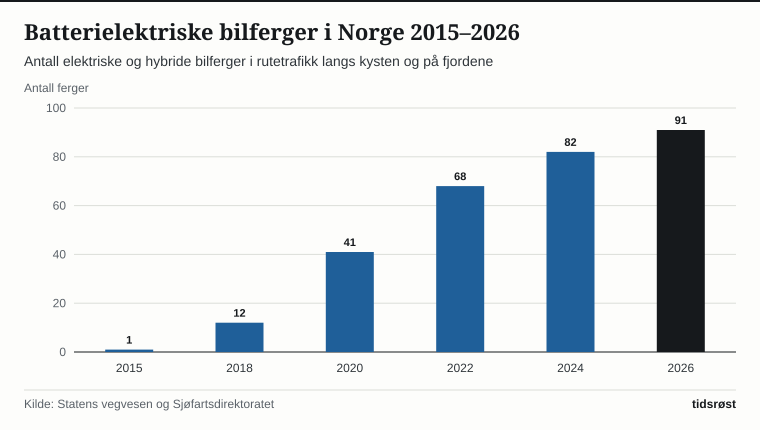
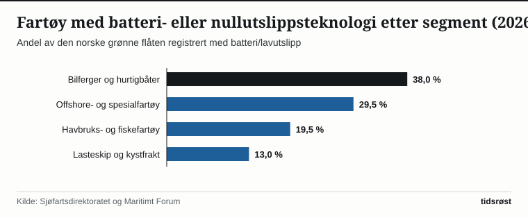

Da bilfergen MF «Ampere» ble satt i rutetrafikk mellom Lavik og Oppedal over Sognefjorden i 2015, var den verdens første batterielektriske bilferge. Elleve år senere, høsten 2026, er 91 elektriske og ladbare hybride bilferger i daglig drift langs norske riks- og fylkesveier, viser oversikter fra Statens vegvesen og Sjøfartsdirektoratet.

Totalt betjener norske bilferger rundt 130 fergesamband som frakter over 20 millioner kjøretøy og mer enn 40 millioner passasjerer hvert år. Med elektrifiseringen av hovedsambandene fra Agder i sør til Troms og Finnmark i nord går nå nærmere to tredjedeler av fergetrafikken i Norge på strøm.

## Fra utviklingskontrakt til nasjonal standard

Utviklingen i fergemarkedet har vært drevet frem av et tett samspill mellom offentlige oppdragsgivere – Statens vegvesen og fylkeskommunene – og den maritime industrien langs kysten. Ved å stille krav om null- og lavutslippsteknologi i offentlige anbud har myndighetene gitt rederier, batteriprodusenter og norske verft forutsigbarhet til å investere i ny teknologi og ladeinfrastruktur på fergekaiene.

*Antall elektriske og ladbare hybride bilferger i rutetrafikk i Norge, 2015–2026. Kilde: Statens vegvesen og Sjøfartsdirektoratet.*

Overgangen sparer allerede over 110 millioner liter marin diesel i året, noe som tilsvarer et årlig utslippskutt på mer enn 300 000 tonn CO₂-ekvivalenter, i tillegg til betydelig lavere utslipp av nitrogenoksider (NOx) og svovel i norske fjorder.

## Grønn teknologi sprer seg til hele den maritime flåten

Erfaringene fra fergesektoren har lagt grunnlaget for batteri- og lavutslippsløsninger i en rekke andre fartøystyper langs kysten:

| Fartøysegment | Antall fartøy med batteri/lavutslipp (ca.) | Viktigste teknologigrep |
|---|---:|---|
| Bilferger og hurtigbåter | 115 | Hel-elektrisk batteridrift og hurtiglading ved kai |
| Offshore- og servicefartøy | 90 | Hybride batteripakker og landstrøm i havn |
| Havbruksbåter og fiskefartøy | 60 | Batterihybrid fremdrift på oppdrettslokaliteter |
| Kystfrakt og nærskipsfart | 40 | Batteri, biogass (LBG), ammoniakk og hydrogenprosjekter |

*Kilde: Sjøfartsdirektoratet, Kystverket og Maritimt Forum.*

Norge har i dag rundt 40 prosent av verdens flåte av batteriutstyrte skip, og norske utstyrsleverandører eksporterer maritime elektriske fremdriftssystemer til verft over hele verden.

*Andel av den norske grønne skipsflåten etter fartøysegment, 2026. Kilde: Sjøfartsdirektoratet og Maritimt Forum.*

## Nye krav til utslippsfrie verdensarvfjorder og hurtigbåter

Fra 2026 gjelder skjerpede nasjonale klimakrav i offentlige anskaffelser av ferger og hurtigbåter, samtidig som passasjerskip under 10 000 bruttotonn møter krav om nullutslipp i de norske verdensarvfjordene Nærøyfjorden og Geirangerfjorden.

Gjennom Enova, Grønn plattform og Eksportfinansiering Norge støtter staten samtidig opp under neste generasjons maritime klimaløsninger – inkludert de første hydrogendrevne fergene på det værharde sambandet over Vestfjorden til Lofoten.

## Kilder

- [Statens vegvesen: Ferjestatistikk og nullutslippsferjer](https://www.vegvesen.no/fag/trafikk/ferje/)
- [Sjøfartsdirektoratet: Grønn skipsfart og ny teknologi](https://www.sdir.no/sjofart/miljo-og-ny-teknologi/)
- [Klima- og miljødepartementet: Regjeringens handlingsplan for grønn skipsfart](https://www.regjeringen.no/no/tema/klima-og-miljo/klima/innsiktsartikler-klima/gronn-skipsfart/id2660885/)
- [SSB: Innenriks sjøfart og utslipp fra sjøfart](https://www.ssb.no/transport-og-reiseliv/sjotransport/statistikk/innenriks-sjofart)
