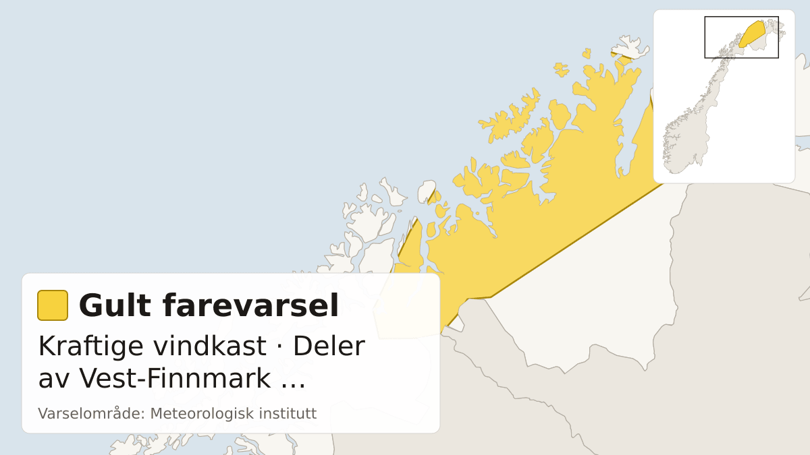

Farevarsler fra Meteorologisk institutt i dag, med de mest alvorlige først. Teksten under hvert varsel er avsenderens egen.

## Oransje farevarsel for sterk ising på skip i BnS

Meteorologisk institutt har sendt ut oransje farevarsel for sterk ising på skip i BnS.

Varselet gjelder fra mandag 12. oktober kl. 16.00 til mandag 12. oktober kl. 20.00.

Utrygt for sterk ising.

**Mulige konsekvenser:** Stor fare for at småbåter kan synke: Det ventes sterk isvekst på fronten/styrhuset til båten. Det er stor fare for at båten mister stabilitet, velter og synker. Sterk isvekst kan gjøre det vanskelig å få fjernet isen raskt nok før uhellet er ute. Kraftig isvekst på overflater: Det er stor risiko for en betydelig mengde is på overflater på båter som ferdes i området. Isen vil føre til glatte dekk, gelender og stiger, og operasjoner utendørs blir utfordrende. Redningsutstyr kan bli påvirket: Nedising av redningsteknisk utstyr kan forekomme, og isingen kan ødelegge samband- og kommunikasjonsutstyr.

**Råd fra MET:** Kraftig isvekst på overflater: Fjern is raskt fra båten.

## Gult farevarsel for kraftige vindkast i deler av Vest-Finnmark og Nord-Troms

*Kart: tidsrøst. Varselområde: Meteorologisk institutt (CC BY 4.0). Kartgrunnlag: Natural Earth.*

Meteorologisk institutt har sendt ut gult farevarsel for kraftige vindkast i deler av Vest-Finnmark og Nord-Troms.

Varselet gjelder fra tirsdag 13. oktober kl. 10.00 til onsdag 14. oktober kl. 00.00.

Fra tirsdag formiddag ventes lokalt kraftige vindkast på 27-33 m/s fra sør, og liten storm 22 m/s, periodevis full storm 25 m/s på fjellet. Minkende sent tirsdag kveld.

**Mulige konsekvenser:** Sikre løse gjenstander: Løse gjenstander kan blåse avgårde. Fare for hindringer i trafikken: Veier kan bli stengt på grunn av trær eller andre objekter i veibanen. Enkelte reiser vil kunne få lengre reisetid. Broer og utsatte veistrekninger kan bli stengt. Fare for strømbrudd: Strømforsyningen kan bli påvirket, for eksempel som følge av trær som knekker eller kommer i kontakt med strømnettet.

**Råd fra MET:** Sikre løse gjenstander: Vurder tiltak for å begrense skade før hendelsen inntreffer. Unngå unødig ferdsel på utsatte steder. Fare for hindringer i trafikken: Sjekk veimeldinger på vegvesen.no/trafikk.

Følg med på oppdaterte varsler på [yr.no](https://www.yr.no/nb/farevarsler) og [varsom.no](https://www.varsom.no/).

*Kilde: [Meteorologisk institutt](https://www.met.no/) (CC BY 4.0)*
