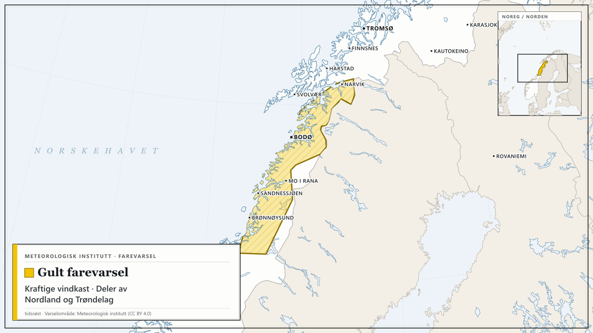
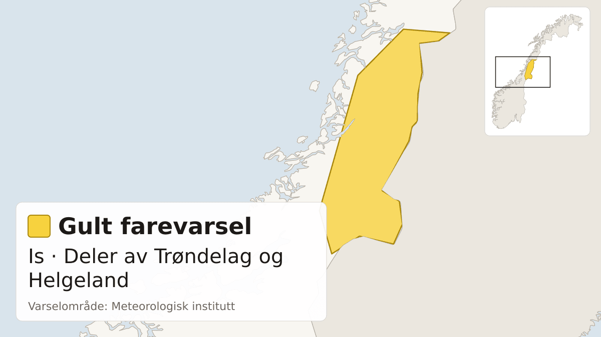
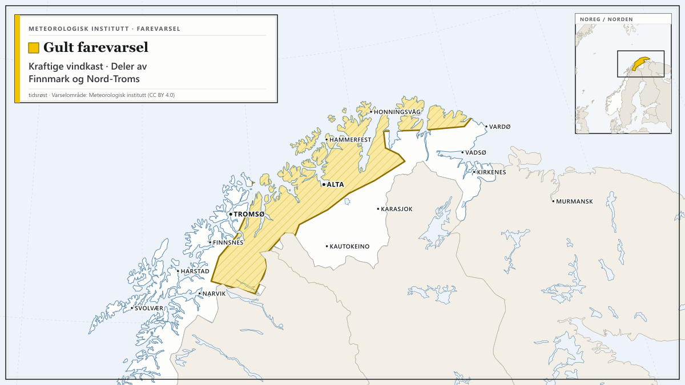

Farevarsler fra Meteorologisk institutt i dag, med de mest alvorlige først. Teksten under hvert varsel er avsenderens egen.

## Gult farevarsel for is i fjellet i Sør-Norge

Meteorologisk institutt har sendt ut gult farevarsel for is i fjellet i Sør-Norge.

Varselet gjelder fra tirsdag 13. oktober kl. 04.00 til tirsdag 13. oktober kl. 16.00.

Tirsdag ventes lokalt fare for is på grunn av overgang til mildvær og nedbør som fryser på kald bakke. Nedbøren vil enkelte steder starte som snø eller sludd.

**Mulige konsekvenser:** Lokalt vanskelige kjøreforhold: Det kan være lokalt vanskelige kjøreforhold. Transporttjenester kan også bli påvirket. Vurder bruk av brodder eller piggsko: Fare for hålkeføre.

**Råd fra MET:** Lokalt vanskelige kjøreforhold: Beregn ekstra tid til transport og kjøring. Bruk riktige dekk og kjør etter forholdene. Vurder bruk av brodder eller piggsko: Vær oppmerksom på at isen kan være vanskelig å se. Følg utviklingen: Følg med på oppdaterte farevarsler. Sjekk veimeldinger på vegvesen.no/trafikk.

## Gult farevarsel for kraftige vindkast i deler av Nordland og Trøndelag

*Kart: tidsrøst. Varselområde: Meteorologisk institutt (CC BY 4.0). Kartgrunnlag: Natural Earth.*

Meteorologisk institutt har sendt ut gult farevarsel for kraftige vindkast i deler av Nordland og Trøndelag.

Varselet gjelder fra tirsdag 13. oktober kl. 08.00 til onsdag 14. oktober kl. 01.00.

Fra tirsdag morgen ventes lokalt kraftige vindkast på 25-30 m/s fra sør, og sterk kuling 20 m/s, periodevis liten storm 22 m/s på fjellet. Minkende tirsdag kveld, først i sør.

**Mulige konsekvenser:** Sikre løse gjenstander: Løse gjenstander kan blåse avgårde. Fare for hindringer i trafikken: Veier kan bli stengt på grunn av trær eller andre objekter i veibanen. Enkelte reiser vil kunne få lengre reisetid. Broer og utsatte veistrekninger kan bli stengt. Fare for strømbrudd: Strømforsyningen kan bli påvirket, for eksempel som følge av trær som knekker eller kommer i kontakt med strømnettet.

**Råd fra MET:** Sikre løse gjenstander: Vurder tiltak for å begrense skade før hendelsen inntreffer. Unngå unødig ferdsel på utsatte steder. Fare for hindringer i trafikken: Sjekk veimeldinger på vegvesen.no/trafikk.

## Gult farevarsel for is i deler av Trøndelag og Helgeland

*Kart: tidsrøst. Varselområde: Meteorologisk institutt (CC BY 4.0). Kartgrunnlag: Natural Earth.*

Meteorologisk institutt har sendt ut gult farevarsel for is i deler av Trøndelag og Helgeland.

Varselet gjelder fra tirsdag 13. oktober kl. 17.00 til onsdag 14. oktober kl. 04.00.

Fra sent tirsdag ettermiddag ventes lokal fare for is på grunn av overgang til mildvær og regn som fryser på kald bakken.

**Mulige konsekvenser:** Lokalt vanskelige kjøreforhold: Det kan være lokalt vanskelige kjøreforhold. Transporttjenester kan også bli påvirket.

**Råd fra MET:** Lokalt vanskelige kjøreforhold: Beregn ekstra tid til transport og kjøring. Bruk riktige dekk og kjør etter forholdene. Vurder bruk av brodder eller piggsko: Vær oppmerksom på at isen kan være vanskelig å se. Følg utviklingen: Følg med på oppdaterte farevarsler. Sjekk veimeldinger på vegvesen.no/trafikk.

## Gult farevarsel for kraftige vindkast i deler av Finnmark og Nord-Troms

*Kart: tidsrøst. Varselområde: Meteorologisk institutt (CC BY 4.0). Kartgrunnlag: Natural Earth.*

Meteorologisk institutt har sendt ut gult farevarsel for kraftige vindkast i deler av Finnmark og Nord-Troms.

Varselet gjelder fra tirsdag 13. oktober kl. 10.00 til onsdag 14. oktober kl. 07.00.

Fra tirsdag formiddag ventes lokalt kraftige vindkast på 27-36 m/s fra sør, og liten storm 22 m/s, periodevis full storm 25 m/s på fjellet. Minkende tidlig onsdag morgen.

**Mulige konsekvenser:** Sikre løse gjenstander: Løse gjenstander kan blåse avgårde. Fare for hindringer i trafikken: Veier kan bli stengt på grunn av trær eller andre objekter i veibanen. Enkelte reiser vil kunne få lengre reisetid. Broer og utsatte veistrekninger kan bli stengt. Fare for strømbrudd: Strømforsyningen kan bli påvirket, for eksempel som følge av trær som knekker eller kommer i kontakt med strømnettet.

**Råd fra MET:** Sikre løse gjenstander: Vurder tiltak for å begrense skade før hendelsen inntreffer. Unngå unødig ferdsel på utsatte steder. Fare for hindringer i trafikken: Sjekk veimeldinger på vegvesen.no/trafikk.

Følg med på oppdaterte varsler på [yr.no](https://www.yr.no/nb/farevarsler) og [varsom.no](https://www.varsom.no/).

*Kilde: [Meteorologisk institutt](https://www.met.no/) (CC BY 4.0)*
