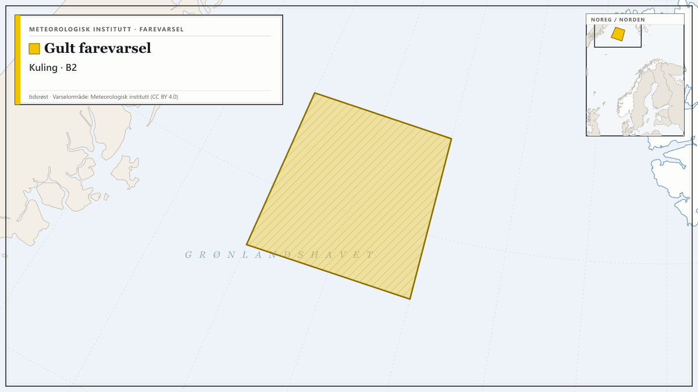
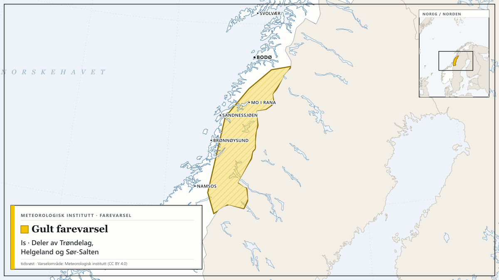
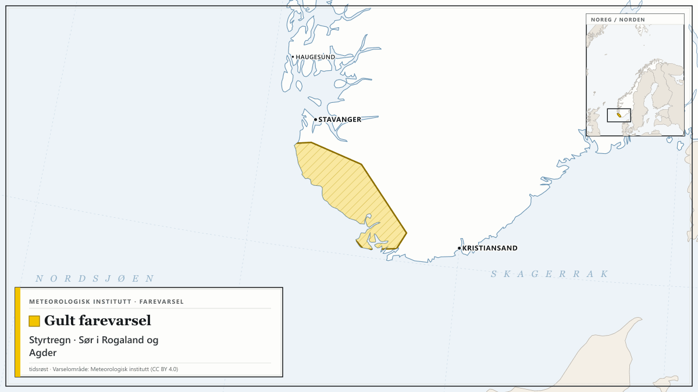
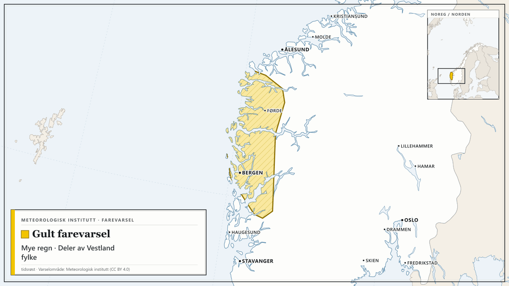
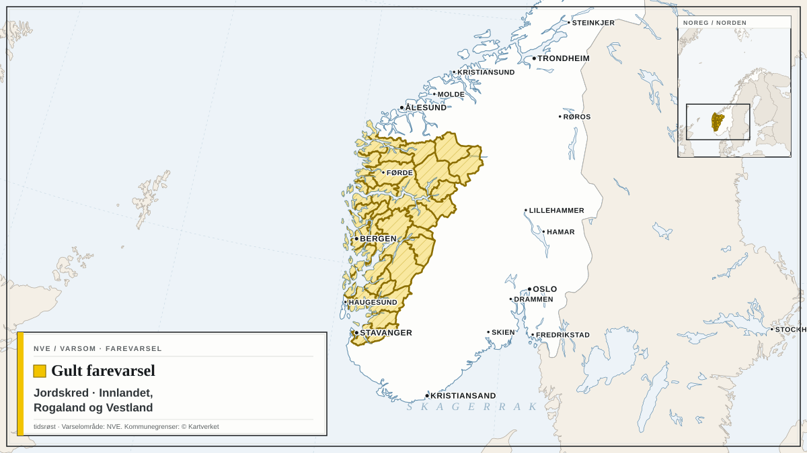

Farevarsler fra Meteorologisk institutt og NVE i dag, med de mest alvorlige først. Teksten under hvert varsel er avsenderens egen.

## Oransje farevarsel for sterk ising på skip i B1

Meteorologisk institutt har sendt ut oransje farevarsel for sterk ising på skip i B1.

Varselet gjelder fra tirsdag 13. oktober kl. 11.00 til onsdag 14. oktober kl. 12.00.

Utrygt for sterk ising.

**Mulige konsekvenser:** Stor fare for at småbåter kan synke: Det ventes sterk isvekst på fronten/styrhuset til båten. Det er stor fare for at båten mister stabilitet, velter og synker. Sterk isvekst kan gjøre det vanskelig å få fjernet isen raskt nok før uhellet er ute. Kraftig isvekst på overflater: Det er stor risiko for en betydelig mengde is på overflater på båter som ferdes i området. Isen vil føre til glatte dekk, gelender og stiger, og operasjoner utendørs blir utfordrende. Redningsutstyr kan bli påvirket: Nedising av redningsteknisk utstyr kan forekomme, og isingen kan ødelegge samband- og kommunikasjonsutstyr.

**Råd fra MET:** Kraftig isvekst på overflater: Fjern is raskt fra båten.

## Oransje farevarsel for sterk ising på skip i B2

*Kart: tidsrøst. Varselområde: Meteorologisk institutt (CC BY 4.0). Kartgrunnlag: Natural Earth.*

Meteorologisk institutt har sendt ut oransje farevarsel for sterk ising på skip i B2.

Varselet gjelder fra onsdag 14. oktober kl. 17.00 til torsdag 15. oktober kl. 00.00.

Utrygt for sterk ising.

**Mulige konsekvenser:** Stor fare for at småbåter kan synke: Det ventes sterk isvekst på fronten/styrhuset til båten. Det er stor fare for at båten mister stabilitet, velter og synker. Sterk isvekst kan gjøre det vanskelig å få fjernet isen raskt nok før uhellet er ute. Kraftig isvekst på overflater: Det er stor risiko for en betydelig mengde is på overflater på båter som ferdes i området. Isen vil føre til glatte dekk, gelender og stiger, og operasjoner utendørs blir utfordrende. Redningsutstyr kan bli påvirket: Nedising av redningsteknisk utstyr kan forekomme, og isingen kan ødelegge samband- og kommunikasjonsutstyr.

**Råd fra MET:** Kraftig isvekst på overflater: Fjern is raskt fra båten.

## Gult farevarsel for is i deler av Trøndelag, Helgeland og Sør-Salten

*Kart: tidsrøst. Varselområde: Meteorologisk institutt (CC BY 4.0). Kartgrunnlag: Natural Earth.*

Meteorologisk institutt har sendt ut gult farevarsel for is i deler av Trøndelag, Helgeland og Sør-Salten.

Varselet gjelder fra tirsdag 13. oktober kl. 17.00 til onsdag 14. oktober kl. 04.00.

Fra sent tirsdag ettermiddag ventes lokal fare for is på grunn av overgang til mildvær og regn som fryser på kald bakke.

**Mulige konsekvenser:** Lokalt vanskelige kjøreforhold: Det kan være lokalt vanskelige kjøreforhold. Transporttjenester kan også bli påvirket.

**Råd fra MET:** Lokalt vanskelige kjøreforhold: Beregn ekstra tid til transport og kjøring. Bruk riktige dekk og kjør etter forholdene. Vurder bruk av brodder eller piggsko: Vær oppmerksom på at isen kan være vanskelig å se. Følg utviklingen: Følg med på oppdaterte farevarsler. Sjekk veimeldinger på vegvesen.no/trafikk.

## Gult farevarsel for styrtregn i Sør i Rogaland og Agder

*Kart: tidsrøst. Varselområde: Meteorologisk institutt (CC BY 4.0). Kartgrunnlag: Natural Earth.*

Meteorologisk institutt har sendt ut gult farevarsel for styrtregn i Sør i Rogaland og Agder.

Varselet gjelder fra tirsdag 13. oktober kl. 14.00 til tirsdag 13. oktober kl. 19.00.

Tirsdag ettermiddag ventes kraftige regnbyger i ditt område. Det er lokale variasjoner i intensitet og mengde, og været kan endres raskt. Nedbørens plassering er usikker. Lokalt er nedbøren ventet å passere 20 mm/1t.

**Mulige konsekvenser:** Lokalt vanskelige kjøreforhold: Lokalt vanskelige kjøreforhold grunnet overvann og fare for vannplaning. Utrygt for lyn: Det er også fare for lyn i forbindelse med regnbygene. Elektriske apparater kan bli skadet hvis de ikke frakobles.

**Råd fra MET:** Hold deg oppdatert på været: Følg utviklingen av regnbygene på yr.no/nb/kart/radar. Fare for vannskade: Vurder å rense stikkrenner og avløp slik at vannet kan renne unna. Lokalt vanskelige kjøreforhold: Tilpass farten og kjør etter forholdene. Ikke kjør bil i oversvømte områder. Sjekk veimeldinger på vegvesen.no/trafikk. Unngå unødvendig ferdsel: Hold deg unna bratte skråninger, samt bekker med stor vannføring. Unngå unødvendig ferdsel på utsatte steder. Utrygt for lyn: Unngå utendørsaktiviteter på utsatte områder, som på fjellet, i vann eller på åpne sletter. Følg utviklingen av tordenværet på yr.no/nb/kart/lyn.

## Gult farevarsel for mye regn i deler av Vestland fylke

*Kart: tidsrøst. Varselområde: Meteorologisk institutt (CC BY 4.0). Kartgrunnlag: Natural Earth.*

Meteorologisk institutt har sendt ut gult farevarsel for mye regn i deler av Vestland fylke.

Varselet gjelder fra torsdag 15. oktober kl. 02.00 til torsdag 15. oktober kl. 17.00.

Det ventes mye regn, lokalt 60-80 mm/12t. Nedbøren øker først i nord og minker sist i sør.

**Mulige konsekvenser:** Overvann kan forekomme: Det kan bli overvann i tettbygde områder. Vanskelige kjøreforhold: Det kan bli vanskelige kjøreforhold noen steder på grunn av overvann og fare for vannplaning. Veier kan bli stengt og det kan være vann i veibanen, særlig ved bekke- og elveløp. Noen reiser kan få lengre reisetid. Flom og skred: NVE sender ut egne flom og skredvarsler.

**Råd fra MET:** Overvann kan forekomme: Vurder å rense stikkrenner og avløp slik at vannet kan renne unna. Vanskelige kjøreforhold: Sjekk veimeldingene på vegvesen.no/trafikk. Tilpass farten og kjør etter forholdene. Flom og skred: Sjekk varslene på Varsom.no.

## Gult farevarsel for jordskred i Innlandet, Rogaland og Vestland

*Kart: tidsrøst. Varselområde: NVE (NLOD). Kommunegrenser: © Kartverket (CC BY 4.0). Kartgrunnlag: Natural Earth.*

NVE har sendt ut gult farevarsel for jordskred i Innlandet, Rogaland og Vestland.

Varselet gjelder fra torsdag 15. oktober kl. 07.00 til fredag 16. oktober kl. 06.59.

Det ventes mye regn fra natt til torsdag, lokalt 60-80 mm på 12 timer. Skredfaren er størst der bygene treffer. Følg værradar. Bratte skråninger, samt bekker og elveløp med stor vannføring er spesielt utsatt. Flomskred har lang rekkevidde og kan gå ned til dalbunnen selv om det løses ut høyt i terrenget.

**Mulige konsekvenser:** Skredhendelser kan forekomme. Utsatte bane- og vegstrekninger kan bli stengt.

**Råd fra NVE:** Hold deg unna bratte skråninger, samt bekker og elveløp med stor vannføring. Hold deg oppdatert om utviklingen av været og skredsituasjonen, og følg med på værradaren. Hold stikkrenner, kummer og andre vannveier fri for grus, søppel, kvist og løv. Tette vannveier med oppdemmet vann kan forårsake skred.

Følg med på oppdaterte varsler på [yr.no](https://www.yr.no/nb/farevarsler) og [varsom.no](https://www.varsom.no/).

*Kilder: [Meteorologisk institutt](https://www.met.no/) (CC BY 4.0), [NVE / Varsom](https://www.varsom.no/) (NLOD)*
