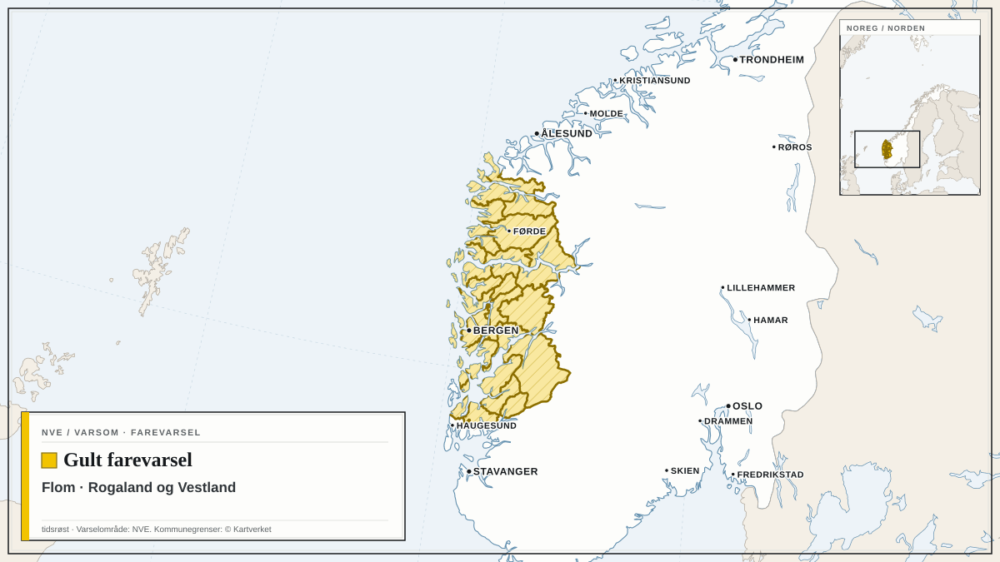

Farevarsler fra Meteorologisk institutt og NVE i dag, med de mest alvorlige først. Teksten under hvert varsel er avsenderens egen.

## Oransje farevarsel for sterk ising på skip i A3

Meteorologisk institutt har sendt ut oransje farevarsel for sterk ising på skip i A3.

Varselet gjelder fra torsdag 15. oktober kl. 21.00 til fredag 16. oktober kl. 00.00.

Utrygt for sterk ising.

**Mulige konsekvenser:** Stor fare for at småbåter kan synke: Det ventes sterk isvekst på fronten/styrhuset til båten. Det er stor fare for at båten mister stabilitet, velter og synker. Sterk isvekst kan gjøre det vanskelig å få fjernet isen raskt nok før uhellet er ute. Kraftig isvekst på overflater: Det er stor risiko for en betydelig mengde is på overflater på båter som ferdes i området. Isen vil føre til glatte dekk, gelender og stiger, og operasjoner utendørs blir utfordrende. Redningsutstyr kan bli påvirket: Nedising av redningsteknisk utstyr kan forekomme, og isingen kan ødelegge samband- og kommunikasjonsutstyr.

**Råd fra MET:** Kraftig isvekst på overflater: Fjern is raskt fra båten.

## Gult farevarsel for flom i Rogaland og Vestland

*Kart: tidsrøst. Varselområde: NVE (NLOD). Kommunegrenser: © Kartverket (CC BY 4.0). Kartgrunnlag: Natural Earth.*

NVE har sendt ut gult farevarsel for flom i Rogaland og Vestland.

Varselet gjelder fra onsdag 14. oktober kl. 07.00 til fredag 16. oktober kl. 06.59.

Vannføringen vil øke raskt i bekker og mindre elver som følge av mye regn første halvdel av torsdagsdøgnet. Sørlig vind gjør at det er i midtre og ytre strøk det forventes mest nedbør. Løvfelling som tetter sluk og vannveier øker risiko for overvann og oversvømmelse i tettbygde områder.

**Mulige konsekvenser:** Lokale oversvømmelser og erosjonsskader i bekker og mindre elver. Overvann i tettbygde områder.

**Råd fra NVE:** Rens stikkrenner, kummer og andre vannveier for kvist og løv slik at vannet kan renne uhindret der det vanligvis renner. Sikre og flytt verdier bort fra utsatte områder.

Følg med på oppdaterte varsler på [yr.no](https://www.yr.no/nb/farevarsler) og [varsom.no](https://www.varsom.no/).

*Kilder: [Meteorologisk institutt](https://www.met.no/) (CC BY 4.0), [NVE / Varsom](https://www.varsom.no/) (NLOD)*
