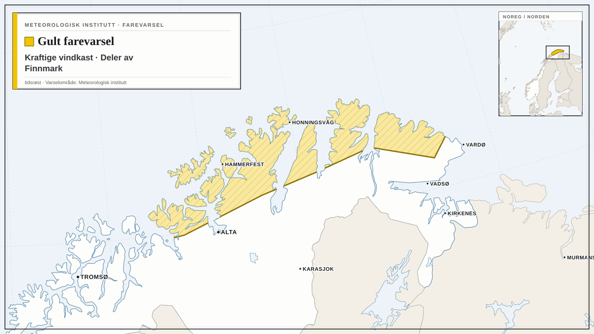
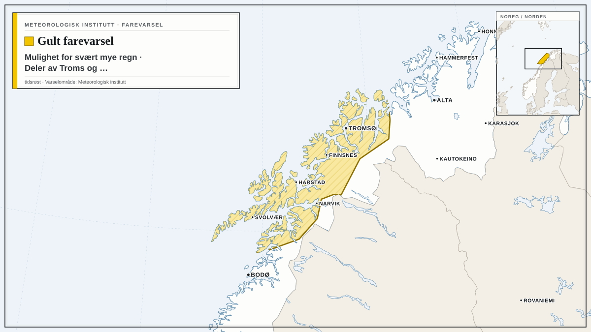
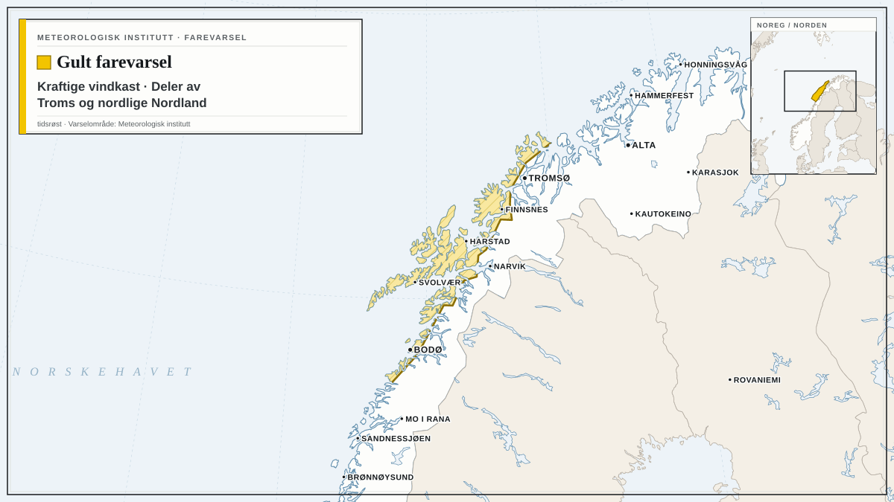

Farevarsler fra Meteorologisk institutt i dag, med de mest alvorlige først. Teksten under hvert varsel er avsenderens egen.

## Oransje farevarsel for sterk ising på skip i A3

Meteorologisk institutt har sendt ut oransje farevarsel for sterk ising på skip i A3.

Varselet gjelder fra lørdag 17. oktober kl. 03.00 til lørdag 17. oktober kl. 08.00.

Utrygt for sterk ising.

**Mulige konsekvenser:** Stor fare for at småbåter kan synke: Det ventes sterk isvekst på fronten/styrhuset til båten. Det er stor fare for at båten mister stabilitet, velter og synker. Sterk isvekst kan gjøre det vanskelig å få fjernet isen raskt nok før uhellet er ute. Kraftig isvekst på overflater: Det er stor risiko for en betydelig mengde is på overflater på båter som ferdes i området. Isen vil føre til glatte dekk, gelender og stiger, og operasjoner utendørs blir utfordrende. Redningsutstyr kan bli påvirket: Nedising av redningsteknisk utstyr kan forekomme, og isingen kan ødelegge samband- og kommunikasjonsutstyr.

**Råd fra MET:** Kraftig isvekst på overflater: Fjern is raskt fra båten.

## Gult farevarsel for kraftige vindkast i deler av Finnmark

*Kart: tidsrøst. Varselområde: Meteorologisk institutt (CC BY 4.0). Kartgrunnlag: Natural Earth.*

Meteorologisk institutt har sendt ut gult farevarsel for kraftige vindkast i deler av Finnmark.

Varselet gjelder fra mandag 19. oktober kl. 09.00 til tirsdag 20. oktober kl. 08.00.

Det ventes lokalt kraftige vindkast på 27-33 m/s fra vest, og liten storm, lokalt full storm, på kysten. Vinden vil øke først i vest og minke sist i øst.

**Mulige konsekvenser:** Sikre løse gjenstander: Løse gjenstander kan blåse avgårde. Fare for hindringer i trafikken: Veier kan bli stengt på grunn av trær eller andre objekter i veibanen. Enkelte reiser vil kunne få lengre reisetid. Broer og utsatte veistrekninger kan bli stengt. Fare for strømbrudd: Strømforsyningen kan bli påvirket, for eksempel som følge av trær som knekker eller kommer i kontakt med strømnettet.

**Råd fra MET:** Sikre løse gjenstander: Vurder tiltak for å begrense skade før hendelsen inntreffer. Unngå unødig ferdsel på utsatte steder. Fare for hindringer i trafikken: Sjekk veimeldinger på vegvesen.no/trafikk.

## Gult farevarsel for mulighet for svært mye regn i deler av Troms og nordlige Nordland

*Kart: tidsrøst. Varselområde: Meteorologisk institutt (CC BY 4.0). Kartgrunnlag: Natural Earth.*

Meteorologisk institutt har sendt ut gult farevarsel for mulighet for svært mye regn i deler av Troms og nordlige Nordland.

Varselet gjelder fra mandag 19. oktober kl. 04.00 til tirsdag 20. oktober kl. 10.00.

Det er fare for svært mye regn, lokal 50-80 mm/24t. Farevarselet vil bli oppgradert til oransje nivå dersom værsituasjonen tilsier det.

**Mulige konsekvenser:** Overvann vil forekomme: Det er fare for overvann i tettbygde områder. Vann kan trenge inn i hus. Vanskelige kjøreforhold: Det kan bli vanskelige kjøreforhold på grunn av overvann og fare for vannplaning. Veier kan bli stengt, og det kan være mye vann i veibanen, særlig ved bekke-og elveløp. Mange reiser kan få lengre reisetid. Flom og skred: NVE sender ut egne flom og skredvarsler.

**Råd fra MET:** Overvann vil forekomme: Rens stikkrenner og avløp slik at vannet kan renne unna. Vanskelige kjøreforhold: Sjekk veimeldinger på vegvesen.no/trafikk. Tilpass farten og kjør etter forholdene. Vurder om reiser er nødvendig. Noen steder kan miste veiforbindelsen: Følg råd fra lokale beredskapsmyndigheter. Flom og skred: Sjekk varslene på Varsom.no.

## Gult farevarsel for kraftige vindkast i deler av Troms og nordlige Nordland

*Kart: tidsrøst. Varselområde: Meteorologisk institutt (CC BY 4.0). Kartgrunnlag: Natural Earth.*

Meteorologisk institutt har sendt ut gult farevarsel for kraftige vindkast i deler av Troms og nordlige Nordland.

Varselet gjelder fra mandag 19. oktober kl. 03.00 til mandag 19. oktober kl. 23.00.

Det ventes lokalt kraftige vindkast på 27-33 m/s fra sørvest, og liten til full storm på kysten. Vinden vil minke sist i nord.

**Mulige konsekvenser:** Sikre løse gjenstander: Løse gjenstander kan blåse avgårde. Fare for hindringer i trafikken: Veier kan bli stengt på grunn av trær eller andre objekter i veibanen. Enkelte reiser vil kunne få lengre reisetid. Broer og utsatte veistrekninger kan bli stengt. Fare for strømbrudd: Strømforsyningen kan bli påvirket, for eksempel som følge av trær som knekker eller kommer i kontakt med strømnettet.

**Råd fra MET:** Sikre løse gjenstander: Vurder tiltak for å begrense skade før hendelsen inntreffer. Unngå unødig ferdsel på utsatte steder. Fare for hindringer i trafikken: Sjekk veimeldinger på vegvesen.no/trafikk.

Følg med på oppdaterte varsler på [yr.no](https://www.yr.no/nb/farevarsler) og [varsom.no](https://www.varsom.no/).

*Kilde: [Meteorologisk institutt](https://www.met.no/) (CC BY 4.0)*
