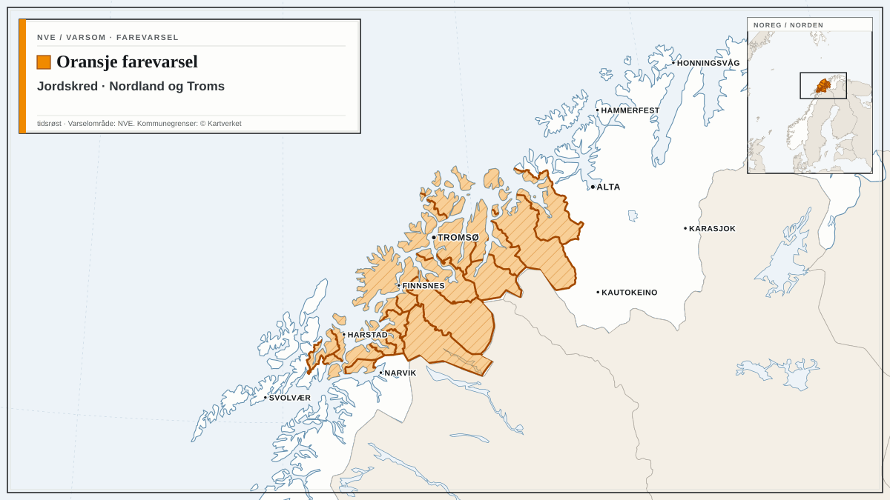
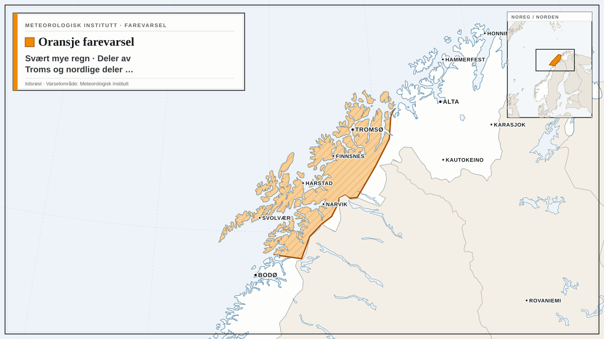
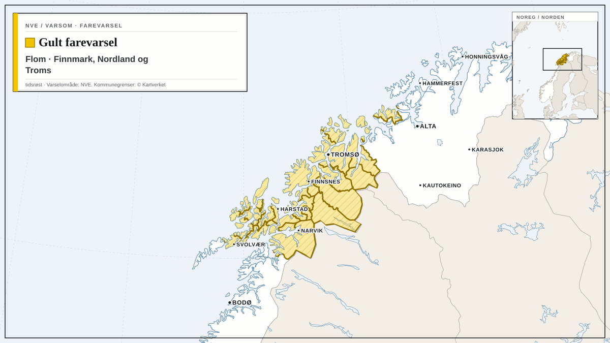
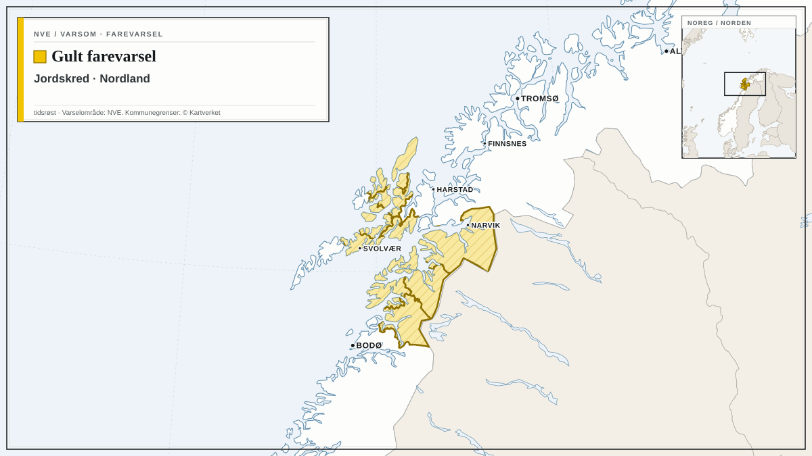
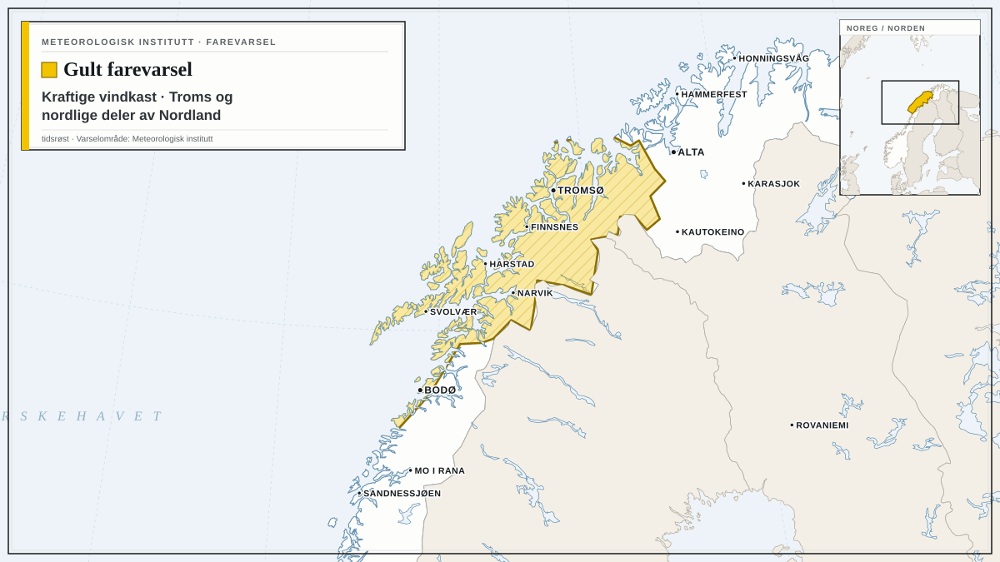

Farevarsler fra Meteorologisk institutt og NVE i dag, med de mest alvorlige først. Teksten under hvert varsel er avsenderens egen.

## Oransje farevarsel for sterk ising på skip i B2

Meteorologisk institutt har sendt ut oransje farevarsel for sterk ising på skip i B2.

Varselet gjelder fra mandag 19. oktober kl. 20.00 til tirsdag 20. oktober kl. 00.00.

Utrygt for sterk ising.

**Mulige konsekvenser:** Stor fare for at småbåter kan synke: Det ventes sterk isvekst på fronten/styrhuset til båten. Det er stor fare for at båten mister stabilitet, velter og synker. Sterk isvekst kan gjøre det vanskelig å få fjernet isen raskt nok før uhellet er ute. Kraftig isvekst på overflater: Det er stor risiko for en betydelig mengde is på overflater på båter som ferdes i området. Isen vil føre til glatte dekk, gelender og stiger, og operasjoner utendørs blir utfordrende. Redningsutstyr kan bli påvirket: Nedising av redningsteknisk utstyr kan forekomme, og isingen kan ødelegge samband- og kommunikasjonsutstyr.

**Råd fra MET:** Kraftig isvekst på overflater: Fjern is raskt fra båten.

## Oransje farevarsel for jordskred i Nordland og Troms

*Kart: tidsrøst. Varselområde: NVE (NLOD). Kommunegrenser: © Kartverket (CC BY 4.0). Kartgrunnlag: Natural Earth.*

NVE har sendt ut oransje farevarsel for jordskred i Nordland og Troms.

Varselet gjelder fra mandag 19. oktober kl. 07.00 til onsdag 21. oktober kl. 06.59.

Det ventes regn og stedvis kraftige regnbyger natt til mandag, opp mot 50-80 mm i lavlandet, og mulig mer nedbør i fjellområder. Relativt høye temperaturer og mye vind fører til stor snøsmelting i fjellområdene. Sterk vind kan føre til nedfall av trær. Lokale regnbyger kan forsterke jord- og flomkredfare der de kraftige bygene treffer. Flomskred har lang rekkevidde og kan gå ned til dalbunnen selv om det løses ut høyt i terrenget. Se varsel om regn og vind for Troms.

**Mulige konsekvenser:** Flere skredhendelser ventes. Noen kan få store konsekvenser. Utsatt bebyggelse kan bli berørt. Framkommelighet på veg eller jernbane kan bli redusert.

**Råd fra NVE:** Hold deg unna bratte skråninger, samt bekker og elveløp med stor vannføring. Hold deg oppdatert om utviklingen av været, skred- og flomsituasjonen, og følg med på værradaren. Beredskapsmyndigheter skal vurdere fortløpende behov for beredskap og forebyggende tiltak. Hold stikkrenner, kummer og andre vannveier fri for snø/is, grus, søppel, kvist og løv. Tette vannveier med oppdemmet vann kan forårsake skred.

## Oransje farevarsel for svært mye regn i deler av Troms og nordlige deler av Nordland

*Kart: tidsrøst. Varselområde: Meteorologisk institutt (CC BY 4.0). Kartgrunnlag: Natural Earth.*

Meteorologisk institutt har sendt ut oransje farevarsel for svært mye regn i deler av Troms og nordlige deler av Nordland.

Varselet gjelder fra mandag 19. oktober kl. 02.00 til tirsdag 20. oktober kl. 10.00.

Fra mandag morgen til tirsdag formiddag ventes svært mye regn, lokalt 50-80 mm/24t i lavlandet.

**Mulige konsekvenser:** Overvann vil forekomme: Det er fare for overvann i tettbygde områder. Vann kan trenge inn i hus. Vanskelige kjøreforhold: Det kan bli vanskelige kjøreforhold på grunn av overvann og fare for vannplaning. Veier kan bli stengt, og det kan være mye vann i veibanen, særlig ved bekke-og elveløp. Mange reiser kan få lengre reisetid. Flom og skred: NVE sender ut egne flom og skredvarsler.

**Råd fra MET:** Overvann vil forekomme: Rens stikkrenner og avløp slik at vannet kan renne unna. Vanskelige kjøreforhold: Sjekk veimeldinger på vegvesen.no/trafikk. Tilpass farten og kjør etter forholdene. Vurder om reiser er nødvendig. Noen steder kan miste veiforbindelsen: Følg råd fra lokale beredskapsmyndigheter. Flom og skred: Sjekk varslene på Varsom.no.

## Gult farevarsel for flom i Finnmark, Nordland og Troms

*Kart: tidsrøst. Varselområde: NVE (NLOD). Kommunegrenser: © Kartverket (CC BY 4.0). Kartgrunnlag: Natural Earth.*

NVE har sendt ut gult farevarsel for flom i Finnmark, Nordland og Troms.

Varselet gjelder fra mandag 19. oktober kl. 07.00 til tirsdag 20. oktober kl. 06.59.

Det er ventet mye nedbør i området fra nord i Nordland og i Troms. Høye temperaturer medfører snøsmelting der det er kommet snø. Det kan føre til raskt økende vannføring i bekker og elver.

**Mulige konsekvenser:** Det er fare for lokale oversvømmelser og erosjonsskader i bekker og mindre elver. Overvann i tettbygde områder, bekke- og elveløpsendringer, jord- og flomskred der regnbygene treffer.

**Råd fra NVE:** Hold deg oppdatert om situasjonen. Sikre og flytt verdier bort fra utsatte områder (f.eks. i kjellere, og biler, campingvogner etc langs elver og bekker). Rens stikkrenner, kummer og andre vannveier for snø/is, jord og grus, kvist og løv, slik at vannet kan renne uhindret der det vanligvis renner. Hold deg unna elver og bekker med stor vannføring. Beredskapsmyndigheter skal vurdere fortløpende behov for beredskap og forebyggende tiltak.

## Gult farevarsel for jordskred i Nordland

*Kart: tidsrøst. Varselområde: NVE (NLOD). Kommunegrenser: © Kartverket (CC BY 4.0). Kartgrunnlag: Natural Earth.*

NVE har sendt ut gult farevarsel for jordskred i Nordland.

Varselet gjelder fra mandag 19. oktober kl. 07.00 til onsdag 21. oktober kl. 06.59.

Det ventes regn og stedvis kraftige regnbyger natt til mandag, stedvis 50-80 mm. Relativt høye temperaturer og mye vind fører til stor snøsmelting, og kan også gi nedfall av trær. Lokale regnbyger kan forsterke jord- og flomkredfare der de kraftige bygene treffer. Se varsel om regn og vind for Nordland. Flomskred har lang rekkevidde og kan gå ned til dalbunnen selv om det løses ut høyt i terrenget.

**Mulige konsekvenser:** Skredhendelser kan forekomme. Utsatte bane- og vegstrekninger kan bli stengt.

**Råd fra NVE:** Hold deg unna bratte skråninger, samt bekker og elveløp med stor vannføring. Hold stikkrenner, kummer og andre vannveier fri for snø/is, grus, søppel, kvist og løv. Tette vannveier med oppdemmet vann kan forårsake skred. Hold deg oppdatert om utviklingen av været, og følg med på værradaren.

## Gult farevarsel for kraftige vindkast i Troms og nordlige deler av Nordland

*Kart: tidsrøst. Varselområde: Meteorologisk institutt (CC BY 4.0). Kartgrunnlag: Natural Earth.*

Meteorologisk institutt har sendt ut gult farevarsel for kraftige vindkast i Troms og nordlige deler av Nordland.

Varselet gjelder fra mandag 19. oktober kl. 06.00 til mandag 19. oktober kl. 21.00.

Det ventes lokalt kraftige vindkast på 27-33 m/s fra sørvest, og full storm på kysten. Vinden vil minke i sør mandag ettermiddag og i nord mandag kveld.

**Mulige konsekvenser:** Fare for innstilte avganger: Det er fare for innstillinger av flyavganger, båter og annen transport. Sikre løse gjenstander: Løse gjenstander kan blåse avgårde. Fare for hindringer i trafikken: Veier kan bli stengt på grunn av trær eller andre objekter i veibanen. Enkelte reiser vil kunne få lengre reisetid. Broer og utsatte veistrekninger kan bli stengt. Fare for strømbrudd: Strømforsyningen kan bli påvirket, for eksempel som følge av trær som knekker eller kommer i kontakt med strømnettet. Lokalt høye bølger: Den sterke vinden kan gi lokalt høye bølger i fjordstrøk og innsjøer.

**Råd fra MET:** Sikre løse gjenstander: Vurder tiltak for å begrense skade før hendelsen inntreffer. Unngå unødig ferdsel på utsatte steder. Fare for hindringer i trafikken: Sjekk veimeldinger på vegvesen.no/trafikk. Fare for innstilte avganger: Følg råd og sjekk status fra transportaktører. Høye bølger treffer land: Vis forsiktighet ved ferdsel i strandsonen.

Følg med på oppdaterte varsler på [yr.no](https://www.yr.no/nb/farevarsler) og [varsom.no](https://www.varsom.no/).

*Kilder: [Meteorologisk institutt](https://www.met.no/) (CC BY 4.0), [NVE / Varsom](https://www.varsom.no/) (NLOD)*
