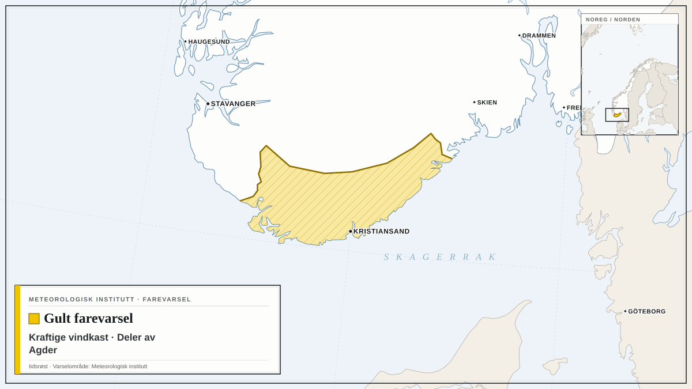
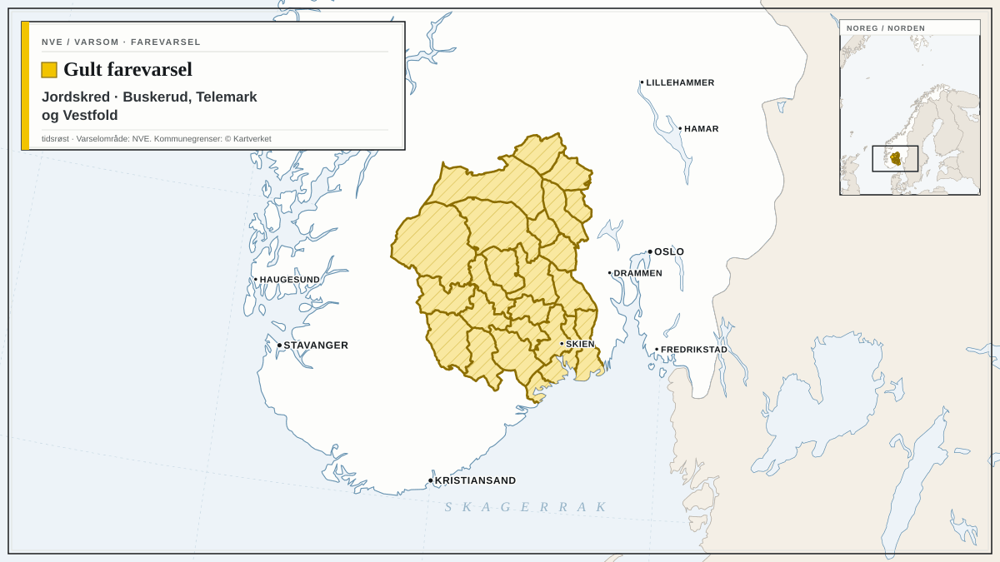
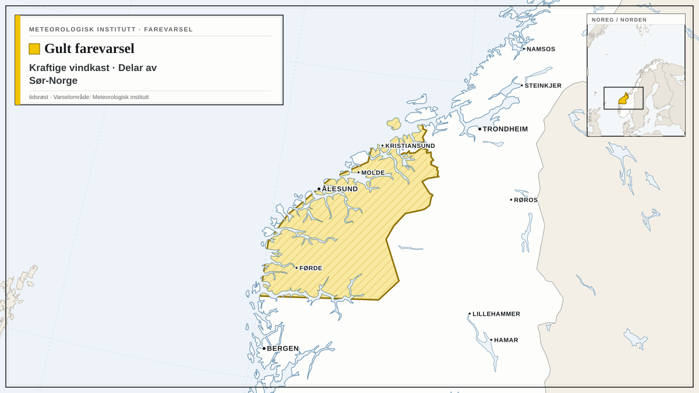
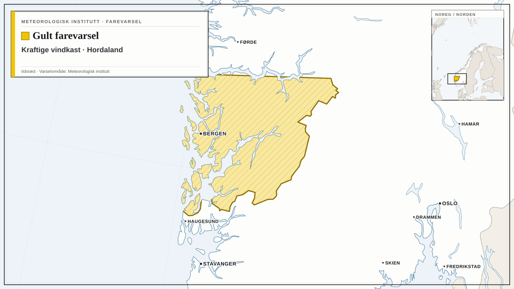
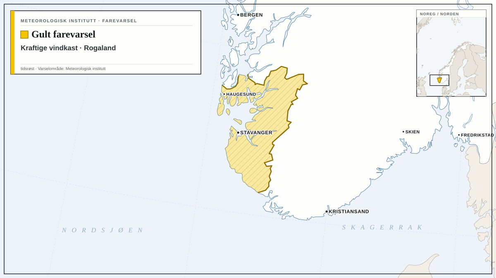
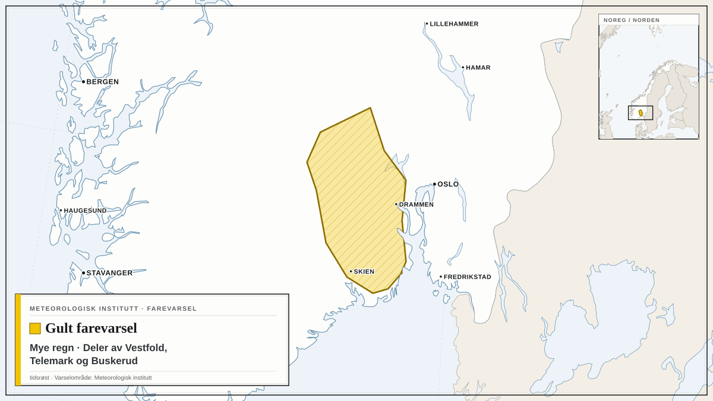
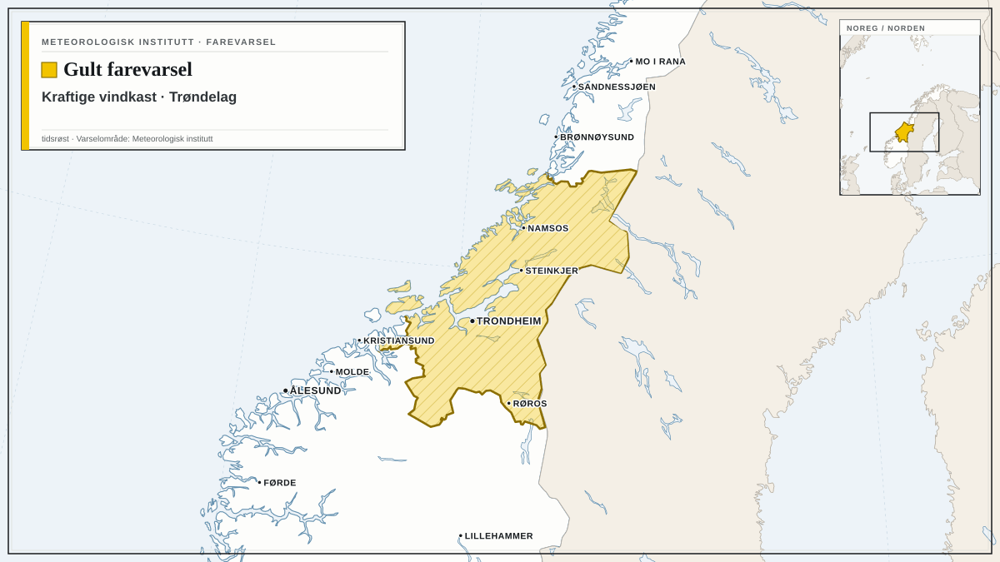
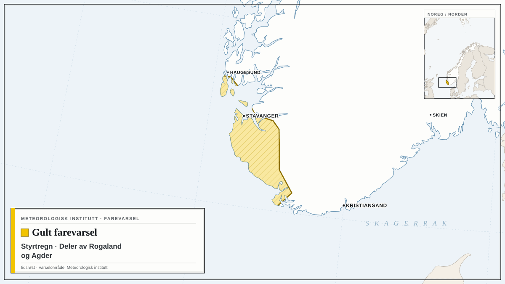

Farevarsler fra NVE og Meteorologisk institutt i dag, med de mest alvorlige først. Teksten under hvert varsel er avsenderens egen.

## Oransje farevarsel for flom i Agder, Akershus, Buskerud, Telemark og Vestfold

NVE har sendt ut oransje farevarsel for flom i Agder, Akershus, Buskerud, Telemark og Vestfold.

Varselet gjelder fra søndag 25. oktober kl. 07.00 til mandag 26. oktober kl. 06.59.

Vannføringen er allerede stor i området og vil øke raskt i bekker og elver i løpet av natt til søndag på grunn av mye nedbør. Det er ventet stedvis 40-60 mm regn på 12 timer. Dette kan føre til omfattende oversvømmelser, erosjonsskader og flomskader på utsatte steder.

**Mulige konsekvenser:** Omfattende oversvømmelser, erosjonsskader og flomskader på utsatte steder. Kan føre til stengte veier og bruer.

**Råd fra NVE:** Hold deg oppdatert om situasjonen. Sikre og flytt verdier bort fra utsatte områder (f.eks. i kjellere, og biler, campingvogner etc langs elver og bekker).  Rens stikkrenner, kummer og andre vannveier for jord og grus, kvist og løv, slik at vannet kan renne uhindret der det vanligvis renner. Hold deg unna elver og bekker med stor vannføring.  Beredskapsmyndigheter skal vurdere fortløpende behov for beredskap og forebyggende tiltak.

## Gult farevarsel for flom i Agder, Akershus, Buskerud, Innlandet, Oslo, Telemark og Vestfold

NVE har sendt ut gult farevarsel for flom i Agder, Akershus, Buskerud, Innlandet, Oslo, Telemark og Vestfold.

Varselet gjelder fra lørdag 24. oktober kl. 07.00 til mandag 26. oktober kl. 06.59.

Vannføringen vil øke i bekker og elver i løpet av lørdag kveld og søndag på grunn av mye nedbør, spesielt natt til søndag. Dette kan føre til lokale oversvømmelser og erosjonsskader.

**Mulige konsekvenser:** Det er fare for lokale oversvømmelser og erosjonsskader i bekker og elver. Overvann i tettbygde områder.

**Råd fra NVE:** Hold deg oppdatert om situasjonen. Sikre og flytt verdier bort fra utsatte områder (f.eks. i kjellere, og biler, campingvogner etc langs elver og bekker). Rens stikkrenner, kummer og andre vannveier for snø/is, jord og grus, kvist og løv, slik at vannet kan renne uhindret der det vanligvis renner. Hold deg unna elver og bekker med stor vannføring.

## Gult farevarsel for kraftige vindkast i deler av Østlandet

Meteorologisk institutt har sendt ut gult farevarsel for kraftige vindkast i deler av Østlandet.

Varselet gjelder fra søndag 25. oktober kl. 03.00 til søndag 25. oktober kl. 10.00.

Det ventes lokalt kraftige vindkast på 20-28 m/s fra sørøst, og liten storm på kysten. Vinden vil øke først i sør, og minke sist i nord.

**Mulige konsekvenser:** Fare for innstilte avganger: Det er fare for innstillinger av flyavganger, båter og annen transport. Sikre løse gjenstander: Løse gjenstander kan blåse avgårde. Fare for hindringer i trafikken: Veier kan bli stengt på grunn av trær eller andre objekter i veibanen. Enkelte reiser vil kunne få lengre reisetid. Broer og utsatte veistrekninger kan bli stengt. Fare for strømbrudd: Strømforsyningen kan bli påvirket, for eksempel som følge av trær som knekker eller kommer i kontakt med strømnettet.

**Råd fra MET:** Sikre løse gjenstander: Vurder tiltak for å begrense skade før hendelsen inntreffer. Unngå unødig ferdsel på utsatte steder. Fare for hindringer i trafikken: Sjekk veimeldinger på vegvesen.no/trafikk. Fare for innstilte avganger: Følg råd og sjekk status fra transportaktører. Lokalt høye bølger: Vis forsiktighet ved ferdsel på sjøen. Høye bølger treffer land: Vis forsiktighet ved ferdsel i strandsonen.

## Gult farevarsel for kraftige vindkast i deler av Agder

*Kart: tidsrøst. Varselområde: Meteorologisk institutt (CC BY 4.0). Kartgrunnlag: Natural Earth.*

Meteorologisk institutt har sendt ut gult farevarsel for kraftige vindkast i deler av Agder.

Varselet gjelder fra søndag 25. oktober kl. 02.00 til søndag 25. oktober kl. 07.00.

Det ventes lokalt kraftige vindkast på 25-30 m/s fra sørøst, og liten storm på kysten. Vinden vil øke først i vest, og minke sist i øst.

**Mulige konsekvenser:** Fare for innstilte avganger: Det er fare for innstillinger av flyavganger, båter og annen transport. Sikre løse gjenstander: Løse gjenstander kan blåse avgårde. Fare for hindringer i trafikken: Veier kan bli stengt på grunn av trær eller andre objekter i veibanen. Enkelte reiser vil kunne få lengre reisetid. Broer og utsatte veistrekninger kan bli stengt. Fare for strømbrudd: Strømforsyningen kan bli påvirket, for eksempel som følge av trær som knekker eller kommer i kontakt med strømnettet.

**Råd fra MET:** Sikre løse gjenstander: Vurder tiltak for å begrense skade før hendelsen inntreffer. Unngå unødig ferdsel på utsatte steder. Fare for hindringer i trafikken: Sjekk veimeldinger på vegvesen.no/trafikk. Fare for innstilte avganger: Følg råd og sjekk status fra transportaktører. Lokalt høye bølger: Vis forsiktighet ved ferdsel på sjøen. Høye bølger treffer land: Vis forsiktighet ved ferdsel i strandsonen.

## Gult farevarsel for jordskred i Buskerud, Telemark og Vestfold

*Kart: tidsrøst. Varselområde: NVE (NLOD). Kommunegrenser: © Kartverket (CC BY 4.0). Kartgrunnlag: Natural Earth.*

NVE har sendt ut gult farevarsel for jordskred i Buskerud, Telemark og Vestfold.

Varselet gjelder fra lørdag 24. oktober kl. 07.00 til mandag 26. oktober kl. 06.59.

Det ventes mye regn og stedvis kraftige regnbyger fra lørdag ettermiddag som gir økt fare for jord- og flomskred. Bratte skråninger, samt bekker og elveløp med stor vannføring er spesielt utsatt. Flomskred har lang rekkevidde og kan gå ned til dalbunnen selv om det løses ut høyt i terrenget.

**Mulige konsekvenser:** Skredhendelser kan forekomme. Utsatte bane- og vegstrekninger kan bli stengt.

**Råd fra NVE:** Hold deg unna bratte skråninger, samt bekker og elveløp med stor vannføring. Hold stikkrenner, kummer og andre vannveier fri for snø/is, grus, søppel, kvist og løv. Tette vannveier med oppdemmet vann kan forårsake skred. Hold deg oppdatert om utviklingen av været, skred- og flomsituasjonen, og følg med på værradaren.

## Gult farevarsel for kraftige vindkast i Delar av Sør-Norge

*Kart: tidsrøst. Varselområde: Meteorologisk institutt (CC BY 4.0). Kartgrunnlag: Natural Earth.*

Meteorologisk institutt har sendt ut gult farevarsel for kraftige vindkast i Delar av Sør-Norge.

Varselet gjelder fra søndag 25. oktober kl. 02.00 til søndag 25. oktober kl. 11.00.

Det er venta lokalt kraftige vindkast på 27-33 m/s fra søraust, og liten storm utsette stader.

**Mulige konsekvenser:** Fare for innstilte avganger: Det er fare for innstillinger av flyavganger, båter og annen transport. Sikre løse gjenstander: Løse gjenstander kan blåse avgårde. Fare for hindringer i trafikken: Veier kan bli stengt på grunn av trær eller andre objekter i veibanen. Enkelte reiser vil kunne få lengre reisetid. Broer og utsatte veistrekninger kan bli stengt. Fare for strømbrudd: Strømforsyningen kan bli påvirket, for eksempel som følge av trær som knekker eller kommer i kontakt med strømnettet. Lokalt høye bølger: Den sterke vinden kan gi lokalt høye bølger i fjordstrøk og innsjøer.

**Råd fra MET:** Sikre løse gjenstander: Vurder tiltak for å begrense skade før hendelsen inntreffer. Unngå unødig ferdsel på utsatte steder. Fare for hindringer i trafikken: Sjekk veimeldinger på vegvesen.no/trafikk. Fare for innstilte avganger: Følg råd og sjekk status fra transportaktører. Lokalt høye bølger: Vis forsiktighet ved ferdsel på sjøen.

## Gult farevarsel for kraftige vindkast i Hordaland

*Kart: tidsrøst. Varselområde: Meteorologisk institutt (CC BY 4.0). Kartgrunnlag: Natural Earth.*

Meteorologisk institutt har sendt ut gult farevarsel for kraftige vindkast i Hordaland.

Varselet gjelder fra søndag 25. oktober kl. 01.00 til søndag 25. oktober kl. 06.00.

Det ventes lokalt kraftige vindkast på 27-35 m/s fra søraust, og full storm på kysten. Vinden vil øke først i sør, og minke sist i nord.

**Mulige konsekvenser:** Fare for innstilte avganger: Det er fare for innstillinger av flyavganger, båter og annen transport. Sikre løse gjenstander: Løse gjenstander kan blåse avgårde. Fare for hindringer i trafikken: Veier kan bli stengt på grunn av trær eller andre objekter i veibanen. Enkelte reiser vil kunne få lengre reisetid. Broer og utsatte veistrekninger kan bli stengt. Fare for strømbrudd: Strømforsyningen kan bli påvirket, for eksempel som følge av trær som knekker eller kommer i kontakt med strømnettet. Lokalt høye bølger: Den sterke vinden kan gi lokalt høye bølger i fjordstrøk og innsjøer.

**Råd fra MET:** Sikre løse gjenstander: Vurder tiltak for å begrense skade før hendelsen inntreffer. Unngå unødig ferdsel på utsatte steder. Fare for hindringer i trafikken: Sjekk veimeldinger på vegvesen.no/trafikk. Fare for innstilte avganger: Følg råd og sjekk status fra transportaktører. Lokalt høye bølger: Vis forsiktighet ved ferdsel på sjøen.

## Gult farevarsel for kraftige vindkast i Rogaland

*Kart: tidsrøst. Varselområde: Meteorologisk institutt (CC BY 4.0). Kartgrunnlag: Natural Earth.*

Meteorologisk institutt har sendt ut gult farevarsel for kraftige vindkast i Rogaland.

Varselet gjelder fra lørdag 24. oktober kl. 23.00 til søndag 25. oktober kl. 05.00.

Det ventes lokalt kraftige vindkast på 27-37 m/s fra søraust, og full og kortvarig sterk storm på kysten. Vinden vil øke først i sør, og minke sist i nord.

**Mulige konsekvenser:** Fare for innstilte avganger: Det er fare for innstillinger av flyavganger, båter og annen transport. Sikre løse gjenstander: Løse gjenstander kan blåse avgårde. Fare for hindringer i trafikken: Veier kan bli stengt på grunn av trær eller andre objekter i veibanen. Enkelte reiser vil kunne få lengre reisetid. Broer og utsatte veistrekninger kan bli stengt. Fare for strømbrudd: Strømforsyningen kan bli påvirket, for eksempel som følge av trær som knekker eller kommer i kontakt med strømnettet. Lokalt høye bølger: Den sterke vinden kan gi lokalt høye bølger i fjordstrøk og innsjøer.

**Råd fra MET:** Sikre løse gjenstander: Vurder tiltak for å begrense skade før hendelsen inntreffer. Unngå unødig ferdsel på utsatte steder. Fare for hindringer i trafikken: Sjekk veimeldinger på vegvesen.no/trafikk. Fare for innstilte avganger: Følg råd og sjekk status fra transportaktører. Lokalt høye bølger: Vis forsiktighet ved ferdsel på sjøen.

## Gult farevarsel for mye regn i deler av Vestfold, Telemark og Buskerud

*Kart: tidsrøst. Varselområde: Meteorologisk institutt (CC BY 4.0). Kartgrunnlag: Natural Earth.*

Meteorologisk institutt har sendt ut gult farevarsel for mye regn i deler av Vestfold, Telemark og Buskerud.

Varselet gjelder fra søndag 25. oktober kl. 02.00 til søndag 25. oktober kl. 16.00.

Det ventes mye regn første del av søndag, lokalt 40-60 mm/12t.

**Mulige konsekvenser:** Overvann kan forekomme: Det kan bli overvann i tettbygde områder. Vanskelige kjøreforhold: Det kan bli vanskelige kjøreforhold noen steder på grunn av overvann og fare for vannplaning. Veier kan bli stengt og det kan være vann i veibanen, særlig ved bekke- og elveløp. Noen reiser kan få lengre reisetid.

**Råd fra MET:** Overvann kan forekomme: Vurder å rense stikkrenner og avløp slik at vannet kan renne unna. Vanskelige kjøreforhold: Sjekk veimeldingene på vegvesen.no/trafikk. Tilpass farten og kjør etter forholdene.

## Gult farevarsel for kraftige vindkast i Trøndelag

*Kart: tidsrøst. Varselområde: Meteorologisk institutt (CC BY 4.0). Kartgrunnlag: Natural Earth.*

Meteorologisk institutt har sendt ut gult farevarsel for kraftige vindkast i Trøndelag.

Varselet gjelder fra lørdag 24. oktober kl. 23.00 til søndag 25. oktober kl. 17.00.

Det er venta lokalt kraftige vindkast på 27-35 m/s fra søraust, og liten storm utsette stader.

**Mulige konsekvenser:** Fare for innstilte avganger: Det er fare for innstillinger av flyavganger, båter og annen transport. Sikre løse gjenstander: Løse gjenstander kan blåse avgårde. Fare for hindringer i trafikken: Veier kan bli stengt på grunn av trær eller andre objekter i veibanen. Enkelte reiser vil kunne få lengre reisetid. Broer og utsatte veistrekninger kan bli stengt. Fare for strømbrudd: Strømforsyningen kan bli påvirket, for eksempel som følge av trær som knekker eller kommer i kontakt med strømnettet. Lokalt høye bølger: Den sterke vinden kan gi lokalt høye bølger i fjordstrøk og innsjøer.

**Råd fra MET:** Sikre løse gjenstander: Vurder tiltak for å begrense skade før hendelsen inntreffer. Unngå unødig ferdsel på utsatte steder. Fare for hindringer i trafikken: Sjekk veimeldinger på vegvesen.no/trafikk. Fare for innstilte avganger: Følg råd og sjekk status fra transportaktører. Lokalt høye bølger: Vis forsiktighet ved ferdsel på sjøen.

## Gult farevarsel for styrtregn i deler av Rogaland og Agder

*Kart: tidsrøst. Varselområde: Meteorologisk institutt (CC BY 4.0). Kartgrunnlag: Natural Earth.*

Meteorologisk institutt har sendt ut gult farevarsel for styrtregn i deler av Rogaland og Agder.

Varselet gjelder fra søndag 25. oktober kl. 02.00 til søndag 25. oktober kl. 05.00.

Kraftige regnbyger ventes i ditt område. Det er lokale variasjoner i intensitet og mengde, og været kan endres raskt. Nedbørens plassering er usikker. Lokalt er nedbøren ventet å passere 20 mm/1t.

**Mulige konsekvenser:** Fare for vannskade: Det er fare for overvann i tettbygde områder, og vann som trenger inn i kjellere. Fare for lokale oversvømmelser, bekke- og elveløpsendringer, jord- og flomskred der de kraftigste regnbygene treffer. Lokalt vanskelige kjøreforhold: Lokalt vanskelige kjøreforhold grunnet overvann og fare for vannplaning. Utrygt for lyn: Det er også fare for lyn i forbindelse med regnbygene. Elektriske apparater kan bli skadet hvis de ikke frakobles.

**Råd fra MET:** Hold deg oppdatert på været: Følg utviklingen av regnbygene på yr.no/nb/kart/radar. Fare for vannskade: Vurder å rense stikkrenner og avløp slik at vannet kan renne unna. Lokalt vanskelige kjøreforhold: Tilpass farten og kjør etter forholdene. Ikke kjør bil i oversvømte områder. Sjekk veimeldinger på vegvesen.no/trafikk.

Følg med på oppdaterte varsler på [yr.no](https://www.yr.no/nb/farevarsler) og [varsom.no](https://www.varsom.no/).

*Kilder: [NVE / Varsom](https://www.varsom.no/) (NLOD), [Meteorologisk institutt](https://www.met.no/) (CC BY 4.0)*
