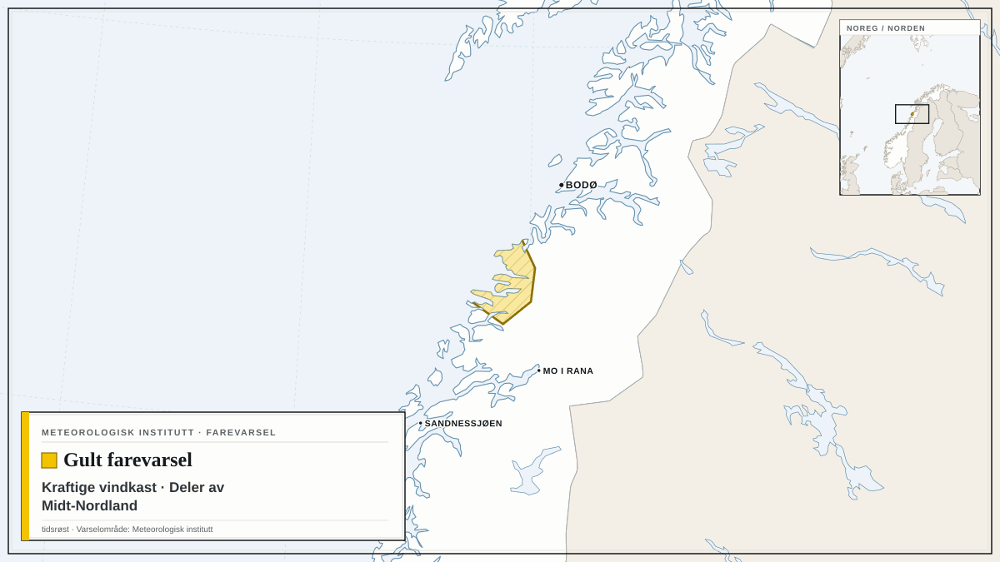

Farevarsler fra NVE og Meteorologisk institutt i dag, med de mest alvorlige først. Teksten under hvert varsel er avsenderens egen.

## Oransje farevarsel for jordskred i Akershus, Buskerud, Oslo, Telemark og Vestfold

NVE har sendt ut oransje farevarsel for jordskred i Akershus, Buskerud, Oslo, Telemark og Vestfold.

Varselet gjelder fra lørdag 24. oktober kl. 07.00 til mandag 26. oktober kl. 06.59.

Det ventes mye regn og stedvis kraftige regnbyger fra lørdag ettermiddag som gir økt fare for jord- og flomskred. Bratte skråninger, samt bekker og elveløp med stor vannføring er spesielt utsatt. Flomskred har lang rekkevidde og kan gå ned til dalbunnen selv om det løses ut høyt i terrenget.

**Råd fra NVE:** Beredskapsmyndigheter skal vurdere fortløpende behov for beredskap og forebyggende tiltak. Hold deg unna bratte skråninger, samt bekker og elveløp med stor vannføring. Hold stikkrenner, kummer og andre vannveier fri for grus, søppel, kvist og løv. Tette vannveier med oppdemmet vann kan forårsake skred. Hold deg oppdatert om utviklingen av været, skred- og flomsituasjonen, og følg med på værradaren.

## Gult farevarsel for kraftige vindkast i deler av Trøndelag

Meteorologisk institutt har sendt ut gult farevarsel for kraftige vindkast i deler av Trøndelag.

Varselet gjelder fra søndag 25. oktober kl. 02.00 til søndag 25. oktober kl. 12.00.

På søndag er det venta lokalt kraftige vindkast på 27-33 m/s fra søraust, og liten storm utsette stader.

**Mulige konsekvenser:** Fare for innstilte avganger: Det er fare for innstillinger av flyavganger, båter og annen transport. Sikre løse gjenstander: Løse gjenstander kan blåse avgårde. Fare for hindringer i trafikken: Veier kan bli stengt på grunn av trær eller andre objekter i veibanen. Enkelte reiser vil kunne få lengre reisetid. Broer og utsatte veistrekninger kan bli stengt. Fare for strømbrudd: Strømforsyningen kan bli påvirket, for eksempel som følge av trær som knekker eller kommer i kontakt med strømnettet. Lokalt høye bølger: Den sterke vinden kan gi lokalt høye bølger i fjordstrøk og innsjøer.

**Råd fra MET:** Sikre løse gjenstander: Vurder tiltak for å begrense skade før hendelsen inntreffer. Unngå unødig ferdsel på utsatte steder. Fare for hindringer i trafikken: Sjekk veimeldinger på vegvesen.no/trafikk. Fare for innstilte avganger: Følg råd og sjekk status fra transportaktører. Lokalt høye bølger: Vis forsiktighet ved ferdsel på sjøen.

## Gult farevarsel for kraftige vindkast i deler av Midt-Nordland

*Kart: tidsrøst. Varselområde: Meteorologisk institutt (CC BY 4.0). Kartgrunnlag: Natural Earth.*

Meteorologisk institutt har sendt ut gult farevarsel for kraftige vindkast i deler av Midt-Nordland.

Varselet gjelder fra søndag 25. oktober kl. 05.00 til søndag 25. oktober kl. 23.00.

Det ventes lokalt kraftige vindkast på 27-32 m/s fra sørøst, og periodevis sterk kuling på kysten. Vinden minker sent søndag kveld.

**Mulige konsekvenser:** Sikre løse gjenstander: Løse gjenstander kan blåse avgårde. Fare for hindringer i trafikken: Veier kan bli stengt på grunn av trær eller andre objekter i veibanen. Enkelte reiser vil kunne få lengre reisetid. Broer og utsatte veistrekninger kan bli stengt. Fare for strømbrudd: Strømforsyningen kan bli påvirket, for eksempel som følge av trær som knekker eller kommer i kontakt med strømnettet.

**Råd fra MET:** Sikre løse gjenstander: Vurder tiltak for å begrense skade før hendelsen inntreffer. Unngå unødig ferdsel på utsatte steder. Fare for hindringer i trafikken: Sjekk veimeldinger på vegvesen.no/trafikk.

Følg med på oppdaterte varsler på [yr.no](https://www.yr.no/nb/farevarsler) og [varsom.no](https://www.varsom.no/).

*Kilder: [NVE / Varsom](https://www.varsom.no/) (NLOD), [Meteorologisk institutt](https://www.met.no/) (CC BY 4.0)*
