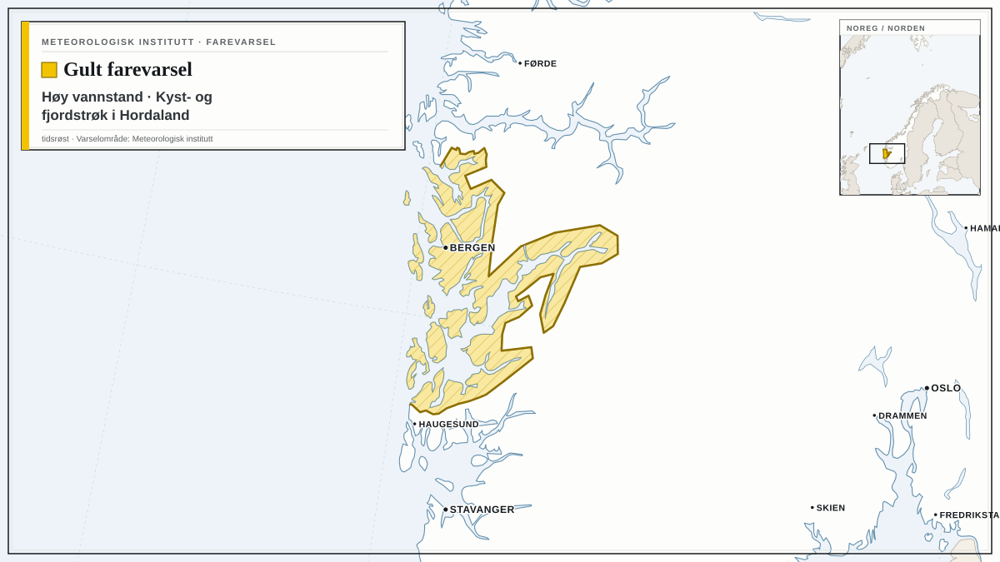
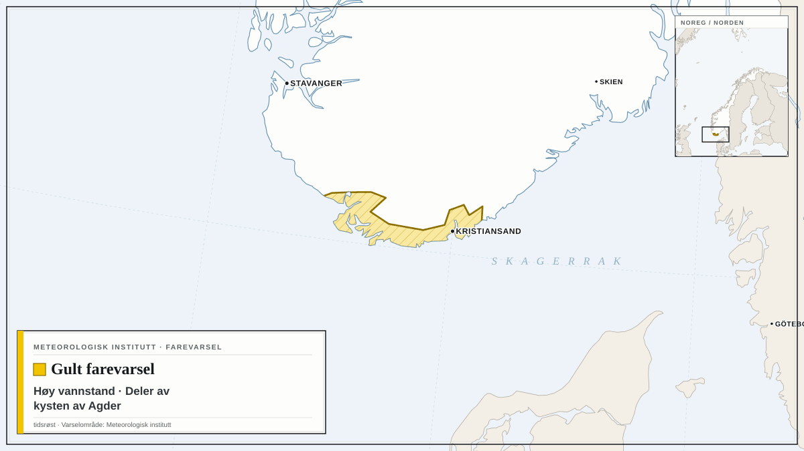
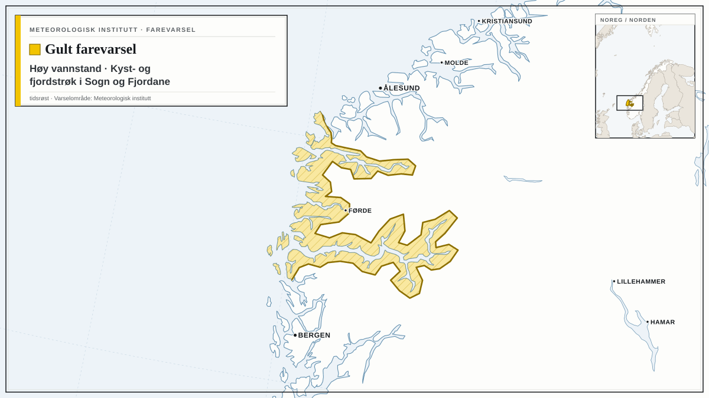

Farevarsler fra Meteorologisk institutt i dag, med de mest alvorlige først. Teksten under hvert varsel er avsenderens egen.

## Oransje farevarsel for svært høy vannstand i Kyst- og fjordstrøk i Rogaland

Meteorologisk institutt har sendt ut oransje farevarsel for svært høy vannstand i Kyst- og fjordstrøk i Rogaland.

Varselet gjelder fra mandag 26. oktober kl. 07.00 til mandag 26. oktober kl. 13.00.

Det er ventet svært høy vannstand. Mer informasjon om tidspunkt for høy vannstand og verdier for steder langs kysten finnes på sehavniva.no. Usikkerheten i varslet vannstand er 5-10 cm.

**Mulige konsekvenser:** Fare for skader i strandsonen: Oversvømmelser kan gi omfattende skader på infrastruktur og bygninger flere steder i strandsonen. Unngå unødig ferdsel i strandsonen: Sterk vind og høye bølger i kombinasjon med høy vannstand kan øke skadeomfanget i strandsonen.

**Råd fra MET:** Fare for skader i strandsonen: Sjekk fortøyningen til båten og sikre løse gjenstander i strandsonen.

## Gult farevarsel for høy vannstand i Kyst- og fjordstrøk i Hordaland

*Kart: tidsrøst. Varselområde: Meteorologisk institutt (CC BY 4.0). Kartgrunnlag: Natural Earth.*

Meteorologisk institutt har sendt ut gult farevarsel for høy vannstand i Kyst- og fjordstrøk i Hordaland.

Varselet gjelder fra mandag 26. oktober kl. 07.00 til mandag 26. oktober kl. 13.00.

Det er ventet høy vannstand. Mer informasjon om tidspunkt for høy vannstand og verdier for steder langs kysten finnes på sehavniva.no. Usikkerheten i varslet vannstand er 5-10 cm.

**Mulige konsekvenser:** Fare for skader i strandsonen: Oversvømmelser kan gi skader på infrastruktur og bygninger enkelte steder i strandsonen. Vis forsiktighet i strandsonen: Sterk vind og høye bølger i kombinasjon med høy vannstand kan øke skadeomfanget i strandsonen.

**Råd fra MET:** Fare for skader i strandsonen: Sjekk fortøyningen til båten og sikre løse gjenstander i strandsonen.

## Gult farevarsel for høy vannstand i deler av kysten av Agder

*Kart: tidsrøst. Varselområde: Meteorologisk institutt (CC BY 4.0). Kartgrunnlag: Natural Earth.*

Meteorologisk institutt har sendt ut gult farevarsel for høy vannstand i deler av kysten av Agder.

Varselet gjelder fra mandag 26. oktober kl. 07.00 til mandag 26. oktober kl. 13.00.

Det er ventet høy vannstand. Mer informasjon om tidspunkt for høy vannstand og verdier for steder langs kysten finnes på sehavniva.no. Usikkerheten i varslet vannstand er 5-10 cm.

**Mulige konsekvenser:** Fare for skader i strandsonen: Oversvømmelser kan gi skader på infrastruktur og bygninger enkelte steder i strandsonen. Vis forsiktighet i strandsonen: Sterk vind og høye bølger i kombinasjon med høy vannstand kan øke skadeomfanget i strandsonen.

**Råd fra MET:** Fare for skader i strandsonen: Sjekk fortøyningen til båten og sikre løse gjenstander i strandsonen.

## Gult farevarsel for høy vannstand i Kyst- og fjordstrøk i Sogn og Fjordane

*Kart: tidsrøst. Varselområde: Meteorologisk institutt (CC BY 4.0). Kartgrunnlag: Natural Earth.*

Meteorologisk institutt har sendt ut gult farevarsel for høy vannstand i Kyst- og fjordstrøk i Sogn og Fjordane.

Varselet gjelder fra mandag 26. oktober kl. 08.00 til mandag 26. oktober kl. 12.00.

Det er ventet høy vannstand. Mer informasjon om tidspunkt for høy vannstand og verdier for steder langs kysten finnes på sehavniva.no. Usikkerheten i varslet vannstand er 5-10 cm.

**Mulige konsekvenser:** Fare for skader i strandsonen: Oversvømmelser kan gi skader på infrastruktur og bygninger enkelte steder i strandsonen. Vis forsiktighet i strandsonen: Sterk vind og høye bølger i kombinasjon med høy vannstand kan øke skadeomfanget i strandsonen.

**Råd fra MET:** Fare for skader i strandsonen: Sjekk fortøyningen til båten og sikre løse gjenstander i strandsonen.

Følg med på oppdaterte varsler på [yr.no](https://www.yr.no/nb/farevarsler) og [varsom.no](https://www.varsom.no/).

*Kilde: [Meteorologisk institutt](https://www.met.no/) (CC BY 4.0)*
