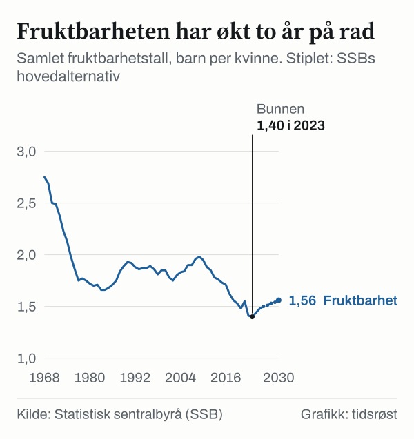

Kvinner i Norge fikk i gjennomsnitt 1,48 barn i 2025, viser statistikk fra Statistisk sentralbyrå (SSB). Det er andre år på rad med oppgang etter at fruktbarheten i 2023 var nede i 1,40 barn per kvinne – det laveste nivået i SSBs tidsserie tilbake til 1968 – og deretter økte til 1,44 i 2024. Samtidig lever befolkningen stadig lenger. I befolkningsframskrivingene fra juni 2026 anslår SSB at andelen innbyggere på 80 år eller mer nesten dobles fram mot 2050.

## Fra 1,98 til 1,48 barn per kvinne

Samlet fruktbarhetstall (SFT) måler hvor mange barn hver kvinne i gjennomsnitt ville fått gjennom livet dersom fødselsmønsteret i et bestemt kalenderår holdt seg uendret.

I 2009 lå tallet på 1,98 barn per kvinne i Norge, før det gikk gradvis ned til 1,48 i 2020. Under pandemien kom et oppsving til 1,55 i 2021, etterfulgt av 1,41 i 2022 og 1,40 i 2023, før pilen igjen har pekt oppover i 2024 og 2025.

*Samlet fruktbarhetstall, hele landet, 2005–2025. Kilde: SSB, tabell 04232.*

Det var særlig kvinner i aldersgruppen 30–34 år som trakk fødselstallene opp i 2025. Gjennomsnittsalderen for førstegangsfødende lå uendret på 30,4 år for kvinner og 32,3 år for førstegangsfedre.

## 55 401 nyfødte i 2025

Utviklingen i antallet nyfødte følger fruktbarhetstallet. I toppåret 2009 kom 61 807 barn til verden i Norge. Etter 51 480 fødte i 2022 og 51 980 i 2023 økte fødselstallet til 54 013 i 2024 og videre til 55 401 levendefødte i 2025 – en oppgang på 1 388 barn fra året før.

| År | Levendefødte | Samlet fruktbarhetstall |
|---|---|---|
| 2009 | 61 807 | 1,98 |
| 2015 | 59 058 | 1,73 |
| 2023 | 51 980 | 1,40 |
| 2024 | 54 013 | 1,44 |
| 2025 | 55 401 | 1,48 |

*Kilde: SSB, tabell 04231 og 04232.*

Fordi flere venter lenger med å få sitt første barn, anslår SSB at samlet barnetall for dagens unge voksne vil ligge lavere enn i tidligere generasjoner. Blant kvinnene som fylte 30 år i 2025, hadde 42 prosent fått barn og 58 prosent var fortsatt uten barn, mot 43 prosent uten barn ti år tidligere.

## Demografisk milepæl i 2032

Ved inngangen til 2026 hadde Norge 5 627 400 innbyggere. Av disse var 959 633 personer 67 år eller eldre (17,1 prosent), mens 284 939 hadde fylt 80 år (5,1 prosent).

I SSBs hovedalternativ for befolkningsutviklingen vokser folketallet til 6 214 071 i 2050. Da ventes gruppen på 67 år og over å telle 1 425 792 personer, mens antallet over 80 år mer enn dobles til 588 212. De eldste over 80 år vil dermed utgjøre 9,5 prosent av befolkningen i 2050 og 10,8 prosent i 2060.

*Andel av befolkningen 67 år og eldre og 80 år og eldre, SSBs hovedalternativ. Kilde: SSB, tabell 14740.*

I 2032 passerer Norge en demografisk milepæl på landsbasis: Da vil det for første gang være flere innbyggere over 65 år enn barn og unge under 20 år. I Innlandet, Telemark, Vestfold, Nordland og Troms har dette skiftet allerede funnet sted, mens Oslo ventes å passere det innen 2046.

Samme år – i 2046 – anslår hovedalternativet at fødselsoverskuddet går over i et lite fødselsunderskudd (58 146 fødte mot 58 801 døde, etter 58 593 fødte og 58 368 døde i 2045).

## Lengre levealder og store etterkrigskull

I hovedalternativet legger SSB til grunn at fruktbarhetstallet gradvis løfter seg videre til 1,50 i 2026, 1,56 i 2030 og 1,63 i 2050 (med et spenn fra 1,19 i lavalternativet til 1,87 i høyalternativet).

Fødselstallsutvalget peker i sin utredning på at endringer i fødselstallene virker på svært lang sikt: «Ulike nivåer på fødselstallene i framskrivingene vil ikke påvirke antallet eldre før etter 2090.» At antallet eldre øker nå, skyldes den positive utviklingen i levealder kombinert med at de store etterkrigskullene når høy alder.

## Fødselstallsutvalgets forslag til familierettede tiltak

Fødselstallsutvalget, som ble oppnevnt av regjeringen i august 2024 under ledelse av Rannveig Kaldager Hart, overleverte utredningen NOU 2026: 2 «Politikk for nye generasjoner» 9. februar 2026.

Utvalget belyser hvordan endret alderssammensetning påvirker kommunenes planlegging. Lavere barnekull reduserer utgiftene til barnehager og skoler på kort sikt, men «gir likevel mindre grunnlag for tilbud til barn og unge» i mindre lokalsamfunn, samtidig som «aldringen gir en sterk og varig vekst i behovet for helse- og omsorgstjenester». For statsfinansene viser utvalget til beregninger fra SSB-forskere som viser at utslaget på nasjonalinntekten per innbygger på lang sikt – etter rundt 65 år – er begrenset.

Utvalgets hovedanbefaling er å videreutvikle de norske velferdsordningene slik at det blir enda enklere å kombinere familieliv, utdanning og arbeid. Blant forslagene er styrket økonomisk støtte til foreldre under 30 år, løpende rett til barnehageplass fra barnet fyller ett år kombinert med mer fleksible foreldrepenger, styrkede barsel- og helsetjenester for nybakte foreldre og utprøving av kortere arbeidstid for småbarnsforeldre.

– Fleksibilitet og tid til familieliv er vel så viktig som økonomiske tilskudd og insentiver, sa barne- og familieminister Lene Vågslid da hun mottok rapporten.

Utredningen ble sendt på bred høring 22. april 2026 med høringsfrist 1. august 2026, og følges nå opp av Barne- og familiedepartementet.

## Kilder

- [SSB: Fødte, statistikkside](https://www.ssb.no/befolkning/fodte-og-dode/statistikk/fodte) – samlet fruktbarhetstall og levendefødte 2015, 2024 og 2025, fødealder
- [SSB: Fruktbarheten fortsetter å øke (12. mars 2026)](https://www.ssb.no/befolkning/fodte-og-dode/statistikk/fodte/artikler/fruktbarheten-fortsetter-a-oke) – aldersgruppen 30–34 år, andel barnløse 30-åringer, vurdering av framtidig fruktbarhet
- [SSB Statistikkbanken, tabell 04232: Samlet fruktbarhetstall](https://www.ssb.no/statbank/table/04232) – tidsserie 1968–2025
- [SSB Statistikkbanken, tabell 04231: Levendefødte](https://www.ssb.no/statbank/table/04231) – antall fødte 2009–2025
- [SSB: Befolkningen eldes raskt de neste ti årene (12. juni 2026)](https://www.ssb.no/befolkning/befolkningsframskrivinger/statistikk/nasjonale-befolkningsframskrivinger/artikler/befolkningen-eldes-raskt-de-neste-ti-arene) – vendepunktet i 2032, fylkestall, fødselsunderskudd fra 2046
- [SSB Statistikkbanken, tabell 14740: Framskrevet folkemengde](https://www.ssb.no/statbank/table/14740) – folkemengde etter alder 2026–2060
- [SSB Statistikkbanken, tabell 14742: Framskrevet befolkningsendringer](https://www.ssb.no/statbank/table/14742) – framskrevne fødte og døde
- [SSB Statistikkbanken, tabell 14743: Framskrevet fruktbarhet](https://www.ssb.no/statbank/table/14743) – fruktbarhetsforutsetninger
- [Regjeringen: NOU 2026: 2 Politikk for nye generasjoner (PDF)](https://www.regjeringen.no/contentassets/a931edce166d4f5fb0dd282e5149784b/no/pdfs/nou202620260002000dddpdfs.pdf) – utvalgets vurderinger av konsekvenser og forslag
- [Regjeringen: Utvalg med tiltak for å øke fødselstallene (9. februar 2026)](https://www.regjeringen.no/no/aktuelt/utvalg-med-tiltak-for-a-oke-fodselstallene/id3148493/) – overlevering, sitat fra statsråd
- [Regjeringen: Høring av NOU 2026: 2](https://www.regjeringen.no/no/dokumenter/horing-av-nou-20262-politikk-for-nye-generasjoner/id3157086/) – høringsdato og frist
