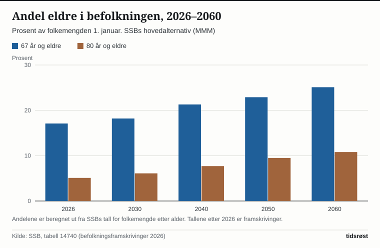
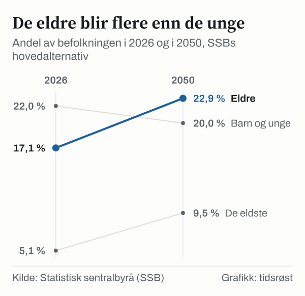

Kvinner i Norge fikk i gjennomsnitt 1,48 barn i 2025, viser statistikk fra Statistisk sentralbyrå (SSB). Fruktbarhetstallet har økt to år på rad etter bunnen på 1,40 i 2023, det laveste nivået i SSBs tidsserie tilbake til 1968. I 2025 ble det født 55 401 barn, og antallet levendefødte har økt tre år på rad. Samtidig blir befolkningen eldre: I SSBs hovedalternativ nesten dobles andelen som er 80 år eller eldre, fra 5,1 prosent i 2026 til 9,5 prosent i 2050.

Samlet fruktbarhetstall (SFT) måler hvor mange barn hver kvinne i gjennomsnitt ville fått gjennom livet dersom fødselsmønsteret i et bestemt kalenderår holdt seg uendret.

![Linjediagram over Fruktbarheten har økt to år på rad: Fruktbarhet: 2,75 i 1968, 2,69 i 1969, 2,50 i 1970, 2,49 i 1971, 2,38 i 1972, 2,23 i 1973, 2,13 i 1974, 1,98 i 1975, 1,86 i 1976, 1,75 i 1977, 1,77 i 1978, 1,75 i 1979, 1,72 i 1980, 1,70 i 1981, 1,71 i 1982, 1,66 i 1983, 1,66 i 1984, 1,68 i 1985, 1,71 i 1986, 1,75 i 1987, 1,84 i 1988, 1,89 i 1989, 1,93 i 1990, 1,92 i 1991, 1,88 i 1992, 1,86 i 1993, 1,87 i 1994, 1,87 i 1995, 1,89 i 1996, 1,86 i 1997, 1,81 i 1998, 1,85 i 1999, 1,85 i 2000, 1,78 i 2001, 1,75 i 2002, 1,80 i 2003, 1,83 i 2004, 1,84 i 2005, 1,90 i 2006, 1,90 i 2007, 1,96 i 2008, 1,98 i 2009, 1,95 i 2010, 1,88 i 2011, 1,85 i 2012, 1,78 i 2013, 1,76 i 2014, 1,73 i 2015, 1,71 i 2016, 1,62 i 2017, 1,56 i 2018, 1,53 i 2019, 1,48 i 2020, 1,55 i 2021, 1,41 i 2022, 1,40 i 2023, 1,44 i 2024, 1,48 i 2025, framskrevet: 1,50 i 2026, framskrevet: 1,51 i 2027, framskrevet: 1,53 i 2028, framskrevet: 1,54 i 2029, framskrevet: 1,56 i 2030.](./graf-1.svg)
*Samlet fruktbarhetstall, hele landet, 1968–2025. Tallene for 2026–2030 er SSBs hovedalternativ i befolkningsframskrivingene. Kilde: SSB, tabell 04232 og 14743.*

## 1968–1983: Fra 2,75 til 1,66 barn per kvinne

I 1968 var samlet fruktbarhetstall 2,75 barn per kvinne. Tallet falt raskt gjennom 1970-tallet, til 1,98 i 1975, og nådde 1,66 i 1983.

## 1984–2009: Opp igjen til nær to barn

Fra midten av 1980-tallet steg fruktbarheten igjen, og den lå mellom 1,75 og 1,98 fra 1987 til 2012. Toppen kom i 2009 med 1,98 barn per kvinne. Samme år ble det født 61 807 barn i Norge.

## 2010–2023: Ned til det laveste nivået som er målt

Etter 2009 gikk fruktbarheten gradvis ned, til 1,48 i 2020. Under pandemien kom et oppsving til 1,55 i 2021, etterfulgt av 1,41 i 2022 og 1,40 i 2023. Antall fødte falt til 51 480 i 2022.

## 2024–2025: To år med økning

Fruktbarhetstallet økte til 1,44 i 2024 og 1,48 i 2025. Det var særlig kvinner i aldersgruppen 30–34 år som trakk fødselstallene opp i 2025. Gjennomsnittsalderen for førstegangsfødende lå uendret på 30,4 år for kvinner og 32,3 år for førstegangsfedre.

Antall levendefødte økte fra 51 980 i 2023 til 54 013 i 2024 og 55 401 i 2025, en oppgang på 1 388 barn fra året før.

*Levendefødte i Norge. Kilde: SSB, tabell 04231.*

Fordi flere venter lenger med å få sitt første barn, anslår SSB at samlet barnetall for dagens unge voksne vil ligge lavere enn i tidligere generasjoner. Blant kvinnene som fylte 30 år i 2025, hadde 42 prosent fått barn og 58 prosent var fortsatt uten barn, mot 43 prosent uten barn ti år tidligere.

## Framover: Flere eldre

Ved inngangen til 2026 hadde Norge 5 627 400 innbyggere. Av disse var 959 633 personer 67 år eller eldre (17,1 prosent), mens 284 939 hadde fylt 80 år (5,1 prosent).

I SSBs hovedalternativ vokser folketallet til 6 214 071 i 2050. Da ventes gruppen på 67 år og over å telle 1 425 792 personer, eller 22,9 prosent av befolkningen, mens antallet over 80 år mer enn dobles til 588 212. De over 80 år vil dermed utgjøre 9,5 prosent av befolkningen i 2050 og 10,8 prosent i 2060. Andelen barn og unge under 20 år går ned fra 22,0 prosent i 2026 til 20,0 prosent i 2050.

*Barn og unge: under 20 år. Eldre: 67 år og over. De eldste: 80 år og over (inngår også i gruppen 67 år og over). Tallet for 2026 er befolkningen 1. januar 2026, tallet for 2050 SSBs hovedalternativ. Kilde: SSB, tabell 14740.*

I 2032 passerer Norge en demografisk milepæl på landsbasis: Da vil det for første gang være flere innbyggere over 65 år enn barn og unge under 20 år. I Innlandet, Telemark, Vestfold, Nordland og Troms har dette skiftet allerede funnet sted, mens Oslo ventes å passere det innen 2046.

Samme år, i 2046, anslår hovedalternativet at fødselsoverskuddet går over i et lite fødselsunderskudd (58 146 fødte mot 58 801 døde, etter 58 593 fødte og 58 368 døde i 2045).

I hovedalternativet legger SSB til grunn at fruktbarhetstallet gradvis øker videre til 1,50 i 2026, 1,56 i 2030 og 1,63 i 2050, med et spenn fra 1,19 i lavalternativet til 1,87 i høyalternativet.

## Fødselstallsutvalgets forslag til familierettede tiltak

Fødselstallsutvalget, som ble oppnevnt i august 2024, overleverte utredningen NOU 2026: 2 «Politikk for nye generasjoner» 9. februar 2026.

Utvalget belyser hvordan endret alderssammensetning påvirker kommunenes planlegging. Lavere barnekull reduserer utgiftene til barnehager og skoler på kort sikt, men gir mindre grunnlag for tilbud til barn og unge i mindre lokalsamfunn, samtidig som aldringen øker behovet for helse- og omsorgstjenester. For statsfinansene viser utvalget til beregninger fra SSB-forskere som viser at utslaget på nasjonalinntekten per innbygger på lang sikt – etter rundt 65 år – er begrenset.

Utvalget mener at familiepolitikken bør ha som mål at folk kan realisere sine ønsker om å få barn. Blant utvalgets forslag er økt økonomisk støtte til foreldre under 30 år, tilbud om barnehageplass fra barnet fyller ett år kombinert med mer fleksible foreldrepenger, styrkede barsel- og helsetjenester for nybakte foreldre og utprøving av kortere arbeidstid for småbarnsforeldre.

Utredningen ble sendt på høring 22. april 2026 med høringsfrist 1. august 2026.

## Hva tallene ikke viser

Samlet fruktbarhetstall er et mål for ett kalenderår. Det sier ikke hvor mange barn kvinnene i et årskull faktisk ender opp med.

Framskrivingene er beregninger som bygger på forutsetninger om fruktbarhet, levealder og innvandring, ikke sikre anslag. Fødselstallsutvalget peker på at endringer i fødselstallene virker på svært lang sikt, og at ulike nivåer på fødselstallene i framskrivingene ikke påvirker antallet eldre før etter 2090. At antallet eldre øker nå, skyldes økt levealder kombinert med at de store etterkrigskullene når høy alder.

## Kilder

- [SSB: Fødte, statistikkside](https://www.ssb.no/befolkning/fodte-og-dode/statistikk/fodte) – samlet fruktbarhetstall og levendefødte 2015, 2024 og 2025, fødealder
- [SSB: Fruktbarheten fortsetter å øke (12. mars 2026)](https://www.ssb.no/befolkning/fodte-og-dode/statistikk/fodte/artikler/fruktbarheten-fortsetter-a-oke) – aldersgruppen 30–34 år, andel barnløse 30-åringer, vurdering av framtidig fruktbarhet
- [SSB Statistikkbanken, tabell 04232: Samlet fruktbarhetstall](https://www.ssb.no/statbank/table/04232) – tidsserie 1968–2025
- [SSB Statistikkbanken, tabell 04231: Levendefødte](https://www.ssb.no/statbank/table/04231) – antall fødte 2009–2025
- [SSB: Befolkningen eldes raskt de neste ti årene (12. juni 2026)](https://www.ssb.no/befolkning/befolkningsframskrivinger/statistikk/nasjonale-befolkningsframskrivinger/artikler/befolkningen-eldes-raskt-de-neste-ti-arene) – vendepunktet i 2032, fylkestall, fødselsunderskudd fra 2046
- [SSB Statistikkbanken, tabell 14740: Framskrevet folkemengde](https://www.ssb.no/statbank/table/14740) – folkemengde etter alder 2026–2060
- [SSB Statistikkbanken, tabell 14742: Framskrevet befolkningsendringer](https://www.ssb.no/statbank/table/14742) – framskrevne fødte og døde
- [SSB Statistikkbanken, tabell 14743: Framskrevet fruktbarhet](https://www.ssb.no/statbank/table/14743) – fruktbarhetsforutsetninger
- [Regjeringen: NOU 2026: 2 Politikk for nye generasjoner (PDF)](https://www.regjeringen.no/contentassets/a931edce166d4f5fb0dd282e5149784b/no/pdfs/nou202620260002000dddpdfs.pdf) – utvalgets vurderinger av konsekvenser og forslag
- [Regjeringen: Utvalg med tiltak for å øke fødselstallene (9. februar 2026)](https://www.regjeringen.no/no/aktuelt/utvalg-med-tiltak-for-a-oke-fodselstallene/id3148493/) – oppnevning og overlevering
- [Regjeringen: Høring av NOU 2026: 2](https://www.regjeringen.no/no/dokumenter/horing-av-nou-20262-politikk-for-nye-generasjoner/id3157086/) – høringsdato og frist
