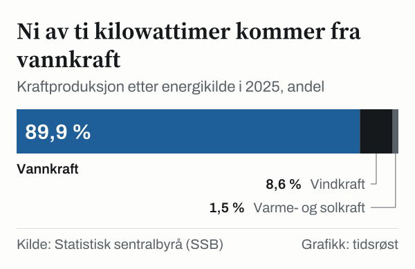

Av all strømmen som ble produsert i Norge i 2025, kom 98,7 prosent fra vannkraft, vindkraft og solkraft, viser elektrisitetsstatistikken fra Statistisk sentralbyrå (SSB). Norske kraftverk leverte til sammen 161,8 terawattimer (TWh), 20,0 prosent mer enn i 2019, da produksjonen var 134,9 TWh. Resten, 1,3 prosent, var varmekraft.

## 89,9 prosent vannkraft

Vannkraften sto alene for 145,5 TWh i 2025, 89,9 prosent av produksjonen. Vindkraften bidro med 13,9 TWh (8,6 prosent), og solkraften med 0,35 TWh (0,2 prosent). Varmekraften var 2,1 TWh.

*Kraftproduksjon etter energikilde i 2025. Varmekraft utgjorde 1,3 prosent og solkraft 0,2 prosent. Kilde: SSB, tabell 08307.*

Ved utgangen av 2024 hadde Norge 1 791 vannkraftverk i drift, med en samlet installert effekt på 33 947 megawatt (MW), ifølge Norges vassdrags- og energidirektorat (NVE). NVE oppgir installert solkraft på 767 MW, fordelt på 32 419 nettilknyttede anlegg, per utgangen av 2024.

## 13,9 TWh fra vindkraft

Vindkraften har vokst fra 0,9 TWh i 2010 til 13,9 TWh i 2025. Det høyeste nivået så langt var 14,8 TWh i 2022.

## 22,8 TWh i nettoeksport

Bruttoforbruket av kraft i Norge var 139,0 TWh i 2025. Siden produksjonen var større enn forbruket, eksporterte Norge 22,8 TWh mer strøm enn landet importerte. I 2019 var forholdet omvendt: Da var forbruket litt større enn produksjonen. Siden 2020 har produksjonen vært større enn forbruket hvert år.

![Linjediagram over Norge har produsert mer strøm enn landet bruker hvert år siden 2020: Produksjon: 142 816 i 2000, 121 608 i 2001, 130 473 i 2002, 107 245 i 2003, 110 472 i 2004, 137 811 i 2005, 121 400 i 2006, 137 164 i 2007, 142 108 i 2008, 131 773 i 2009, 123 630 i 2010, 127 631 i 2011, 147 716 i 2012, 133 975 i 2013, 141 968 i 2014, 144 511 i 2015, 148 989 i 2016, 149 402 i 2017, 147 057 i 2018, 134 882 i 2019, 154 197 i 2020, 157 113 i 2021, 145 942 i 2022, 153 973 i 2023, 157 136 i 2024, 161 793 i 2025; Forbruk: 123 761 i 2000, 125 206 i 2001, 120 800 i 2002, 115 130 i 2003, 121 964 i 2004, 125 769 i 2005, 122 255 i 2006, 127 128 i 2007, 128 231 i 2008, 122 790 i 2009, 131 180 i 2010, 124 557 i 2011, 129 900 i 2012, 128 970 i 2013, 126 383 i 2014, 129 884 i 2015, 132 579 i 2016, 134 238 i 2017, 136 908 i 2018, 134 926 i 2019, 133 724 i 2020, 139 529 i 2021, 133 420 i 2022, 136 235 i 2023, 138 697 i 2024, 138 993 i 2025.](./graf-1.svg)
*Produksjon og bruttoforbruk av elektrisk kraft i Norge, 2000–2025, gigawattimer (1 000 GWh = 1 TWh). Kilde: SSB, tabell 08307.*

| Nøkkeltall i kraftbalansen (TWh) | 2021 | 2023 | 2025 |
|---|---:|---:|---:|
| Vannkraftproduksjon | 143,7 | 137,3 | 145,5 |
| Vindkraftproduksjon | 11,8 | 14,0 | 13,9 |
| Varmekraft og solkraft | 1,6 | 2,7 | 2,4 |
| **Samlet produksjon** | **157,1** | **154,0** | **161,8** |
| Bruttoforbruk | 139,5 | 136,2 | 139,0 |
| Nettoeksport av kraft | 17,6 | 17,7 | 22,8 |

*Nettoeksport er eksport minus import. Kilde: SSB, tabell 08307.*

## 31 prosent i husholdningene

Nettoforbruket, det som brukes hos sluttbrukerne, var 130,1 TWh i 2025. Husholdninger og hytter brukte 40,4 TWh, om lag 31 prosent, mens kraftintensiv industri brukte 37,4 TWh, om lag 29 prosent. Tjenesteytende næringer sto for 20,2 prosent og olje- og gassutvinning for 8,5 prosent.

*Andel av nettoforbruket av elektrisk kraft i 2025, beregnet fra SSBs månedstall. Jordbruk, skogbruk og fiske (2,0 prosent) er ikke med i figuren. Kilde: SSB, tabell 14091.*

## Hva tallene ikke viser

Tallene viser hvor strømmen ble produsert og brukt, ikke hva den kostet. Bruttoforbruket omfatter også tap i nettet og pumpekraft, og er derfor større enn nettoforbruket.

## Kilder

- [SSB: Elektrisitet, årlig og månedlig kraftstatistikk](https://www.ssb.no/energi-og-industri/energi/statistikk/elektrisitet)
- [SSB Statistikkbanken: Tabell 08307 – Produksjon, import, eksport og forbruk av elektrisk kraft](https://www.ssb.no/statbank/table/08307)
- [SSB Statistikkbanken: Tabell 14091 – Elektrisitetsbalanse, månedlig](https://www.ssb.no/statbank/table/14091)
- [NVE: Kraftproduksjon og energi i Norge](https://www.nve.no/energi/energisystem/kraftproduksjon/)
