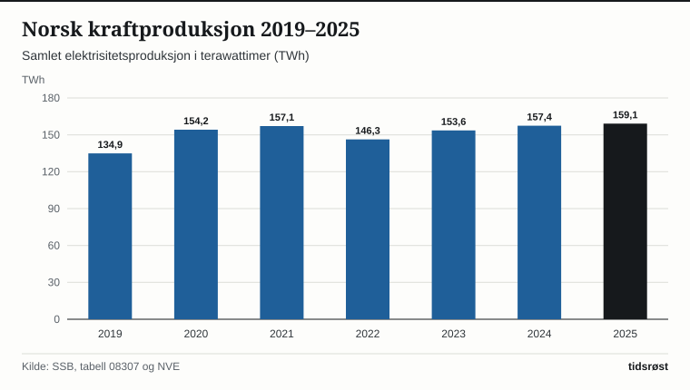

Norske kraftverk leverte 161,8 terawattimer (TWh) elektrisitet i 2025, viser elektrisitetsstatistikken fra Statistisk sentralbyrå (SSB). Det er 20,0 prosent mer enn i 2019, da produksjonen var 134,9 TWh.

Når vannkraft, vindkraft og solkraft regnes sammen, kommer 98,7 prosent av den norske strømproduksjonen fra disse kildene. Resten, 1,3 prosent, er varmekraft.

## Vannkraften er bærebjelken i kraftsystemet

Ved utgangen av 2024 hadde Norge 1 791 vannkraftverk i drift, med en samlet installert effekt på 33 947 megawatt (MW), ifølge Norges vassdrags- og energidirektorat (NVE).

I 2025 sto vannkraften alene for 145,5 TWh – 89,9 prosent av all elektrisitet som ble produsert i landet. Vindkraften bidro med 13,9 TWh (8,6 prosent), og solkraften med 0,35 TWh (0,2 prosent). NVE oppgir installert solkraft på 767 MW, fordelt på 32 419 nettilknyttede anlegg, per utgangen av 2024.

*Samlet norsk elektrisitetsproduksjon i terawattimer (TWh), 2019–2025. Kilde: SSB, tabell 08307.*

## Fordeling mellom kraftkilder og forbrukssektorer

Bruttoforbruket av kraft i Norge var 139,0 TWh i 2025, og nettoforbruket 130,1 TWh. Kraftintensiv industri brukte 37,4 TWh, om lag 29 prosent av nettoforbruket, mens husholdningene brukte 40,4 TWh, om lag 31 prosent (andelene er beregnet fra SSBs tall).

| Nøkkeltall i kraftbalansen (TWh) | 2021 | 2023 | 2025 |
|---|---:|---:|---:|
| Vannkraftproduksjon | 143,7 | 137,3 | 145,5 |
| Vindkraftproduksjon | 11,8 | 14,0 | 13,9 |
| Varmekraft og solkraft | 1,6 | 2,7 | 2,4 |
| **Samlet produksjon** | **157,1** | **154,0** | **161,8** |
| Bruttoforbruk | 139,5 | 136,2 | 139,0 |
| Nettoeksport av kraft | 17,6 | 17,7 | 22,8 |

*Nettoeksport er eksport minus import. Kilde: SSB, tabell 08307.*

*Andel av norsk elektrisitetsproduksjon etter energikilde i 2025. Kilde: SSB, tabell 08307.*

## Investeringer i strømnettet

Det statlige foretaket Statnett investerte 6,4 milliarder kroner i første halvår 2026, ifølge selskapets halvårsrapport som ble lagt fram 27. august 2026. Det er 1,7 milliarder kroner mer enn i første halvår 2025.

## Kilder

- [SSB: Elektrisitet, årlig og månedlig kraftstatistikk](https://www.ssb.no/energi-og-industri/energi/statistikk/elektrisitet)
- [SSB Statistikkbanken: Tabell 08307 – Produksjon, import, eksport og forbruk av elektrisk kraft](https://www.ssb.no/statbank/table/08307)
- [NVE: Kraftproduksjon og energi i Norge](https://www.nve.no/energi/energisystem/kraftproduksjon/)
- [Statnett: Halvårsrapport 2026](https://www.statnett.no/en/about-statnett/news-and-press-releases/news-archive-2026/half-year-report-2026-statnett-sf---increasing-the-pace-of-grid-development/)
