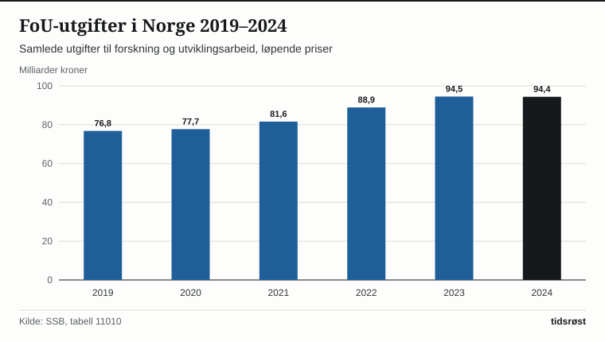
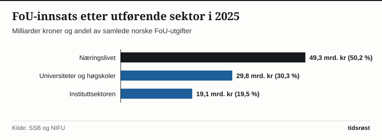

I 2025 ble det utført forskning og utviklingsarbeid (FoU) i Norge for 98,2 milliarder kroner, viser FoU-statistikken fra Statistisk sentralbyrå (SSB) og Nordisk institutt for studier av innovasjon, forskning og utdanning (NIFU). Målt i løpende priser har de årlige investeringene i ny kunnskap og teknologi økt med nær 29 prosent siden 2019.

Totalt ble det lagt ned mer enn 52 000 årsverk i norsk forskning og utvikling i løpet av året, fordelt mellom bedrifter, universiteter, universitetssykehus og uavhengige forskningsinstitutter som SINTEF, Havforskningsinstituttet og Folkehelseinstituttet.

## Næringslivet står for halvparten av forskningsinnsatsen

Det norske forskningssystemet er delt inn i tre utførende sektorer som utfyller hverandre. Næringslivet er den største aktøren og sto i 2025 for 49,3 milliarder kroner – 50,2 prosent av de samlede FoU-utgiftene. Universitets- og høgskolesektoren (inkludert helseforetakene) sto for 29,8 milliarder kroner (30,3 prosent), mens instituttsektoren utførte oppdrags- og anvendt forskning for 19,1 milliarder kroner (19,5 prosent).

*Samlede utgifter til forskning og utviklingsarbeid (FoU) i Norge, løpende milliarder kroner. Kilde: SSB, tabell 07967 og NIFU.*

For bedriftene er den statlige Skattefunn-ordningen, administrert av Norges forskningsråd i samarbeid med Skatteetaten, et av de viktigste virkemidlene. Gjennom Skattefunn kan alle norske bedrifter som utvikler nye eller forbedrede varer, tjenester eller produksjonsprosesser, få skattefradrag for opptil 19 prosent av prosjektkostnadene.

## Slik fordeler FoU-midlene seg mellom sektorene

Tabellen viser utviklingen i FoU-utgifter og forskningsårsverk i de tre sektorene:

| Utførende sektor | FoU-utgifter 2021 (mrd. kr) | FoU-utgifter 2025 (mrd. kr) | FoU-årsverk 2025 |
|---|---:|---:|---:|
| Næringslivet | 40,8 | 49,3 | 24 900 |
| Universiteter og høgskoler | 25,6 | 29,8 | 17 600 |
| Instituttsektoren | 15,7 | 19,1 | 9 800 |
| **Norge i alt** | **82,1** | **98,2** | **52 300** |

*Kilde: SSB, tabell 07967 og Indikatorrapporten (NIFU/Forskningsrådet).*

I næringslivet er det informasjonsteknologi og programvareutvikling som utgjør det største teknologifeltet, tett fulgt av maritim teknologi, havbruk, fornybar energi og legemiddelutvikling.

*FoU-utgifter etter utførende sektor i 2025. Kilde: SSB og NIFU.*

## Milliardsatsing på kunstig intelligens og Horisont Europa

Som del av *Langtidsplanen for forskning og høyere utdanning* har regjeringen satt av en ekstra milliard kroner over fem år til forskning på kunstig intelligens og digital sikkerhet. Midlene har blant annet finansiert opprettelsen av seks nye nasjonale forskningssentre for kunstig intelligens (KI-sentre) gjennom Norges forskningsråd, der forskere samarbeider med sykehus, kommuner og bedrifter om trygg og samfunnsnyttig bruk av KI.

Samtidig hevder norske forskningsmiljøer seg sterkt internasjonalt: Gjennom EUs rammeprogram *Horisont Europa* har norske universiteter, institutter og bedrifter hentet hjem over 15 milliarder kroner til felles europeiske prosjekter innen klima, helse, hav og kvanteteknologi.

## Kilder

- [SSB: Forskning og utvikling i næringslivet og samlet FoU-statistikk](https://www.ssb.no/teknologi-og-innovasjon/forskning-og-innovasjon-i-naeringslivet/statistikk/forskning-og-utvikling-i-naeringslivet)
- [SSB Statistikkbanken: Tabell 07967 – Utgifter til FoU etter sektor](https://www.ssb.no/statbank/table/07967)
- [Norges forskningsråd: Indikatorrapporten for det norske forsknings- og innovasjonssystemet](https://www.forskningsradet.no/indikatorrapporten/)
- [Kunnskapsdepartementet: Langtidsplan for forskning og høyere utdanning](https://www.regjeringen.no/no/tema/forskning/innsiktsartikler/langtidsplan-for-forskning-og-hoyere-utdanning/id2353340/)
