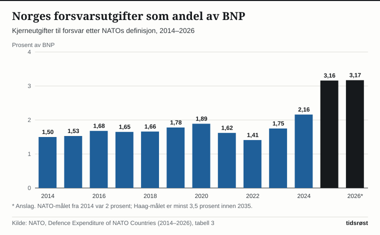

Regjeringen foreslår å bevilge 191,7 milliarder kroner til forsvarssektoren i 2027, går det fram av Forsvarsdepartementets budsjettproposisjon (Prop. 1 S (2026–2027)), som ble lagt fram av forsvarsminister Tore O. Sandvik (Ap) 7. oktober 2026 etter statsråd 25. september. Det er 11,9 milliarder kroner mer enn i saldert budsjett for 2026. Drøyt en tredjedel av totalrammen – nærmere 69 milliarder kroner – er militær støtte til Ukraina. Holder man Ukraina-midlene utenfor, vokser det ordinære forsvarsbudsjettet fra rundt 112 milliarder kroner i 2026 til rundt 123 milliarder i 2027. Budsjettet skal behandles og vedtas av Stortinget i høst.

## Slik fordeles milliardene i 2027

Totalrammen i budsjettforslaget lyder på 191 680,9 millioner kroner, en nominell økning på rundt 6,6 prosent fra 2026. Renset for pris- og lønnskompensasjon og tekniske flyttinger mellom budsjettposter utgjør den reelle økningen i bevilgningsrammen nær 6,4 milliarder kroner, eller rundt 3,5 prosent.

Når den militære støtten til Ukraina skilles ut fra totalrammen, ser utviklingen fra 2026 til 2027 slik ut:

| Millioner kroner | Saldert 2026 | Forslag 2027 |
|---|---|---|
| Total forsvarsramme | 179 809 | 191 681 |
| Militær støtte til Ukraina | 67 689 | 68 651 |
| Rammen uten Ukraina-støtte | 112 120 | 123 030 |

*Kilde: Forsvarsdepartementet, Prop. 1 S (2026–2027), tabell 1.1. Nederste rad viser differansen mellom totalrammen og Ukraina-støtten.*

Uten Ukraina-støtten løftes dermed rammen for Norges eget forsvar med rundt 10,9 milliarder kroner, eller 9,7 prosent i løpende kroner. Det er særlig den daglige driften av Forsvaret og utbygging av eiendom, bygg og anlegg som trekker opp.

*Drift og infrastruktur øker mest, mens Ukraina-støtten er om lag uendret. Kilde: Forsvarsdepartementet, Prop. 1 S (2026–2027).*

At posten for materiellinvesteringer ser litt lavere ut i kronebeløp fra 2026 til 2027, skyldes ifølge proposisjonen tekniske budsjettendringer og en justert innretning på forskning og utvikling; selve innsatsen til materiellinvesteringer øker med 103,6 millioner kroner.

## 70 milliarder i militær støtte gjennom Nansen-programmet

Den militære bistanden til Ukraina kanaliseres gjennom Nansen-programmet. For 2027 foreslår regjeringen å videreføre en samlet sivil og militær støtte til Ukraina på 85 milliarder kroner, der 70 milliarder kroner er satt av til militære formål. Selve bevilgningen under kapittel 1750 på forsvarsbudsjettet er på 68,7 milliarder kroner; resten av rammen på 70 milliarder ligger på andre poster, blant annet 481,4 millioner kroner på kapittel 1760 til ordinær prisutvikling i flerårige anskaffelsesløp for gjenanskaffelse av donert materiell. Regjeringen foreslår å videreføre at 50 milliarder kroner skal brukes uavkortet på internasjonale innkjøpssamarbeid og direkte kjøp fra ukrainsk forsvarsindustri, slik at pengene ikke presser opp etterspørselen i norsk økonomi.

Planen for den militære støtten legger opp til at rundt 35 prosent går til droner og autonome systemer, 25 prosent til luftvern og støtte til F-16-kampfly, 24 prosent til landstyrker og opplæring av ukrainske soldater, 14 prosent til maritim sikkerhet og 3 prosent til øvrige tiltak.

## Fra 2 til 5 prosent: Nye NATO-krav løfter BNP-andelen

I tiåret etter NATO-toppmøtet i Wales i 2014 var alliansens mål at medlemslandene skulle bruke minst 2 prosent av bruttonasjonalproduktet (BNP) på forsvar. På toppmøtet i Haag 25. juni 2025 vedtok NATO-landene en langt høyere forpliktelse: 5 prosent av BNP årlig innen 2035, delt i minst 3,5 prosent til militære kjerneutgifter etter NATOs definisjon og inntil 1,5 prosent til bredere forsvars- og sikkerhetsrelaterte tiltak. Etter toppmøteerklæringen teller direkte militære bidrag til Ukrainas forsvar og forsvarsindustri med i landenes kjerneandel.

NATOs egne tall viser at Norges militære kjerneutgifter lå mellom 1,4 og 1,9 prosent av BNP i årene 2014–2023, før andelen passerte 2-prosentgrensen i 2024 med 2,16 prosent. For 2025 og 2026 anslår NATO den norske andelen til henholdsvis 3,16 og 3,17 prosent.

*Andelen passerte 2 prosent i 2024 og økte kraftig i 2025, samme år som Stortinget økte rammen for militær støtte til Ukraina med 50 milliarder kroner. Tallene for 2025 og 2026 er anslag. Kilde: NATO.*

For 2027 anslår Forsvarsdepartementet at forsvarsutgiftene vil tilsvare rundt 3,4 prosent av BNP inklusive Ukraina-støtten, og 2,2 prosent dersom den militære Ukraina-støtten holdes utenfor.

## Langtidsplanen utvidet til 1 854 milliarder kroner

Årets budsjettforslag følger opp langtidsplanen for forsvarssektoren (Prop. 87 S (2023–2024)). Da regjeringen la fram planen i april 2024, var rammen foreslått styrket med 600 milliarder kroner over tolv år, et beløp som ble økt til 611 milliarder da et samlet Storting inngikk forsvarsforliket i juni 2024.

Våren 2026 ble planen skalert ytterligere opp gjennom Prop. 68 S (2025–2026), lagt fram 27. mars 2026. Et enstemmig Storting sluttet seg til å øke rammen med rundt 121 milliarder kroner for årene 2026–2036 og forlenge planperioden fram til 2040. Dermed lyder den samlede langtidsplanen for tolvårsperioden 2025–2036 på rundt 1 854 milliarder 2026-kroner, med sikte på å nå minst 3,5 prosent av BNP i ordinære forsvarsutgifter innen 2035. Av budsjettøkningen i 2027 utgjør opptrappingen etter langtidsplanen 6,5 milliarder kroner.

## Flere ansatte, vernepliktige og kaserner i 2027

I praksis skal de ekstra driftskronene i 2027 gi plass til rundt 750 nye fast ansatte, 900 flere reservister og 450 flere vernepliktige inne til førstegangstjeneste i løpet av neste år. Samtidig foreslås det 1,59 milliarder kroner mer til bygg og anlegg på militære baser rundt i landet, og 516 millioner kroner ekstra til å bygge ut produksjonskapasiteten i norsk og europeisk forsvarsindustri.

Samtidig pålegges forsvarssektoren et effektiviseringskrav: I 2027-budsjettet frigjøres rundt 190 millioner kroner gjennom intern effektivisering som flyttes til andre poster på statsbudsjettet.

## Kilder

- [Forsvarsdepartementet: Prop. 1 S (2026–2027) For budsjettåret 2027](https://www.regjeringen.no/no/dokumenter/prop.-1-s-20262027/id3175722/)
- [Forsvarsdepartementet: Prop. 1 S (2026–2027), PDF](https://www.regjeringen.no/contentassets/7bae73dc874a447987882870c551abcf/no/pdfs/prp202620270001_fddddpdfs.pdf)
- [Forsvarsdepartementet: The National Budget 2027 – Proposes to strengthen defence capability with 6,5 billion Norwegian kroner (7. oktober 2026)](https://www.regjeringen.no/en/whats-new/proposes-to-strengthen-defence-capability-with-65-billion-norwegian-kroner/id3174288/)
- [Finansdepartementet: The 2027 National Budget (7. oktober 2026)](https://www.regjeringen.no/en/whats-new/a-responsible-budget-that-keeps-norway-secure-in-uncertain-times/id3174614/)
- [NATO: Defence Expenditure of NATO Countries (2014–2026), Excel-tabeller](https://www.nato.int/content/dam/nato/webready/documents/finance/def-exp-2026-en.xlsx)
- [NATO: Defence Investment Update (7. juli 2026)](https://www.nato.int/en/news-and-events/articles/news/2026/07/07/defence-investment-update-record-spending-in-europe-and-canada)
- [NATO: The Hague Summit Declaration (25. juni 2025)](https://www.nato.int/en/about-us/official-texts-and-resources/official-texts/2025/06/25/the-hague-summit-declaration)
- [NATO: Defence investment and NATO's 5% commitment](https://www.nato.int/en/what-we-do/introduction-to-nato/defence-expenditures-and-natos-5-commitment)
- [Regjeringen: Styrker forsvarsevnen med 600 milliarder (5. april 2024)](https://www.regjeringen.no/no/aktuelt/styrker-forsvarsevnen-med-600-milliarder/id3032880/)
- [Regjeringen: Historisk enighet om langtidsplanen for Forsvaret (4. juni 2024)](https://www.regjeringen.no/no/aktuelt/enighet-om-regjeringens-langtidsplan/id3043564/)
