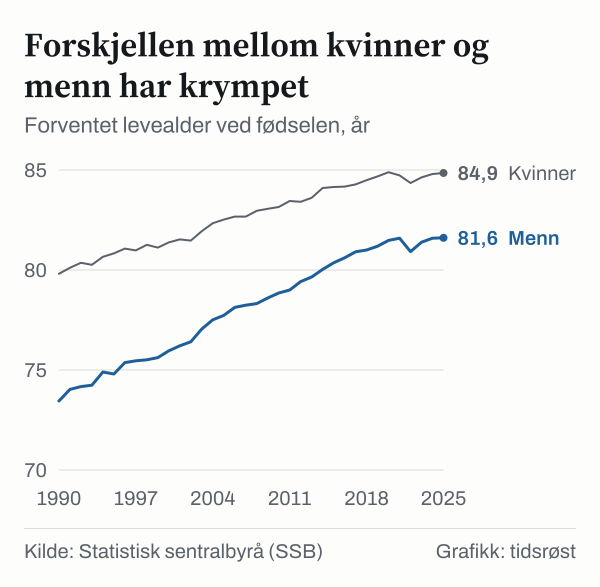

En jente født i Norge i 2025 kan forvente å bli 84,9 år gammel, mens en nyfødt gutt har en forventet levealder på 81,6 år, viser dødelighetstabellene fra Statistisk sentralbyrå (SSB). For begge kjønn samlet er tallet 83,2 år. Folkehelseinstituttet (FHI) skriver at økningen fra 2024 til 2025 var liten sammenlignet med økningen før pandemien, og at levealderen i 2023 var tilbake på omtrent samme nivå som i 2019.

Også blant eldre har levetiden økt over tid: En 65-årig kvinne i Norge kan i snitt regne med om lag 21,9 gjenstående leveår (til 86,9 år), mens en 65-årig mann i snitt har om lag 19,7 gjenstående leveår (til 84,7 år).

## Kjønnsforskjellen er omtrent halvert siden 1990

Siden 1995 har menns forventede levealder økt med 6,8 år (fra 74,8 til 81,6 år), mens kvinners har økt med 4,1 år (fra 80,8 til 84,9 år). Dermed er forskjellen mellom kjønnene nede i om lag 3,2 år (3,3 år regnet fra de avrundede tallene i tabellen). FHI oppgir at forskjellen var 6,4 år i 1990, og at den dermed er omtrent halvert.

*Forventet levealder ved fødselen i Norge (år, gjennomsnitt for begge kjønn), utvalgte år 1995–2025. Kilde: SSB, tabell 07902.*

## Utviklingen i forventet levealder gjennom 30 år

Tabellen viser forventet levealder ved fødselen for kvinner og menn i Norge siden 1995:

| År | Kvinner (år) | Menn (år) | Forskjell (år) |
|---|---:|---:|---:|
| 1995 | 80,8 | 74,8 | 6,0 |
| 2005 | 82,5 | 77,7 | 4,8 |
| 2015 | 84,2 | 80,4 | 3,8 |
| 2020 | 84,9 | 81,5 | 3,4 |
| 2024 | 84,8 | 81,6 | 3,2 |
| 2025 | 84,9 | 81,6 | 3,3 |

*Kilde: SSB, tabell 07902. Tallene er avrundet til én desimal, og forskjellen er regnet ut fra de avrundede tallene. Regnet fra uavrundede tall er forskjellen 3,24 år i 2025, omtrent som i 2024 (3,21 år).*

*Forventet levealder ved fødselen og ved fylte 65 år i 2025. Kilde: SSB, tabell 07902.*

## Dødelighet, røyking og kreftoverlevelse

I perioden 1991–1995 røykte 36 prosent av menn og 33 prosent av kvinner daglig, mens andelen i 2021–2025 var 8 prosent blant menn og 7 prosent blant kvinner (18–74 år).

Kreftregisteret ved FHI oppgir i rapporten *Cancer in Norway 2025* at 5-års relativ overlevelse for alle krefttyper samlet er 78 prosent.

## Kilder

- [SSB Statistikkbanken: Tabell 07902 – Dødelighetstabeller](https://www.ssb.no/statbank/table/07902)
- [Folkehelseinstituttet: Forventet levealder i Norge](https://www.fhi.no/he/folkehelserapporten/samfunn/levealder/)
- [Folkehelseinstituttet: Tobakksbruk blant voksne](https://fhi.no/is/ncd/tobakk/voksne)
- [Folkehelseinstituttet: Cancer in Norway 2025](https://www.fhi.no/publ/2026/cancer-in-norway-2025/)
