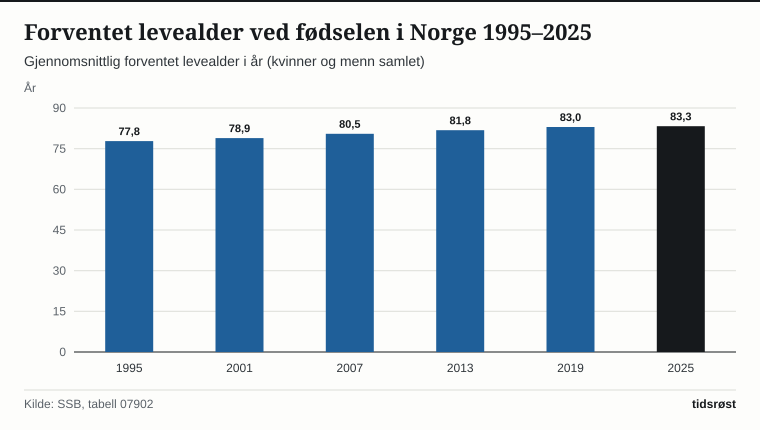
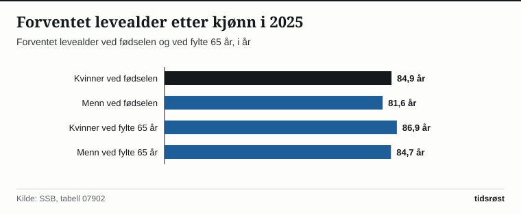

En jente født i Norge i 2025 kan forvente å bli 84,8 år gammel, mens en nyfødt gutt har en forventet levealder på 81,7 år, viser befolkningsstatistikken fra Statistisk sentralbyrå (SSB). Det plasserer Norge blant de fem landene i Europa med høyest levealder.

Etter en kortvarig utflating i etterkant av pandemiårene har levealderen igjen steget markant i både 2024 og 2025. Også blant eldre har levetiden økt jevnt: En 65-årig kvinne i Norge kan i snitt regne med 22,2 gjenstående leveår (til 87,2 år), mens en 65-årig mann i snitt har 19,9 gjenstående leveår (til 84,9 år).

## Menn har tatt igjen mer enn halvparten av forspranget

På midten av 1980-tallet levde norske kvinner i snitt nesten sju år lenger enn menn. Siden den gang har levealderen steget langt raskere blant menn enn blant kvinner: Fra 1995 til 2025 økte menns forventede levealder med hele 6,9 år (fra 74,8 til 81,7 år), mens kvinners levealder økte med 4,0 år (fra 80,8 til 84,8 år).

Dermed er forskjellen i forventet levealder mellom kjønnene nede i 3,1 år – blant de minste kjønnsforskjellene som er registrert i moderne tid.

*Forventet levealder ved fødselen i Norge (år, gjennomsnitt for begge kjønn), 1995–2025. Kilde: SSB, tabell 07902.*

## Utviklingen i forventet levealder gjennom 30 år

Tabellen under viser utviklingen i forventet levealder ved fødselen for kvinner og menn i Norge siden 1995:

| År | Kvinner (år) | Menn (år) | Forskjell (år) |
|---|---:|---:|---:|
| 1995 | 80,8 | 74,8 | 6,0 |
| 2005 | 82,5 | 77,7 | 4,8 |
| 2015 | 84,2 | 80,4 | 3,8 |
| 2020 | 84,9 | 81,5 | 3,4 |
| 2024 | 84,6 | 81,4 | 3,2 |
| 2025 | 84,8 | 81,7 | 3,1 |

*Kilde: SSB, tabell 07902.*

Også regionalt er forskjellene i levealder relativt små sammenlignet med andre land. Sogn og Fjordane (Vestland), Møre og Romsdal, Rogaland og Akershus har gjennomgående de høyeste tallene, men levealderen har økt betydelig i samtlige norske fylker.

*Forventet levealder ved fødsel og ved fylte 65 år i 2025. Kilde: SSB.*

## Kraftig nedgang i hjerte- og karsykdommer og bedre kreftoverlevelse

Ifølge Folkehelseinstituttets (FHI) *Folkehelserapport* er den viktigste medisinske forklaringen på de ekstra leveårene at dødeligheten av hjerte- og karsykdommer har falt med mer enn 70 prosent siden 1990. Dette skyldes både bedre akuttbehandling ved norske sykehus, forebyggende legemidler mot høyt blodtrykk og kolesterol, og store endringer i levevaner.

Spesielt har røykeslutt gitt store helsegevinster: Andelen av den voksne befolkningen som røyker daglig, er redusert fra over 30 prosent rundt årtusenskiftet til om lag 6 prosent i dag, og blant unge voksne under 35 år er dagligrøyking nede i rundt 2 prosent. Samtidig viser tall fra Kreftregisteret ved FHI at tre av fire som får en kreftdiagnose i Norge i dag, lever minst fem år etter at sykdommen ble oppdaget – støttet av nasjonale screeningprogrammer og pakkeforløp i helsetjenesten.

## Kilder

- [SSB: Døde og forventet levealder i Norge](https://www.ssb.no/befolkning/fodte-og-dode/statistikk/dode)
- [SSB Statistikkbanken: Tabell 07902 – Forventet gjenstående levetid etter kjønn og alder](https://www.ssb.no/statbank/table/07902)
- [Folkehelseinstituttet (FHI): Folkehelserapporten – Helsetilstanden i Norge](https://www.fhi.no/he/folkehelserapporten/)
- [Helse- og omsorgsdepartementet: Nasjonal helse- og samhandlingsplan og folkehelsearbeid](https://www.regjeringen.no/no/tema/helse-og-omsorg/folkehelse/id10877/)
