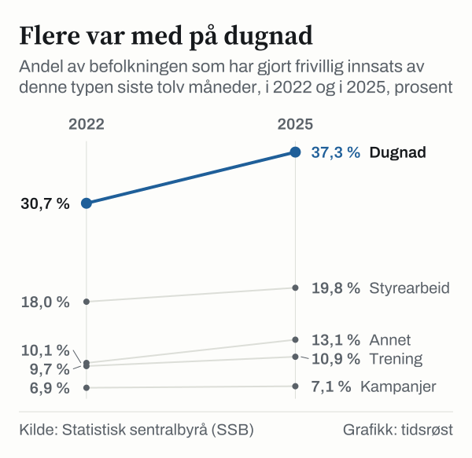
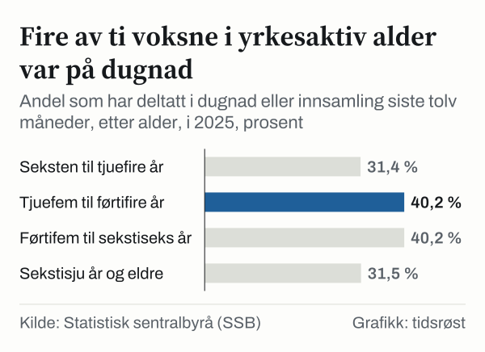

Ubetalt frivillig arbeid i Norge tilsvarte om lag 142 000 årsverk i 2018, ifølge Statistisk sentralbyrås (SSB) satellittregnskap for ideelle og frivillige organisasjoner. Verdsatt til samme pris som lønnet arbeid utgjorde innsatsen om lag 78 milliarder kroner. Nyere tall fra SSB viser at flere deltok på dugnad i 2025 enn i 2022: 37,3 prosent av befolkningen hadde vært med på dugnad eller innsamling det siste året, mot 30,7 prosent tre år tidligere.

## 142 000 årsverk

Til sammenligning med de 142 000 frivillige årsverkene var lønnet sysselsetting i sektoren om lag 89 000 årsverk i 2018. Nærmere 53 prosent av de frivillige årsverkene ble lagt ned innen kultur og fritid, og idrett alene sto for omtrent 35 000 årsverk, eller 25 prosent. Satellittregnskapet ble publisert 3. desember 2020, og 2018 er det siste året med slike beregninger i artikkelen.

| Nøkkeltall fra SSBs satellittregnskap (2018) | Verdi |
|---|---:|
| Ubetalt frivillig arbeid | om lag 142 000 årsverk |
| Lønnet sysselsetting i sektoren | om lag 89 000 årsverk |
| Verdi av ubetalt frivillig arbeid | om lag 78 milliarder kr |
| Andel av frivillige årsverk innen kultur og fritid | om lag 53 % |
| Frivillige årsverk innen idrett | om lag 35 000 (25 %) |

*Kilde: SSB, «Nordmenn legger ned frivillig innsats verdt 78 milliarder» (3. desember 2020).*

## 37,3 prosent på dugnad

I SSBs undersøkelse for 2025 var dugnad eller innsamling den vanligste typen frivillig innsats. Deretter fulgte styrearbeid eller administrasjon (19,8 prosent), annen frivillig innsats (13,1 prosent), instruksjon eller trening (10,9 prosent) og informasjonsarbeid, kampanjer eller politisk arbeid (7,1 prosent). Andelen var høyere i 2025 enn i 2022 for alle de fem typene.

*Andel av befolkningen som har gjort frivillig innsats av hver type de siste tolv månedene, 2022 og 2025. Kilde: SSB, tabell 13826.*

Blant dem mellom 25 og 66 år hadde 40,2 prosent vært på dugnad eller innsamling i 2025, mot 31,4 prosent av 16–24-åringene og 31,5 prosent av dem som er 67 år eller eldre.

*Andel som har deltatt i dugnad eller innsamling siste tolv måneder, etter alder, 2025. Kilde: SSB, tabell 13826.*

## Over 72 000 registrerte enheter

Over 72 000 enheter er registrert i Frivillighetsregisteret hos Brønnøysundregistrene, ifølge registerets åpne data høsten 2026. Registrering er frivillig, så tallet sier ikke noe om det samlede antallet lag og foreninger i landet.

## 2,7 milliarder i momskompensasjon

Merverdiavgiftskompensasjonen for frivillige organisasjoner er en statlig ordning som Lotteri- og stiftelsestilsynet forvalter og Kultur- og likestillingsdepartementet fastsetter reglene for. Organisasjonene trenger ikke rapportere hvordan pengene brukes. I 2024 fikk nærmere 25 000 foreninger og lag til sammen 2,7 milliarder kroner. I forslaget til statsbudsjett for 2026 foreslo regjeringen over 3 milliarder kroner, 429 millioner kroner mer enn året før.

## Hva tallene ikke viser

Satellittregnskapet og spørreundersøkelsen måler ulike ting: Regnskapet beregner hvor mye arbeid som legges ned, mens undersøkelsen viser hvor stor andel som har deltatt i ulike typer frivillig innsats. En person kan ha deltatt i flere typer.

## Kilder

- [SSB: Nordmenn legger ned frivillig innsats verdt 78 milliarder](https://www.ssb.no/nasjonalregnskap-og-konjunkturer/artikler-og-publikasjoner/nordmenn-legger-ned-frivillig-innsats-verdt-78-milliarder)
- [Brønnøysundregistrene: Enhetsregisteret, åpne data (registrert i Frivillighetsregisteret)](https://data.brreg.no/enhetsregisteret/api/docs/index.html)
- [Regjeringen: Merverdiavgiftskompensasjon for frivillige organisasjoner](https://www.regjeringen.no/no/tema/kultur-idrett-og-frivillighet/frivillighet/innsiktsartikler/merverdiavgiftskompensasjon-for-frivillige-organisasjoner/id3092362/)
- [Regjeringen: Statsbudsjettet 2026 – momskompensasjon til frivilligheita](https://www.regjeringen.no/no/aktuelt/full-momskompensasjon-til-frivilligheita/id3121008/)
- [SSB Statistikkbanken: Tabell 13826 – Type frivillig innsats siste 12 måneder](https://www.ssb.no/statbank/table/13826)
