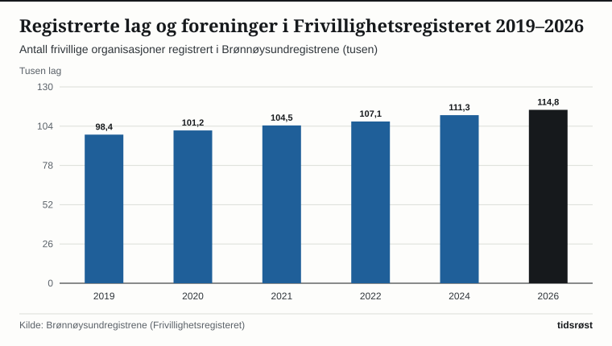

Det frivillige foreningslivet er en av grunnpilarene i det norske samfunnet. Ved inngangen til høsten 2026 var hele 114 800 lag, foreninger og ideelle stiftelser registrert i Frivillighetsregisteret hos Brønnøysundregistrene – en økning på over 16 000 organisasjoner siden 2019.

Ifølge Statistisk sentralbyrås (SSB) satellittregnskap for ideelle og frivillige organisasjoner legger innbyggerne i Norge hvert år ned ubetalt frivillig arbeid tilsvarende rundt 142 000 årsverk. Regnet i verdiskaping tilsvarer denne dugnadsinnsatsen mer enn 85 milliarder kroner i året.

## Over seks av ti deltar i frivillig arbeid

Undersøkelser fra SSB og Senter for forskning på sivilsamfunn og frivillig sektor viser at over 60 prosent av den voksne befolkningen i Norge utfører frivillig arbeid for minst én organisasjon i løpet av et år. Deltakelsen spenner fra trenere og lagledere i det lokale idrettslaget til dirigenter og styremedlemmer i skolekorps, språkkafeer, turlag, Røde Kors Hjelpekorps og Norsk Folkehjelp.

*Antall registrerte enheter i Frivillighetsregisteret (tusen), 2019–2026. Kilde: Brønnøysundregistrene.*

## Idrett, kultur og sosial beredskap topper innsatsen

Mer enn en tredjedel av de frivillige årsverkene legges ned innen idrett og friluftsliv (36,5 prosent), fulgt av kultur, musikk og kunstforeninger (21,0 prosent) og sosiale tjenester, inkludering og redningsberedskap (15,8 prosent).

| Organisasjonsområde | Andel av frivillige årsverk | Frivillige årsverk (ca.) | Typiske lag og aktiviteter |
|---|---:|---:|---|
| Idrett og friluftsliv | 36,5 % | 51 800 | Lokale idrettslag, turlag, jeger- og fiskerforeninger |
| Kultur, musikk og kunst | 21,0 % | 29 800 | Korps, kor, teaterlag, historielag og festivaler |
| Sosiale tjenester og beredskap | 15,8 % | 22 400 | Hjelpekorps, besøksvenner, språkkafeer og eldresentre |
| Nærmiljø og velforeninger | 14,2 % | 20 200 | Velforeninger, grendelag og fellesdugnader |
| Tro, livssyn og internasjonalt | 12,5 % | 17 800 | Menighetsarbeid, humanitære lag og solidaritet |
| **Totalt** | **100,0 %** | **142 000** | **Over 114 800 registrerte enheter** |

*Kilde: SSB, satellittregnskap for ideelle og frivillige organisasjoner og Brønnøysundregistrene.*

*Andel av de frivillige årsverkene etter organisasjonsområde. Kilde: SSB.*

## Full momskompensasjon og Grasrotandelen gir frie midler

Et hovedprinsipp i den norske frivillighetspolitikken er at staten skal støtte opp under lagene med brede, ubyråkratiske ordninger uten å detaljstyre aktiviteten. Den største statlige ordningen er merverdiavgiftskompensasjonen for frivillige organisasjoner, forvaltet av Lotteri- og stiftelsestilsynet. Regjeringen har sikret full momskompensasjon i de siste statsbudsjettene, slik at over 24 000 lag og foreninger får tilbakebetalt merverdiavgiften på sine innkjøp av varer og tjenester – rundt 2,6 milliarder kroner i året.

I tillegg tilfører *Grasrotandelen* fra Norsk Tipping over 800 millioner kroner direkte til mer enn 37 000 lokale lag og foreninger hvert år, mens *Frifond* gir ubyråkratisk støtte til lokal kultur- og fritidsaktivitet drevet av og for barn og unge.

## Kilder

- [SSB: Satellittregnskap for ideelle og frivillige organisasjoner](https://www.ssb.no/nasjonalregnskap-og-konjunkturer/nasjonalregnskap/statistikk/satellittregnskap-for-ideelle-og-frivillige-organisasjoner)
- [Brønnøysundregistrene: Frivillighetsregisteret – statistikk og nøkkeltall](https://www.brreg.no/frivillighetsregisteret/)
- [Lotteri- og stiftelsestilsynet: Momskompensasjon for frivillige organisasjoner](https://lottstift.no/for-frivilligheten/momskompensasjon-for-frivillige-organisasjoner/)
- [Kultur- og likestillingsdepartementet: Frivillighetspolitikk og statlige støtteordninger](https://www.regjeringen.no/no/tema/kultur-idrett-og-frivillighet/frivillighet/id1127/)
